# AM20 progress (generated by sync.py, do not edit)

Updated 2026-11-22 18:12. 30 of 121 concepts studied (95 AM20 concepts plus 26 prerequisites from other courses). Source: brain's rep ledger (`System/reps.csv` in the vault) replayed through FSRS-6. Machine-readable: [progress.csv](progress.csv), raw reps: [reps.csv](reps.csv).

**Key.** Recall/use now: ⬜ never studied · 🟥 under 40% · 🟧 40-69% · 🟨 70-89% · 🟩 90%+. A memory shows at most 30% until a free-recall success an hour or more later proves it, and 0 after a miss. *Recall* = produce the definition from memory; *use* = solve a problem with it.

## Exams

| exam | date | in scope | studied | ready on the day |
|---|---|---|---|---|
| Exam 3 (practice final) | 2026-12-03 | 0 | 0 | 0% |
| Final | 2026-12-09 | 95 | 24 | 8% |

## When I studied

Reps per day on these concepts: ⬜ 0 · 🟨 1-9 · 🟧 10-29 · 🟩 30+

| | W0 | W1 | W2 | W3 | W4 | W5 | W6 | W7 | W8 |
|---|---|---|---|---|---|---|---|---|---|
| M | ⬜ | ⬜ | ⬜ | 🟧 | ⬜ | ⬜ | ⬜ | ⬜ | ⬜ |
| T | ⬜ | ⬜ | ⬜ | 🟨 | ⬜ | ⬜ | ⬜ | ⬜ | ⬜ |
| W | ⬜ | 🟨 | ⬜ | 🟧 | ⬜ | ⬜ | ⬜ | ⬜ | ⬜ |
| T | ⬜ | ⬜ | ⬜ | ⬜ | ⬜ | ⬜ | ⬜ | ⬜ | ⬜ |
| F | ⬜ | ⬜ | ⬜ | ⬜ | ⬜ | ⬜ | ⬜ | ⬜ | ⬜ |
| S | ⬜ | ⬜ | ⬜ | ⬜ | ⬜ | ⬜ | ⬜ | ⬜ | ⬜ |
| S | ⬜ | ⬜ | ⬜ | 🟧 | ⬜ | ⬜ | ⬜ | ⬜ | ⬜ |

Week 0 starts 2026-09-21. Total reps: 54 on 5 days.

## Next

**Due now (29):** Function, Basic Derivative Formulas, Linear Independence, Fundamental Set of Solutions, Autonomous vs Non-Autonomous ODE, Separable Equation, Wronskian, Constant-Coefficient Linear ODE General Solution, ODE, Homogeneous Equation (First Order), Antiderivative, Canonical Form of a First-Order Linear ODE, Second Law of Motion, Order and Variables of an ODE, Chain Rule, Asymptotic Stability, General Solution, Bisection Method, Integrating-Factor, Constant Coefficient ODE, Separation of Variables, Differential Equation, Linear ODE, Verifying a Solution to an ODE, Independent vs Dependent Variable ...

**Ready to start (40), prerequisites all studied:** AM20L18, Real numbers, Continuity, Set, Derivative, Existence and Uniqueness, Forcing Function, Fundamental Solutions, Homogeneous Linear ODE, Natural logarithm, Linear Operator Theory, U Substitution, Logistic-Growth, Second Order ODE, Spring Mass Dashpot, Superposition Principle, Vector Space, Nonlinear ODE, Partial Differential Equation (PDE), Scalar vs System of Differential Equations, Time-Invariant vs Time-Varying, Velocity, Interval of Validity (First-Order Linear ODE), Quadratic Equation, Recognizing Which Solution Method Applies ...

## Dependency heatmap

Arrows go from a prerequisite to the concept that needs it. Colour = recall now.

```mermaid
flowchart LR
  subgraph g0["(no source)"]
    n8440d52661["Abels Formula"]:::none
    neaf4c1e710["AM20L18"]:::none
    n0a0fcc4976["Real numbers"]:::none
    n984f6b4726["Vectors"]:::none
    nb97ef64ba4["Determinant"]:::none
    n94146534aa["Dot Product"]:::none
    ncb449030fb["Characteristic Equation"]:::none
    ne5815fb4c1["Constant Coefficient ODE"]:::none
    ndcb7f374f7["Continuity"]:::none
    ncdaeeeba9b["Set"]:::none
    nc1c425268e["Function"]:::red
    n98081e91c3["Derivative"]:::none
    na2033ff288["Initial Value Problem"]:::none
    n4f3307b17c["Existence and Uniqueness"]:::none
    n2451f3704a["Forcing Function"]:::none
    n6511b5954f["Fundamental Set of Solutions"]:::none
    n8b0e1cb3ab["Fundamental Solutions"]:::none
    nb8205eaeb1["Homogeneous Linear ODE"]:::none
    n9fa32fa61a["ODE"]:::none
    n6518370f58["Linear ODE"]:::none
    n48950aa339["Natural logarithm"]:::none
    na47fc813f8["Integrating-Factor"]:::none
    nc58ec6e736["Linear Independence"]:::none
    n899a5a899b["Linear Operator Theory"]:::none
    n7a3b914915["Equilibrium Solution"]:::none
    n9810184f3a["Chain Rule"]:::none
    ne947e82473["U Substitution"]:::none
    nd891df5e99["Logistic-Growth"]:::none
    nef18beba19["Second Order ODE"]:::none
    ndaa0e9b046["Spring Mass Dashpot"]:::none
    n09c635502c["Superposition Principle"]:::none
    n4fadcc6dda["Vector Space"]:::none
    nfb8d8a32d1["Wronskian"]:::none
    n0e5dadf962["Second Law of Motion"]:::none
    ne715cb3192["Nonlinear ODE"]:::none
    nac1a453d0c["Velocity"]:::none
    n1378bbbc32["Quadratic Equation"]:::none
    n997d9f27d5["Complex numbers"]:::none
    n3a402e9b30["Trigonometric functions"]:::none
    n8a649cc933["Arctan"]:::none
    n382eb179a7["Transpose"]:::none
    ne9c6a763be["System of equations"]:::none
    nccd9216702["Invertibility"]:::none
    n5e6841743d["Product Rule (Calculus)"]:::none
    ndc862ceeec["Antiderivative"]:::none
    n3369022ed3["Integrals"]:::none
    n8d8b7db66e["Integration By Parts"]:::none
    n87a6822e3d["Asymptotic Stability"]:::none
  end
  subgraph g1["AM20 L1 Supplementary Problems"]
    n656d7706a6["Bisection Method"]:::none
    n9b3ad26b4d["Order and Variables of an ODE"]:::none
    nac30f81707["Separation of Variables"]:::none
    na6f303f1ad["Terminal Velocity"]:::none
    n13dd61cc97["Verifying a Solution to an ODE"]:::none
  end
  subgraph g2["AM20 Lecture1"]
    n8360823e72["Differential Equation"]:::none
    n73122d6ea1["Independent vs Dependent Variable"]:::none
    n5f568399e7["General Solution"]:::none
  end
  subgraph g3["AM20 Lecture2"]
    n4f308343be["Linearization"]:::none
    nbe6cce45c1["Order of a Differential Equation"]:::none
    n0d37304e7e["Partial Differential Equation (PDE)"]:::none
    n74e63abbb2["Scalar vs System of Differential Equations"]:::none
    nd8b7635c11["Time-Invariant vs Time-Varying"]:::none
  end
  subgraph g4["AM20 Lecture2 Notation"]
    n7ca81d957f["Leibniz Notation for Higher Derivatives"]:::none
    n3953441cfb["Position, Velocity and Acceleration"]:::none
    n545f656b2f["Choosing the Unknown Changes the Order"]:::none
  end
  subgraph g5["AM20 Lecture3"]
    ne7840c8dfe["Canonical Form of a First-Order Linear ODE"]:::none
    n316ecd1ee8["Constant-Coefficient Linear ODE General Solution"]:::none
  end
  subgraph g6["AM20 Lecture3 p.5-6"]
    ncca3040afc["Interval of Validity (First-Order Linear ODE)"]:::none
  end
  subgraph g7["AM20 Lecture4"]
    nf8f3269d8a["Separable Equation"]:::none
  end
  subgraph g8["AM20 Lecture4 p.3-5"]
    nc3e005b903["Interval of Validity (Separable Equation)"]:::none
  end
  subgraph g9["AM20 Lecture5"]
    n7b797920de["Rate Balance (Inflow Minus Outflow)"]:::none
  end
  subgraph g10["AM20 Lecture5 p.4-5"]
    nc08e70de60["Autonomous vs Non-Autonomous ODE"]:::none
  end
  subgraph g11["AM20 Lecture5 p.5-6"]
    n364a6cb75c["Recognizing Which Solution Method Applies"]:::none
  end
  subgraph g12["AM20 Review1 Complex Numbers"]
    ne14bd2fb2c["Complex Conjugate and Modulus"]:::none
    n2cc1c807df["Complex Number Arithmetic"]:::none
    n21a83add0e["Conjugate Root Pairs Theorem"]:::none
    n34a7ac434e["Division of Complex Numbers"]:::none
    n864d89b477["Euler's Formula"]:::none
    n12f599bbfa["Real and Imaginary Parts of a Complex Exponential"]:::none
    nd1557884ec["Square Root of a Negative Number"]:::none
  end
  subgraph g13["AM20 Review2 Vectors"]
    n6733005943["Euclidean Norm"]:::none
    n1ac03770e6["Amplitude-Phase Form of a Sinusoid"]:::none
    nddd7539d95["Orthogonality (Vectors)"]:::none
  end
  subgraph g14["AM20 Review3 Matrices"]
    n21b72c0b7a["Matrix"]:::none
    nc3c3a78539["Matrix-Vector Multiplication"]:::none
    n8fe303d7ca["Identity Matrix"]:::none
    n2253ac083f["Matrix Addition and Scalar Multiplication"]:::none
    ne6e87db07a["Matrix Multiplication"]:::none
    nfd64417686["Symmetric Matrix"]:::none
    nb280498236["Transpose of a Product"]:::none
  end
  subgraph g15["AM20 Review4 Linear Systems"]
    n82ef674472["Cofactor Expansion of a Determinant"]:::none
    ndec5eb3add["Determinant of a Triangular Matrix"]:::none
    n779216e8da["Elimination Method for Linear Systems"]:::none
    n547d3a465b["Inverse of a 2x2 Matrix"]:::none
    nb123e7e561["Singular Matrix Equivalences"]:::none
    n0c453e21be["Solving a Linear System via Matrix Inverse"]:::none
  end
  subgraph g16["AM20 Review5 Eigenvalues"]
    n33641ea012["Eigenvalue and Eigenvector Definition"]:::none
    nf4b6677102["Finding Eigenvectors Procedure"]:::none
    nc9a72a02de["Symmetric Matrix Eigenvalues"]:::none
    n4a3824b36b["Three Cases for Eigenvalues and Eigenvectors"]:::none
    ned796d431f["Trace and Determinant Shortcut for Two by Two Matrices"]:::none
    n261a9e79a1["Triangular Matrix Eigenvalues"]:::none
  end
  subgraph g17["AM20 Review6 Derivative Formulas"]
    n77aae24f42["Basic Derivative Formulas"]:::red
    n7ed5f18eaf["Partial Derivatives"]:::none
    n6709da673e["Recurring Derivative Products"]:::none
  end
  subgraph g18["AM20 Review7 Integration Formulas"]
    n2d6236a78b["Basic Antiderivatives"]:::none
    nd35ff55193["Exponential Times Trigonometric Integrals"]:::none
    n99323e57f4["Improper Integrals"]:::none
    n6dbafddd90["Partial Fractions"]:::none
  end
  subgraph g19["Boyce 1.1-1.3 Introduction"]
    n5882164d76["System of Differential Equations"]:::none
  end
  subgraph g20["Boyce 2.2 Separable Equations"]
    n2cb506af0f["Homogeneous Equation (First Order)"]:::none
  end
  subgraph g21["Boyce 2.3 Modeling"]
    nb3202e4cac["Velocity Chain Rule Substitution"]:::none
    nf1e03f095d["Escape Velocity"]:::none
    na3f6547cd8["Torricelli's Law"]:::none
  end
  subgraph g22["Boyce 2.4 Linear vs Nonlinear"]
    n3c51b49246["Bernoulli Equation"]:::none
    n85bfa90d56["Discontinuous Coefficients"]:::none
    n2b91001e21["Interval of Existence (Nonlinear ODE)"]:::none
  end
  subgraph g23["Boyce 2.5 Autonomous Equations"]
    n54e40d3bec["Bifurcation"]:::none
    n7a318b72c5["Critical Threshold Model"]:::none
    n87e0ec2026["Logistic Growth with a Threshold"]:::none
    n774fe66cae["Semistable Equilibrium"]:::none
  end
  subgraph g24["Boyce 2.6 Exact Equations"]
    n13b5b1cda0["Exact Equation"]:::none
  end
  n0a0fcc4976 --> n984f6b4726
  n984f6b4726 --> n21b72c0b7a
  n21b72c0b7a --> nb97ef64ba4
  n984f6b4726 --> n94146534aa
  n21b72c0b7a --> nc3c3a78539
  n94146534aa --> nc3c3a78539
  nc3c3a78539 --> n33641ea012
  nb97ef64ba4 --> n33641ea012
  nb97ef64ba4 --> ncb449030fb
  n33641ea012 --> ncb449030fb
  ncdaeeeba9b --> nc1c425268e
  nc1c425268e --> n98081e91c3
  n98081e91c3 --> n8360823e72
  nc1c425268e --> n8360823e72
  n8360823e72 --> n73122d6ea1
  n8360823e72 --> na2033ff288
  n73122d6ea1 --> na2033ff288
  na2033ff288 --> n4f3307b17c
  n8360823e72 --> n9fa32fa61a
  n9fa32fa61a --> n6518370f58
  n6518370f58 --> ne7840c8dfe
  ne7840c8dfe --> na47fc813f8
  n48950aa339 --> na47fc813f8
  n8360823e72 --> n7a3b914915
  n98081e91c3 --> n9810184f3a
  n9810184f3a --> ne947e82473
  ne947e82473 --> nf8f3269d8a
  n7a3b914915 --> nd891df5e99
  nf8f3269d8a --> nd891df5e99
  nc1c425268e --> n656d7706a6
  n0a0fcc4976 --> n656d7706a6
  n98081e91c3 --> n9b3ad26b4d
  n7a3b914915 --> nac30f81707
  n48950aa339 --> nac30f81707
  n98081e91c3 --> n0e5dadf962
  n0e5dadf962 --> na6f303f1ad
  n9810184f3a --> n13dd61cc97
  nac30f81707 --> n5f568399e7
  n6518370f58 --> ne715cb3192
  ne715cb3192 --> n4f308343be
  n9fa32fa61a --> nbe6cce45c1
  n9fa32fa61a --> n0d37304e7e
  n9fa32fa61a --> n74e63abbb2
  nbe6cce45c1 --> nd8b7635c11
  n98081e91c3 --> n7ca81d957f
  n7ca81d957f --> n3953441cfb
  nac1a453d0c --> n3953441cfb
  nbe6cce45c1 --> n545f656b2f
  n3953441cfb --> n545f656b2f
  na47fc813f8 --> n316ecd1ee8
  ne7840c8dfe --> ncca3040afc
  nf8f3269d8a --> nc3e005b903
  n1378bbbc32 --> nc3e005b903
  n98081e91c3 --> n7b797920de
  n9fa32fa61a --> nc08e70de60
  na47fc813f8 --> n364a6cb75c
  n0a0fcc4976 --> n997d9f27d5
  n997d9f27d5 --> ne14bd2fb2c
  n997d9f27d5 --> n2cc1c807df
  ne14bd2fb2c --> n21a83add0e
  n1378bbbc32 --> n21a83add0e
  ne14bd2fb2c --> n34a7ac434e
  n997d9f27d5 --> n864d89b477
  n3a402e9b30 --> n864d89b477
  n864d89b477 --> n12f599bbfa
  n997d9f27d5 --> nd1557884ec
  n94146534aa --> n6733005943
  n6733005943 --> n1ac03770e6
  n3a402e9b30 --> n1ac03770e6
  n8a649cc933 --> n1ac03770e6
  n94146534aa --> nddd7539d95
  n21b72c0b7a --> n8fe303d7ca
  n21b72c0b7a --> n2253ac083f
  n21b72c0b7a --> ne6e87db07a
  n94146534aa --> ne6e87db07a
  n21b72c0b7a --> n382eb179a7
  n382eb179a7 --> nfd64417686
  n382eb179a7 --> nb280498236
  ne6e87db07a --> nb280498236
  nb97ef64ba4 --> n82ef674472
  nb97ef64ba4 --> ndec5eb3add
  ne9c6a763be --> n779216e8da
  nb97ef64ba4 --> n547d3a465b
  nb97ef64ba4 --> nb123e7e561
  nccd9216702 --> nb123e7e561
  n547d3a465b --> n0c453e21be
  ncb449030fb --> nf4b6677102
  ncb449030fb --> nc9a72a02de
  ncb449030fb --> n4a3824b36b
  nf4b6677102 --> n4a3824b36b
  ncb449030fb --> ned796d431f
  nb97ef64ba4 --> ned796d431f
  n33641ea012 --> n261a9e79a1
  nb97ef64ba4 --> n261a9e79a1
  n98081e91c3 --> n77aae24f42
  n98081e91c3 --> n7ed5f18eaf
  n98081e91c3 --> n5e6841743d
  n5e6841743d --> n6709da673e
  n9810184f3a --> n6709da673e
  n77aae24f42 --> n6709da673e
  ndc862ceeec --> n2d6236a78b
  n3369022ed3 --> n8d8b7db66e
  n8d8b7db66e --> nd35ff55193
  n9fa32fa61a --> n5882164d76
  nf8f3269d8a --> n2cb506af0f
  n9810184f3a --> nb3202e4cac
  nb3202e4cac --> nf1e03f095d
  nf8f3269d8a --> nf1e03f095d
  n7b797920de --> na3f6547cd8
  n6518370f58 --> n3c51b49246
  na47fc813f8 --> n3c51b49246
  na47fc813f8 --> n85bfa90d56
  n6518370f58 --> n85bfa90d56
  ne715cb3192 --> n2b91001e21
  n4f3307b17c --> n2b91001e21
  n7a3b914915 --> n87a6822e3d
  n7a3b914915 --> n54e40d3bec
  n87a6822e3d --> n54e40d3bec
  nd891df5e99 --> n7a318b72c5
  n87a6822e3d --> n7a318b72c5
  n7a318b72c5 --> n87e0ec2026
  nd891df5e99 --> n87e0ec2026
  n7a3b914915 --> n774fe66cae
  n87a6822e3d --> n774fe66cae
  nf8f3269d8a --> n13b5b1cda0
  classDef none fill:#eeeeee,stroke:#999,color:#333
  classDef red fill:#f4a6a6,stroke:#b33,color:#000
  classDef orange fill:#f8c58c,stroke:#c70,color:#000
  classDef yellow fill:#f6e58d,stroke:#aa0,color:#000
  classDef green fill:#9be29b,stroke:#3a3,color:#000
```

## Every concept (prerequisites first)

| recall | use | concept | lecture | last studied | days ago | reps | next due | needs |
|---|---|---|---|---|---|---|---|---|
| ⬜  | ⬜  | Abels Formula | (no source) | 2026-10-13 | 40 | 1 | - |  |
| ⬜  | ⬜  | AM20L18 | (no source) | - |  | 0 | - |  |
| ⬜  | ⬜  | Real numbers | (no source) | - |  | 0 | - |  |
| ⬜  | ⬜  | Vectors | (no source) | - |  | 0 | - | ⬜ Real numbers |
| ⬜  | ⬜  | Matrix | AM20 Review3 Matrices | - |  | 0 | - | ⬜ Vectors |
| ⬜  | ⬜  | Determinant | (no source) | - |  | 0 | - | ⬜ Matrix |
| ⬜  | ⬜  | Dot Product | (no source) | - |  | 0 | - | ⬜ Vectors |
| ⬜  | ⬜  | Matrix-Vector Multiplication | AM20 Review3 Matrices | - |  | 0 | - | ⬜ Matrix, ⬜ Dot Product |
| ⬜  | ⬜  | Eigenvalue and Eigenvector Definition | AM20 Review5 Eigenvalues | - |  | 0 | - | ⬜ Matrix-Vector Multiplication, ⬜ Determinant |
| ⬜  | ⬜  | Characteristic Equation | (no source) | - |  | 0 | - | ⬜ Determinant, ⬜ Eigenvalue and Eigenvector Definition |
| ⬜  | 🟨 75% | Constant Coefficient ODE | (no source) | 2026-10-14 | 39 | 2 | 2026-10-22 |  |
| ⬜  | ⬜  | Continuity | (no source) | - |  | 0 | - |  |
| ⬜  | ⬜  | Set | (no source) | - |  | 0 | - |  |
| 🟥 30% | ⬜  | Function | (no source) | 2026-09-30 | 53 | 6 | 2026-10-02 | ⬜ Set |
| ⬜  | ⬜  | Derivative | (no source) | - |  | 0 | - | 🟥 Function |
| ⬜  | 🟨 82% | Differential Equation | AM20 Lecture1 | 2026-10-18 | 35 | 3 | 2026-11-01 | ⬜ Derivative, 🟥 Function |
| ⬜  | 🟨 85% | Independent vs Dependent Variable | AM20 Lecture1 | 2026-10-18 | 35 | 2 | 2026-11-05 | ⬜ Differential Equation |
| ⬜  | 🟨 86% | Initial Value Problem | (no source) | 2026-10-18 | 35 | 4 | 2026-11-07 | ⬜ Differential Equation, ⬜ Independent vs Dependent Variable |
| ⬜  | ⬜  | Existence and Uniqueness | (no source) | - |  | 0 | - | ⬜ Initial Value Problem |
| ⬜  | ⬜  | Forcing Function | (no source) | - |  | 0 | - |  |
| ⬜  | 🟧 59% | Fundamental Set of Solutions | (no source) | 2026-10-13 | 40 | 1 | 2026-10-14 |  |
| ⬜  | ⬜  | Fundamental Solutions | (no source) | - |  | 0 | - |  |
| ⬜  | ⬜  | Homogeneous Linear ODE | (no source) | - |  | 0 | - |  |
| ⬜  | 🟧 64% | ODE | (no source) | 2026-10-14 | 39 | 1 | 2026-10-17 | ⬜ Differential Equation |
| ⬜  | 🟨 84% | Linear ODE | (no source) | 2026-10-18 | 35 | 4 | 2026-11-03 | ⬜ ODE |
| ⬜  | 🟧 64% | Canonical Form of a First-Order Linear ODE | AM20 Lecture3 | 2026-10-14 | 39 | 2 | 2026-10-17 | ⬜ Linear ODE |
| ⬜  | ⬜  | Natural logarithm | (no source) | - |  | 0 | - |  |
| ⬜  | 🟨 71% | Integrating-Factor | (no source) | 2026-10-14 | 39 | 3 | 2026-10-19 | ⬜ Canonical Form of a First-Order Linear ODE, ⬜ Natural logarithm |
| ⬜  | 🟧 59% | Linear Independence | (no source) | 2026-10-13 | 40 | 1 | 2026-10-14 |  |
| ⬜  | ⬜  | Linear Operator Theory | (no source) | - |  | 0 | - |  |
| ⬜  | 🟨 85% | Equilibrium Solution | (no source) | 2026-10-18 | 35 | 2 | 2026-11-05 | ⬜ Differential Equation |
| ⬜  | 🟧 65% | Chain Rule | (no source) | 2026-10-18 | 35 | 1 | 2026-10-20 | ⬜ Derivative |
| ⬜  | ⬜  | U Substitution | (no source) | - |  | 0 | - | ⬜ Chain Rule |
| ⬜  | 🟧 64% | Separable Equation | AM20 Lecture4 | 2026-10-12 | 41 | 1 | 2026-10-15 | ⬜ U Substitution |
| ⬜  | ⬜  | Logistic-Growth | (no source) | - |  | 0 | - | ⬜ Equilibrium Solution, ⬜ Separable Equation |
| ⬜  | ⬜  | Second Order ODE | (no source) | - |  | 0 | - |  |
| ⬜  | ⬜  | Spring Mass Dashpot | (no source) | - |  | 0 | - |  |
| ⬜  | ⬜  | Superposition Principle | (no source) | - |  | 0 | - |  |
| ⬜  | ⬜  | Vector Space | (no source) | - |  | 0 | - |  |
| ⬜  | 🟧 64% | Wronskian | (no source) | 2026-10-13 | 40 | 1 | 2026-10-15 |  |
| ⬜  | 🟧 65% | Bisection Method | AM20 L1 Supplementary Problems | 2026-10-18 | 35 | 1 | 2026-10-20 | 🟥 Function, ⬜ Real numbers |
| ⬜  | 🟧 65% | Order and Variables of an ODE | AM20 L1 Supplementary Problems | 2026-10-18 | 35 | 1 | 2026-10-20 | ⬜ Derivative |
| ⬜  | 🟨 82% | Separation of Variables | AM20 L1 Supplementary Problems | 2026-10-18 | 35 | 2 | 2026-11-01 | ⬜ Equilibrium Solution, ⬜ Natural logarithm |
| ⬜  | 🟧 65% | Second Law of Motion | (no source) | 2026-10-18 | 35 | 1 | 2026-10-20 | ⬜ Derivative |
| ⬜  | 🟨 85% | Terminal Velocity | AM20 L1 Supplementary Problems | 2026-10-18 | 35 | 2 | 2026-11-05 | ⬜ Second Law of Motion |
| ⬜  | 🟨 85% | Verifying a Solution to an ODE | AM20 L1 Supplementary Problems | 2026-10-18 | 35 | 2 | 2026-11-05 | ⬜ Chain Rule |
| ⬜  | 🟧 65% | General Solution | AM20 Lecture1 | 2026-10-18 | 35 | 1 | 2026-10-20 | ⬜ Separation of Variables |
| ⬜  | ⬜  | Nonlinear ODE | (no source) | - |  | 0 | - | ⬜ Linear ODE |
| ⬜  | ⬜  | Linearization | AM20 Lecture2 | - |  | 0 | - | ⬜ Nonlinear ODE |
| ⬜  | 🟨 85% | Order of a Differential Equation | AM20 Lecture2 | 2026-10-18 | 35 | 2 | 2026-11-05 | ⬜ ODE |
| ⬜  | ⬜  | Partial Differential Equation (PDE) | AM20 Lecture2 | - |  | 0 | - | ⬜ ODE |
| ⬜  | ⬜  | Scalar vs System of Differential Equations | AM20 Lecture2 | - |  | 0 | - | ⬜ ODE |
| ⬜  | ⬜  | Time-Invariant vs Time-Varying | AM20 Lecture2 | - |  | 0 | - | ⬜ Order of a Differential Equation |
| ⬜  | ⬜  | Leibniz Notation for Higher Derivatives | AM20 Lecture2 Notation | - |  | 0 | - | ⬜ Derivative |
| ⬜  | ⬜  | Velocity | (no source) | - |  | 0 | - |  |
| ⬜  | ⬜  | Position, Velocity and Acceleration | AM20 Lecture2 Notation | - |  | 0 | - | ⬜ Leibniz Notation for Higher Derivatives, ⬜ Velocity |
| ⬜  | ⬜  | Choosing the Unknown Changes the Order | AM20 Lecture2 Notation | - |  | 0 | - | ⬜ Order of a Differential Equation, ⬜ Position, Velocity and Acceleration |
| ⬜  | 🟧 64% | Constant-Coefficient Linear ODE General Solution | AM20 Lecture3 | 2026-10-14 | 39 | 1 | 2026-10-17 | ⬜ Integrating-Factor |
| ⬜  | ⬜  | Interval of Validity (First-Order Linear ODE) | AM20 Lecture3 p.5-6 | - |  | 0 | - | ⬜ Canonical Form of a First-Order Linear ODE |
| ⬜  | ⬜  | Quadratic Equation | (no source) | - |  | 0 | - |  |
| ⬜  | ⬜  | Interval of Validity (Separable Equation) | AM20 Lecture4 p.3-5 | - |  | 0 | - | ⬜ Separable Equation, ⬜ Quadratic Equation |
| ⬜  | ⬜  | Rate Balance (Inflow Minus Outflow) | AM20 Lecture5 | - |  | 0 | - | ⬜ Derivative |
| ⬜  | 🟧 64% | Autonomous vs Non-Autonomous ODE | AM20 Lecture5 p.4-5 | 2026-10-12 | 41 | 1 | 2026-10-15 | ⬜ ODE |
| ⬜  | ⬜  | Recognizing Which Solution Method Applies | AM20 Lecture5 p.5-6 | - |  | 0 | - | ⬜ Integrating-Factor |
| ⬜  | ⬜  | Complex numbers | (no source) | - |  | 0 | - | ⬜ Real numbers |
| ⬜  | ⬜  | Complex Conjugate and Modulus | AM20 Review1 Complex Numbers | - |  | 0 | - | ⬜ Complex numbers |
| ⬜  | ⬜  | Complex Number Arithmetic | AM20 Review1 Complex Numbers | - |  | 0 | - | ⬜ Complex numbers |
| ⬜  | ⬜  | Conjugate Root Pairs Theorem | AM20 Review1 Complex Numbers | - |  | 0 | - | ⬜ Complex Conjugate and Modulus, ⬜ Quadratic Equation |
| ⬜  | ⬜  | Division of Complex Numbers | AM20 Review1 Complex Numbers | - |  | 0 | - | ⬜ Complex Conjugate and Modulus |
| ⬜  | ⬜  | Trigonometric functions | (no source) | - |  | 0 | - |  |
| ⬜  | ⬜  | Euler's Formula | AM20 Review1 Complex Numbers | - |  | 0 | - | ⬜ Complex numbers, ⬜ Trigonometric functions |
| ⬜  | ⬜  | Real and Imaginary Parts of a Complex Exponential | AM20 Review1 Complex Numbers | - |  | 0 | - | ⬜ Euler's Formula |
| ⬜  | ⬜  | Square Root of a Negative Number | AM20 Review1 Complex Numbers | - |  | 0 | - | ⬜ Complex numbers |
| ⬜  | ⬜  | Arctan | (no source) | - |  | 0 | - |  |
| ⬜  | ⬜  | Euclidean Norm | AM20 Review2 Vectors | - |  | 0 | - | ⬜ Dot Product |
| ⬜  | ⬜  | Amplitude-Phase Form of a Sinusoid | AM20 Review2 Vectors | - |  | 0 | - | ⬜ Euclidean Norm, ⬜ Trigonometric functions, ⬜ Arctan |
| ⬜  | ⬜  | Orthogonality (Vectors) | AM20 Review2 Vectors | - |  | 0 | - | ⬜ Dot Product |
| ⬜  | ⬜  | Identity Matrix | AM20 Review3 Matrices | - |  | 0 | - | ⬜ Matrix |
| ⬜  | ⬜  | Matrix Addition and Scalar Multiplication | AM20 Review3 Matrices | - |  | 0 | - | ⬜ Matrix |
| ⬜  | ⬜  | Matrix Multiplication | AM20 Review3 Matrices | - |  | 0 | - | ⬜ Matrix, ⬜ Dot Product |
| ⬜  | ⬜  | Transpose | (no source) | - |  | 0 | - | ⬜ Matrix |
| ⬜  | ⬜  | Symmetric Matrix | AM20 Review3 Matrices | - |  | 0 | - | ⬜ Transpose |
| ⬜  | ⬜  | Transpose of a Product | AM20 Review3 Matrices | - |  | 0 | - | ⬜ Transpose, ⬜ Matrix Multiplication |
| ⬜  | ⬜  | Cofactor Expansion of a Determinant | AM20 Review4 Linear Systems | - |  | 0 | - | ⬜ Determinant |
| ⬜  | ⬜  | Determinant of a Triangular Matrix | AM20 Review4 Linear Systems | - |  | 0 | - | ⬜ Determinant |
| ⬜  | ⬜  | System of equations | (no source) | - |  | 0 | - |  |
| ⬜  | ⬜  | Elimination Method for Linear Systems | AM20 Review4 Linear Systems | - |  | 0 | - | ⬜ System of equations |
| ⬜  | ⬜  | Inverse of a 2x2 Matrix | AM20 Review4 Linear Systems | - |  | 0 | - | ⬜ Determinant |
| ⬜  | ⬜  | Invertibility | (no source) | - |  | 0 | - |  |
| ⬜  | ⬜  | Singular Matrix Equivalences | AM20 Review4 Linear Systems | - |  | 0 | - | ⬜ Determinant, ⬜ Invertibility |
| ⬜  | ⬜  | Solving a Linear System via Matrix Inverse | AM20 Review4 Linear Systems | - |  | 0 | - | ⬜ Inverse of a 2x2 Matrix |
| ⬜  | ⬜  | Finding Eigenvectors Procedure | AM20 Review5 Eigenvalues | - |  | 0 | - | ⬜ Characteristic Equation |
| ⬜  | ⬜  | Symmetric Matrix Eigenvalues | AM20 Review5 Eigenvalues | - |  | 0 | - | ⬜ Characteristic Equation |
| ⬜  | ⬜  | Three Cases for Eigenvalues and Eigenvectors | AM20 Review5 Eigenvalues | - |  | 0 | - | ⬜ Characteristic Equation, ⬜ Finding Eigenvectors Procedure |
| ⬜  | ⬜  | Trace and Determinant Shortcut for Two by Two Matrices | AM20 Review5 Eigenvalues | - |  | 0 | - | ⬜ Characteristic Equation, ⬜ Determinant |
| ⬜  | ⬜  | Triangular Matrix Eigenvalues | AM20 Review5 Eigenvalues | - |  | 0 | - | ⬜ Eigenvalue and Eigenvector Definition, ⬜ Determinant |
| 🟥 30% | ⬜  | Basic Derivative Formulas | AM20 Review6 Derivative Formulas | 2026-10-12 | 41 | 1 | 2026-10-14 | ⬜ Derivative |
| ⬜  | ⬜  | Partial Derivatives | AM20 Review6 Derivative Formulas | - |  | 0 | - | ⬜ Derivative |
| ⬜  | ⬜  | Product Rule (Calculus) | (no source) | - |  | 0 | - | ⬜ Derivative |
| ⬜  | ⬜  | Recurring Derivative Products | AM20 Review6 Derivative Formulas | - |  | 0 | - | ⬜ Product Rule (Calculus), ⬜ Chain Rule, 🟥 Basic Derivative Formulas |
| ⬜  | 🟧 64% | Antiderivative | (no source) | 2026-10-14 | 39 | 1 | 2026-10-17 |  |
| ⬜  | ⬜  | Basic Antiderivatives | AM20 Review7 Integration Formulas | - |  | 0 | - | ⬜ Antiderivative |
| ⬜  | ⬜  | Integrals | (no source) | - |  | 0 | - |  |
| ⬜  | ⬜  | Integration By Parts | (no source) | - |  | 0 | - | ⬜ Integrals |
| ⬜  | ⬜  | Exponential Times Trigonometric Integrals | AM20 Review7 Integration Formulas | - |  | 0 | - | ⬜ Integration By Parts |
| ⬜  | ⬜  | Improper Integrals | AM20 Review7 Integration Formulas | - |  | 0 | - |  |
| ⬜  | ⬜  | Partial Fractions | AM20 Review7 Integration Formulas | - |  | 0 | - |  |
| ⬜  | ⬜  | System of Differential Equations | Boyce 1.1-1.3 Introduction | - |  | 0 | - | ⬜ ODE |
| ⬜  | 🟧 64% | Homogeneous Equation (First Order) | Boyce 2.2 Separable Equations | 2026-10-14 | 39 | 2 | 2026-10-17 | ⬜ Separable Equation |
| ⬜  | ⬜  | Velocity Chain Rule Substitution | Boyce 2.3 Modeling | - |  | 0 | - | ⬜ Chain Rule |
| ⬜  | ⬜  | Escape Velocity | Boyce 2.3 Modeling | - |  | 0 | - | ⬜ Velocity Chain Rule Substitution, ⬜ Separable Equation |
| ⬜  | ⬜  | Torricelli's Law | Boyce 2.3 Modeling | - |  | 0 | - | ⬜ Rate Balance (Inflow Minus Outflow) |
| ⬜  | ⬜  | Bernoulli Equation | Boyce 2.4 Linear vs Nonlinear | - |  | 0 | - | ⬜ Linear ODE, ⬜ Integrating-Factor |
| ⬜  | ⬜  | Discontinuous Coefficients | Boyce 2.4 Linear vs Nonlinear | - |  | 0 | - | ⬜ Integrating-Factor, ⬜ Linear ODE |
| ⬜  | ⬜  | Interval of Existence (Nonlinear ODE) | Boyce 2.4 Linear vs Nonlinear | - |  | 0 | - | ⬜ Nonlinear ODE, ⬜ Existence and Uniqueness |
| ⬜  | 🟧 65% | Asymptotic Stability | (no source) | 2026-10-18 | 35 | 1 | 2026-10-20 | ⬜ Equilibrium Solution |
| ⬜  | ⬜  | Bifurcation | Boyce 2.5 Autonomous Equations | - |  | 0 | - | ⬜ Equilibrium Solution, ⬜ Asymptotic Stability |
| ⬜  | ⬜  | Critical Threshold Model | Boyce 2.5 Autonomous Equations | - |  | 0 | - | ⬜ Logistic-Growth, ⬜ Asymptotic Stability |
| ⬜  | ⬜  | Logistic Growth with a Threshold | Boyce 2.5 Autonomous Equations | - |  | 0 | - | ⬜ Critical Threshold Model, ⬜ Logistic-Growth |
| ⬜  | ⬜  | Semistable Equilibrium | Boyce 2.5 Autonomous Equations | - |  | 0 | - | ⬜ Equilibrium Solution, ⬜ Asymptotic Stability |
| ⬜  | ⬜  | Exact Equation | Boyce 2.6 Exact Equations | - |  | 0 | - | ⬜ Separable Equation |
