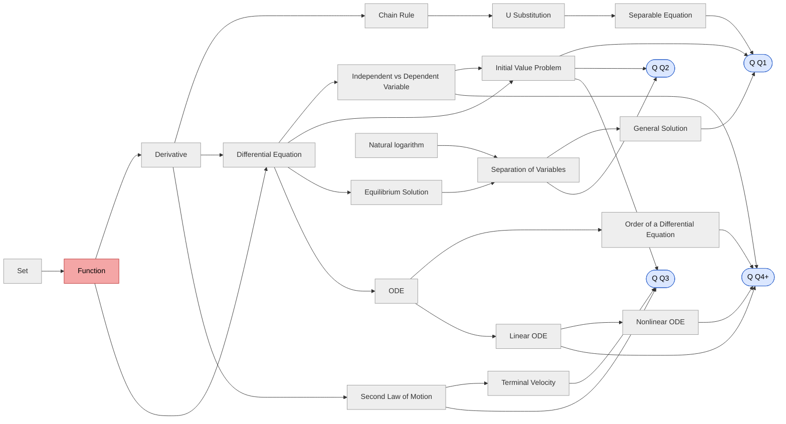

# AM20 HW1 (AM20)

Generated by `sync.py` / `assignments.py`; do not edit. Track status in [../status.csv](../status.csv).

- **Due:** 2026-10-03
- **Source:** [AM20 HW 01 (due Oct 3).pdf](../../files/homework/AM20%20HW%2001%20(due%20Oct%203).pdf)
- **Readiness now:** 28% (14 of 19 concepts in the chain studied)

## Questions

| Q | asks | concepts (recall now) |
|---|---|---|
| Q1 | attendance model dp/dt = p/2 - a: find a, then the solution | ⬜ Separable Equation, ⬜ Initial Value Problem, ⬜ General Solution |
| Q2 | mice population dp/dt = rp: rate from doubling time | ⬜ Separation of Variables, ⬜ Initial Value Problem |
| Q3 | falling object: time to 95% of limiting velocity, distance fallen | ⬜ Terminal Velocity, ⬜ Initial Value Problem, ⬜ Second Law of Motion |
| Q4+ | identify variables, order, linear vs nonlinear | ⬜ Independent vs Dependent Variable, ⬜ Order of a Differential Equation, ⬜ Linear ODE, ⬜ Nonlinear ODE |

## Study order

Prerequisites first; only what is below 70% recall or never studied. Do these top to bottom, then work the set closed-book.

| # | concept | recall now | layer | taught in |
|---|---|---|---|---|
| 1 | Set | ⬜  | 1 | no source |
| 2 | Natural logarithm | ⬜  | 1 | no source |
| 3 | Function | 🟥 30% | 2 | no source |
| 4 | Derivative | ⬜  | 3 | no source |
| 5 | Chain Rule | ⬜  | 4 | no source |
| 6 | Differential Equation | ⬜  | 4 | am20-lec01 p.1 |
| 7 | Second Law of Motion | ⬜  | 4 | brain: am20-lec01 p.1 |
| 8 | U Substitution | ⬜  | 5 | no source |
| 9 | Independent vs Dependent Variable | ⬜  | 5 | am20-lec01 p.2 |
| 10 | Equilibrium Solution | ⬜  | 5 | no source |
| 11 | Terminal Velocity | ⬜  | 5 | am20-lec01-supp p.2 |
| 12 | ODE | ⬜  | 5 | no source |
| 13 | Separable Equation | ⬜  | 6 | am20-lec04 p.1 |
| 14 | Initial Value Problem | ⬜  | 6 | brain: am20-lec07 p.4 |
| 15 | Separation of Variables | ⬜  | 6 | am20-lec01-supp p.4 |
| 16 | Order of a Differential Equation | ⬜  | 6 | am20-lec02 p.3 |
| 17 | Linear ODE | ⬜  | 6 | brain: am20-lec02 p.4 |
| 18 | General Solution | ⬜  | 7 | am20-lec01 p.4 |
| 19 | Nonlinear ODE | ⬜  | 7 | brain: am20-lec02 p.4 |

## Dependency map

Question -> concept -> prerequisite (arrows point from what you need to what needs it). Colour = recall now; dashed box = concept missing from the graph.

