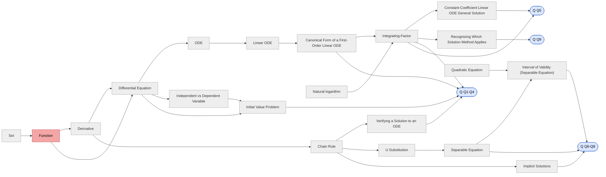

# AM20 HW2 (AM20)

Generated by `sync.py` / `assignments.py`; do not edit. Track status in [../status.csv](../status.csv).

- **Due:** 2026-10-10
- **Source:** [AM20 HW 02 (due Oct 10).pdf](../../files/homework/AM20%20HW%2002%20(due%20Oct%2010).pdf)
- **Readiness now:** 22% (12 of 20 concepts in the chain studied)

## Questions

| Q | asks | concepts (recall now) |
|---|---|---|
| Q1-Q4 | integrating factors: solve IVP, check by substitution, long-run limit | ⬜ Integrating-Factor, ⬜ Canonical Form of a First-Order Linear ODE, ⬜ Verifying a Solution to an ODE, ⬜ Initial Value Problem |
| Q5 | range of y0 giving y -> +infinity or -infinity | ⬜ Integrating-Factor, ⬜ Constant-Coefficient Linear ODE General Solution |
| Q6-Q8 | separable: implicit and explicit solutions, valid interval | ⬜ Separable Equation, ⬜ Implicit Solutions, ⬜ Interval of Validity (Separable Equation) |
| Q9 | choose a method and justify | ⬜ Recognizing Which Solution Method Applies |

## Study order

Prerequisites first; only what is below 70% recall or never studied. Do these top to bottom, then work the set closed-book.

| # | concept | recall now | layer | taught in |
|---|---|---|---|---|
| 1 | Set | ⬜  | 1 | no source |
| 2 | Natural logarithm | ⬜  | 1 | no source |
| 3 | Quadratic Equation | ⬜  | 1 | no source |
| 4 | Function | 🟥 30% | 2 | no source |
| 5 | Derivative | ⬜  | 3 | no source |
| 6 | Differential Equation | ⬜  | 4 | am20-lec01 p.1 |
| 7 | Chain Rule | ⬜  | 4 | no source |
| 8 | ODE | ⬜  | 5 | no source |
| 9 | Verifying a Solution to an ODE | ⬜  | 5 | am20-lec01-supp p.1 |
| 10 | Independent vs Dependent Variable | ⬜  | 5 | am20-lec01 p.2 |
| 11 | U Substitution | ⬜  | 5 | no source |
| 12 | Implicit Solutions | ⬜  | 5 | no source |
| 13 | Linear ODE | ⬜  | 6 | brain: am20-lec02 p.4 |
| 14 | Initial Value Problem | ⬜  | 6 | brain: am20-lec07 p.4 |
| 15 | Separable Equation | ⬜  | 6 | am20-lec04 p.1 |
| 16 | Canonical Form of a First-Order Linear ODE | ⬜  | 7 | am20-lec03 p.1 |
| 17 | Interval of Validity (Separable Equation) | ⬜  | 7 | am20-lec04 p.3 |
| 18 | Integrating-Factor | ⬜  | 8 | no source |
| 19 | Constant-Coefficient Linear ODE General Solution | ⬜  | 9 | am20-lec03 p.2 |
| 20 | Recognizing Which Solution Method Applies | ⬜  | 9 | am20-lec05 p.5 |

## Dependency map

Question -> concept -> prerequisite (arrows point from what you need to what needs it). Colour = recall now; dashed box = concept missing from the graph.

