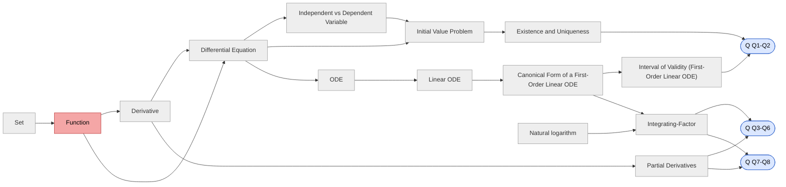

# AM20 HW3 (AM20)

Generated by `sync.py` / `assignments.py`; do not edit. Track status in [../status.csv](../status.csv).

- **Due:** 2026-10-17
- **Source:** [AM20 HW 03 (due Oct 17).pdf](../../files/homework/AM20%20HW%2003%20(due%20Oct%2017).pdf)
- **Readiness now:** 22% (8 of 14 concepts in the chain studied)

## Questions

| Q | asks | concepts (recall now) |
|---|---|---|
| Q1-Q2 | interval where the solution must exist (do not solve) | ⬜ Existence and Uniqueness, ⬜ Interval of Validity (First-Order Linear ODE) |
| Q3-Q6 | exact equations: test, solve, integrating factor making it exact | ⬜ Partial Derivatives, ⬜ Integrating-Factor |
| Q7-Q8 | find an integrating factor and solve | ⬜ Integrating-Factor, ⬜ Partial Derivatives |

## Study order

Prerequisites first; only what is below 70% recall or never studied. Do these top to bottom, then work the set closed-book.

| # | concept | recall now | layer | taught in |
|---|---|---|---|---|
| 1 | Set | ⬜  | 1 | no source |
| 2 | Natural logarithm | ⬜  | 1 | no source |
| 3 | Function | 🟥 30% | 2 | no source |
| 4 | Derivative | ⬜  | 3 | no source |
| 5 | Differential Equation | ⬜  | 4 | am20-lec01 p.1 |
| 6 | Partial Derivatives | ⬜  | 4 | am20-review06-derivative-formulas p.1 |
| 7 | Independent vs Dependent Variable | ⬜  | 5 | am20-lec01 p.2 |
| 8 | ODE | ⬜  | 5 | no source |
| 9 | Initial Value Problem | ⬜  | 6 | brain: am20-lec07 p.4 |
| 10 | Linear ODE | ⬜  | 6 | brain: am20-lec02 p.4 |
| 11 | Existence and Uniqueness | ⬜  | 7 | brain: am20-lec08 p.1 |
| 12 | Canonical Form of a First-Order Linear ODE | ⬜  | 7 | am20-lec03 p.1 |
| 13 | Interval of Validity (First-Order Linear ODE) | ⬜  | 8 | am20-lec03 p.5 |
| 14 | Integrating-Factor | ⬜  | 8 | no source |

## Dependency map

Question -> concept -> prerequisite (arrows point from what you need to what needs it). Colour = recall now; dashed box = concept missing from the graph.

