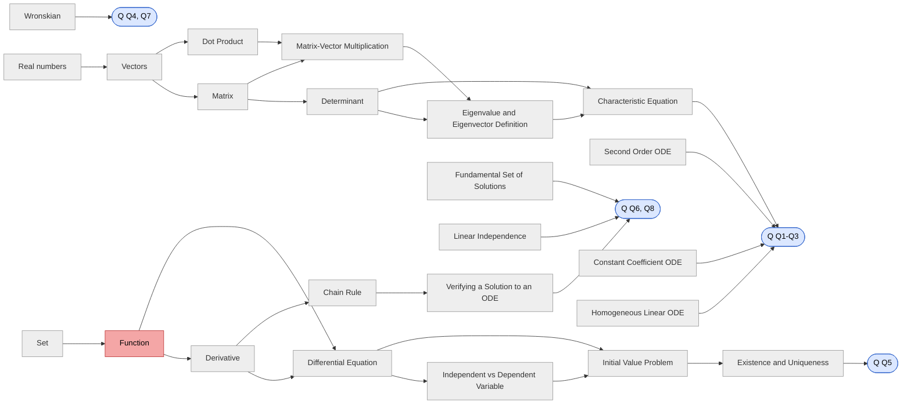

# AM20 HW4 (AM20)

Generated by `sync.py` / `assignments.py`; do not edit. Track status in [../status.csv](../status.csv).

- **Due:** 2026-10-24
- **Source:** [AM20 HW 04 (due Oct 24).pdf](../../files/homework/AM20%20HW%2004%20(due%20Oct%2024).pdf)
- **Readiness now:** 16% (10 of 23 concepts in the chain studied)

**Gaps:**
- 6 concept(s) with no prerequisites listed: Second Order ODE, Constant Coefficient ODE, Homogeneous Linear ODE, Wronskian, Fundamental Set of Solutions, Linear Independence

## Questions

| Q | asks | concepts (recall now) |
|---|---|---|
| Q1-Q3 | constant-coefficient 2nd order IVPs, long-run behavior | ⬜ Second Order ODE, ⬜ Characteristic Equation, ⬜ Constant Coefficient ODE, ⬜ Homogeneous Linear ODE |
| Q4, Q7 | Wronskian of function pairs | ⬜ Wronskian |
| Q5 | longest interval of existence (do not solve) | ⬜ Existence and Uniqueness |
| Q6, Q8 | verify solutions, superposition | ⬜ Fundamental Set of Solutions, ⬜ Linear Independence, ⬜ Verifying a Solution to an ODE |

## Study order

Prerequisites first; only what is below 70% recall or never studied. Do these top to bottom, then work the set closed-book.

| # | concept | recall now | layer | taught in |
|---|---|---|---|---|
| 1 | Second Order ODE | ⬜  | 1 | no source |
| 2 | Real numbers | ⬜  | 1 | no source |
| 3 | Constant Coefficient ODE | ⬜  | 1 | brain: am20-lec07 p.4 |
| 4 | Homogeneous Linear ODE | ⬜  | 1 | brain: am20-lec07 p.2 |
| 5 | Wronskian | ⬜  | 1 | brain: am20-lec08 p.3 |
| 6 | Set | ⬜  | 1 | no source |
| 7 | Fundamental Set of Solutions | ⬜  | 1 | brain: am20-lec08 p.3 |
| 8 | Linear Independence | ⬜  | 1 | no source |
| 9 | Vectors | ⬜  | 2 | no source |
| 10 | Function | 🟥 30% | 2 | no source |
| 11 | Matrix | ⬜  | 3 | am20-review03-matrix p.1 |
| 12 | Dot Product | ⬜  | 3 | no source |
| 13 | Derivative | ⬜  | 3 | no source |
| 14 | Determinant | ⬜  | 4 | no source |
| 15 | Matrix-Vector Multiplication | ⬜  | 4 | am20-review03-matrix p.1 |
| 16 | Differential Equation | ⬜  | 4 | am20-lec01 p.1 |
| 17 | Chain Rule | ⬜  | 4 | no source |
| 18 | Eigenvalue and Eigenvector Definition | ⬜  | 5 | am20-review05-eigenvalues p.1 |
| 19 | Independent vs Dependent Variable | ⬜  | 5 | am20-lec01 p.2 |
| 20 | Verifying a Solution to an ODE | ⬜  | 5 | am20-lec01-supp p.1 |
| 21 | Characteristic Equation | ⬜  | 6 | brain: am20-lec07 p.2 |
| 22 | Initial Value Problem | ⬜  | 6 | brain: am20-lec07 p.4 |
| 23 | Existence and Uniqueness | ⬜  | 7 | brain: am20-lec08 p.1 |

## Dependency map

Question -> concept -> prerequisite (arrows point from what you need to what needs it). Colour = recall now; dashed box = concept missing from the graph.

