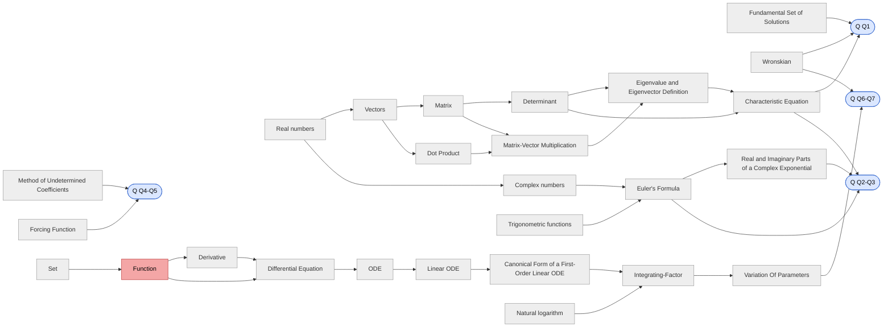

# AM20 HW5 (AM20)

Generated by `sync.py` / `assignments.py`; do not edit. Track status in [../status.csv](../status.csv).

- **Due:** 2026-10-31
- **Source:** [AM20 HW 05 (due Oct 31).pdf](../../files/homework/AM20%20HW%2005%20(due%20Oct%2031).pdf)
- **Readiness now:** 12% (9 of 26 concepts in the chain studied)

**Gaps:**
- 4 concept(s) with no prerequisites listed: Fundamental Set of Solutions, Wronskian, Method of Undetermined Coefficients, Forcing Function

## Questions

| Q | asks | concepts (recall now) |
|---|---|---|
| Q1 | fundamental set, alpha for decay | ⬜ Fundamental Set of Solutions, ⬜ Wronskian, ⬜ Characteristic Equation |
| Q2-Q3 | complex characteristic roots | ⬜ Euler's Formula, ⬜ Real and Imaginary Parts of a Complex Exponential, ⬜ Characteristic Equation |
| Q4-Q5 | method of undetermined coefficients | ⬜ Method of Undetermined Coefficients, ⬜ Forcing Function |
| Q6-Q7 | variation of parameters | ⬜ Variation Of Parameters, ⬜ Wronskian |

## Study order

Prerequisites first; only what is below 70% recall or never studied. Do these top to bottom, then work the set closed-book.

| # | concept | recall now | layer | taught in |
|---|---|---|---|---|
| 1 | Fundamental Set of Solutions | ⬜  | 1 | brain: am20-lec08 p.3 |
| 2 | Wronskian | ⬜  | 1 | brain: am20-lec08 p.3 |
| 3 | Real numbers | ⬜  | 1 | no source |
| 4 | Trigonometric functions | ⬜  | 1 | no source |
| 5 | Method of Undetermined Coefficients | ⬜  | 1 | no source |
| 6 | Forcing Function | ⬜  | 1 | no source |
| 7 | Set | ⬜  | 1 | no source |
| 8 | Natural logarithm | ⬜  | 1 | no source |
| 9 | Vectors | ⬜  | 2 | no source |
| 10 | Complex numbers | ⬜  | 2 | no source |
| 11 | Function | 🟥 30% | 2 | no source |
| 12 | Matrix | ⬜  | 3 | am20-review03-matrix p.1 |
| 13 | Dot Product | ⬜  | 3 | no source |
| 14 | Euler's Formula | ⬜  | 3 | am20-review01-complex-numbers p.1 |
| 15 | Derivative | ⬜  | 3 | no source |
| 16 | Determinant | ⬜  | 4 | no source |
| 17 | Matrix-Vector Multiplication | ⬜  | 4 | am20-review03-matrix p.1 |
| 18 | Real and Imaginary Parts of a Complex Exponential | ⬜  | 4 | am20-review01-complex-numbers p.1 |
| 19 | Differential Equation | ⬜  | 4 | am20-lec01 p.1 |
| 20 | Eigenvalue and Eigenvector Definition | ⬜  | 5 | am20-review05-eigenvalues p.1 |
| 21 | ODE | ⬜  | 5 | no source |
| 22 | Characteristic Equation | ⬜  | 6 | brain: am20-lec07 p.2 |
| 23 | Linear ODE | ⬜  | 6 | brain: am20-lec02 p.4 |
| 24 | Canonical Form of a First-Order Linear ODE | ⬜  | 7 | am20-lec03 p.1 |
| 25 | Integrating-Factor | ⬜  | 8 | no source |
| 26 | Variation Of Parameters | ⬜  | 9 | no source |

## Dependency map

Question -> concept -> prerequisite (arrows point from what you need to what needs it). Colour = recall now; dashed box = concept missing from the graph.

