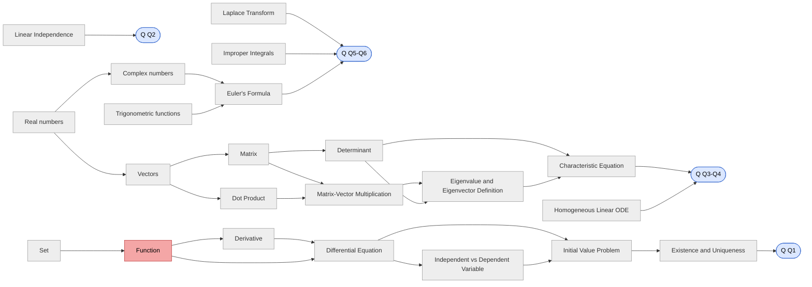

# AM20 HW6 (AM20)

Generated by `sync.py` / `assignments.py`; do not edit. Track status in [../status.csv](../status.csv).

- **Due:** 2026-11-07
- **Source:** [AM20 HW 06 (due Nov 7).pdf](../../files/homework/AM20%20HW%2006%20(due%20Nov%207).pdf)
- **Readiness now:** 8% (5 of 22 concepts in the chain studied)

**Gaps:**
- 3 concept(s) with no prerequisites listed: Linear Independence, Homogeneous Linear ODE, Laplace Transform

## Questions

| Q | asks | concepts (recall now) |
|---|---|---|
| Q1 | canonical form of a 4th-order equation, valid interval | ⬜ Existence and Uniqueness |
| Q2 | linear independence of four functions | ⬜ Linear Independence |
| Q3-Q4 | higher-order constant-coefficient equations | ⬜ Characteristic Equation, ⬜ Homogeneous Linear ODE |
| Q5-Q6 | Laplace transform from the definition; Euler's formula check | ⬜ Laplace Transform, ⬜ Improper Integrals, ⬜ Euler's Formula |

## Study order

Prerequisites first; only what is below 70% recall or never studied. Do these top to bottom, then work the set closed-book.

| # | concept | recall now | layer | taught in |
|---|---|---|---|---|
| 1 | Set | ⬜  | 1 | no source |
| 2 | Linear Independence | ⬜  | 1 | no source |
| 3 | Real numbers | ⬜  | 1 | no source |
| 4 | Homogeneous Linear ODE | ⬜  | 1 | brain: am20-lec07 p.2 |
| 5 | Laplace Transform | ⬜  | 1 | no source |
| 6 | Improper Integrals | ⬜  | 1 | am20-review07-integration-formulas p.2 |
| 7 | Trigonometric functions | ⬜  | 1 | no source |
| 8 | Vectors | ⬜  | 2 | no source |
| 9 | Complex numbers | ⬜  | 2 | no source |
| 10 | Function | 🟥 30% | 2 | no source |
| 11 | Derivative | ⬜  | 3 | no source |
| 12 | Matrix | ⬜  | 3 | am20-review03-matrix p.1 |
| 13 | Dot Product | ⬜  | 3 | no source |
| 14 | Euler's Formula | ⬜  | 3 | am20-review01-complex-numbers p.1 |
| 15 | Differential Equation | ⬜  | 4 | am20-lec01 p.1 |
| 16 | Determinant | ⬜  | 4 | no source |
| 17 | Matrix-Vector Multiplication | ⬜  | 4 | am20-review03-matrix p.1 |
| 18 | Independent vs Dependent Variable | ⬜  | 5 | am20-lec01 p.2 |
| 19 | Eigenvalue and Eigenvector Definition | ⬜  | 5 | am20-review05-eigenvalues p.1 |
| 20 | Initial Value Problem | ⬜  | 6 | brain: am20-lec07 p.4 |
| 21 | Characteristic Equation | ⬜  | 6 | brain: am20-lec07 p.2 |
| 22 | Existence and Uniqueness | ⬜  | 7 | brain: am20-lec08 p.1 |

## Dependency map

Question -> concept -> prerequisite (arrows point from what you need to what needs it). Colour = recall now; dashed box = concept missing from the graph.

