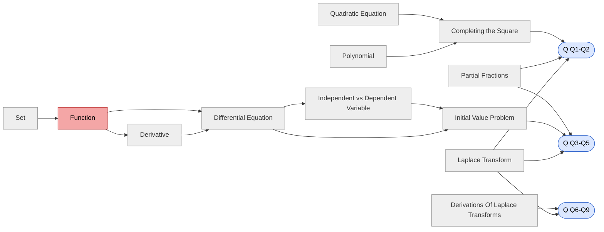

# AM20 HW7 (AM20)

Generated by `sync.py` / `assignments.py`; do not edit. Track status in [../status.csv](../status.csv).

- **Due:** 2026-11-14
- **Source:** [AM20 HW 07 (due Nov 14).pdf](../../files/homework/AM20%20HW%2007%20(due%20Nov%2014).pdf)
- **Readiness now:** 13% (4 of 12 concepts in the chain studied)

**Gaps:**
- 2 concept(s) with no prerequisites listed: Laplace Transform, Derivations Of Laplace Transforms

## Questions

| Q | asks | concepts (recall now) |
|---|---|---|
| Q1-Q2 | inverse Laplace transforms | ⬜ Laplace Transform, ⬜ Partial Fractions, ⬜ Completing the Square |
| Q3-Q5 | solve IVPs with the Laplace transform | ⬜ Laplace Transform, ⬜ Initial Value Problem, ⬜ Partial Fractions |
| Q6-Q9 | unit step functions and their transforms | ⬜ Laplace Transform, ⬜ Derivations Of Laplace Transforms |

## Study order

Prerequisites first; only what is below 70% recall or never studied. Do these top to bottom, then work the set closed-book.

| # | concept | recall now | layer | taught in |
|---|---|---|---|---|
| 1 | Laplace Transform | ⬜  | 1 | no source |
| 2 | Partial Fractions | ⬜  | 1 | am20-review07-integration-formulas p.1 |
| 3 | Polynomial | ⬜  | 1 | no source |
| 4 | Quadratic Equation | ⬜  | 1 | no source |
| 5 | Set | ⬜  | 1 | no source |
| 6 | Derivations Of Laplace Transforms | ⬜  | 1 | no source |
| 7 | Completing the Square | ⬜  | 2 | no source |
| 8 | Function | 🟥 30% | 2 | no source |
| 9 | Derivative | ⬜  | 3 | no source |
| 10 | Differential Equation | ⬜  | 4 | am20-lec01 p.1 |
| 11 | Independent vs Dependent Variable | ⬜  | 5 | am20-lec01 p.2 |
| 12 | Initial Value Problem | ⬜  | 6 | brain: am20-lec07 p.4 |

## Dependency map

Question -> concept -> prerequisite (arrows point from what you need to what needs it). Colour = recall now; dashed box = concept missing from the graph.

