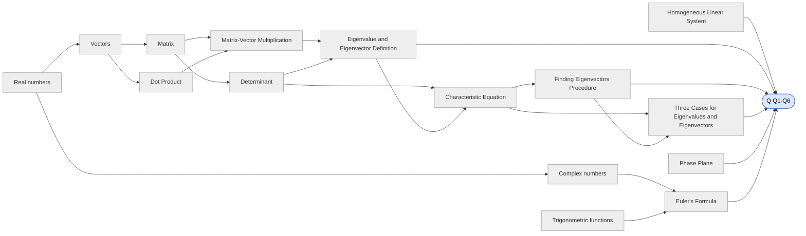

# AM20 HW8 (AM20)

Generated by `sync.py` / `assignments.py`; do not edit. Track status in [../status.csv](../status.csv).

- **Due:** 2026-11-21
- **Source:** [AM20 HW 08 (due Nov 21).pdf](../../files/homework/AM20%20HW%2008%20(due%20Nov%2021).pdf)
- **Readiness on the due date:** 0% (0 of 15 concepts in the chain studied)

**Gaps:**
- 2 concept(s) with no prerequisites listed: Homogeneous Linear System, Phase Plane

## Questions

| Q | asks | concepts (recall now) |
|---|---|---|
| Q1-Q6 | 2x2 linear systems: general solution, classify the origin, long-run behavior | ⬜ Homogeneous Linear System, ⬜ Eigenvalue and Eigenvector Definition, ⬜ Finding Eigenvectors Procedure, ⬜ Three Cases for Eigenvalues and Eigenvectors, ⬜ Phase Plane, ⬜ Euler's Formula |

## Study order

Prerequisites first; only what is below 70% recall or never studied. Do these top to bottom, then work the set closed-book.

| # | concept | recall now | layer | taught in |
|---|---|---|---|---|
| 1 | Homogeneous Linear System | ⬜  | 1 | no source |
| 2 | Real numbers | ⬜  | 1 | no source |
| 3 | Phase Plane | ⬜  | 1 | no source |
| 4 | Trigonometric functions | ⬜  | 1 | no source |
| 5 | Vectors | ⬜  | 2 | no source |
| 6 | Complex numbers | ⬜  | 2 | no source |
| 7 | Matrix | ⬜  | 3 | am20-review03-matrix p.1 |
| 8 | Dot Product | ⬜  | 3 | no source |
| 9 | Euler's Formula | ⬜  | 3 | am20-review01-complex-numbers p.1 |
| 10 | Determinant | ⬜  | 4 | no source |
| 11 | Matrix-Vector Multiplication | ⬜  | 4 | am20-review03-matrix p.1 |
| 12 | Eigenvalue and Eigenvector Definition | ⬜  | 5 | am20-review05-eigenvalues p.1 |
| 13 | Characteristic Equation | ⬜  | 6 | brain: am20-lec07 p.2 |
| 14 | Finding Eigenvectors Procedure | ⬜  | 7 | am20-review05-eigenvalues p.1 |
| 15 | Three Cases for Eigenvalues and Eigenvectors | ⬜  | 8 | am20-review05-eigenvalues p.1 |

## Dependency map

Question -> concept -> prerequisite (arrows point from what you need to what needs it). Colour = recall now; dashed box = concept missing from the graph.

