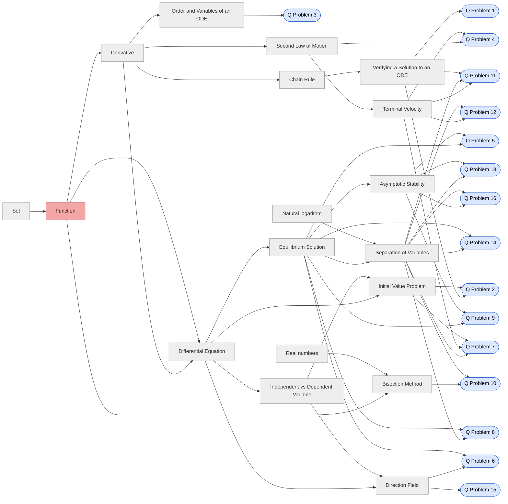

# Supplementary problems: am20-lec01-supp (AM20)

Generated by `sync.py` / `assignments.py`; do not edit. Track status in [../status.csv](../status.csv).

- **Due:** not set
- **Source:** am20-lec01-supp
- **Readiness now:** 29% (14 of 18 concepts in the chain studied)

## Questions

| Q | asks | concepts (recall now) |
|---|---|---|
| Problem 1 | Verify Exponential Solution | ⬜ Verifying a Solution to an ODE |
| Problem 10 | Impact Time by Bisection | ⬜ Bisection Method, ⬜ Separation of Variables |
| Problem 11 | General Falling Object Formula and t90 | ⬜ Terminal Velocity, ⬜ Separation of Variables, ⬜ Verifying a Solution to an ODE |
| Problem 12 | Infer Drag and Gravity from Data | ⬜ Terminal Velocity, ⬜ Separation of Variables |
| Problem 13 | Object Thrown Upward | ⬜ Separation of Variables, ⬜ Asymptotic Stability |
| Problem 14 | Attendance Model Thresholds | ⬜ Separation of Variables, ⬜ Equilibrium Solution |
| Problem 15 | Isocline and Local Minimum | ⬜ Direction Field |
| Problem 16 | Bounding Impact Speed | ⬜ Asymptotic Stability, ⬜ Separation of Variables |
| Problem 2 | Verify Solution and Initial Condition | ⬜ Verifying a Solution to an ODE, ⬜ Initial Value Problem |
| Problem 3 | Identify Order and Variables | ⬜ Order and Variables of an ODE |
| Problem 4 | Falling Object Force Balance | ⬜ Second Law of Motion, ⬜ Terminal Velocity |
| Problem 5 | Equilibrium of y prime equals y minus 2 | ⬜ Equilibrium Solution, ⬜ Asymptotic Stability |
| Problem 6 | Slope Table for y prime equals t minus y | ⬜ Direction Field, ⬜ Equilibrium Solution |
| Problem 7 | Solve the Falling Object Equation | ⬜ Separation of Variables, ⬜ Terminal Velocity, ⬜ Initial Value Problem |
| Problem 8 | Population Model Reaching Zero | ⬜ Separation of Variables, ⬜ Equilibrium Solution |
| Problem 9 | Equilibria of y prime equals y times 3 minus y | ⬜ Equilibrium Solution, ⬜ Asymptotic Stability |

## Study order

Prerequisites first; only what is below 70% recall or never studied. Do these top to bottom, then work the set closed-book.

| # | concept | recall now | layer | taught in |
|---|---|---|---|---|
| 1 | Set | ⬜  | 1 | no source |
| 2 | Real numbers | ⬜  | 1 | no source |
| 3 | Natural logarithm | ⬜  | 1 | no source |
| 4 | Function | 🟥 30% | 2 | no source |
| 5 | Derivative | ⬜  | 3 | no source |
| 6 | Bisection Method | ⬜  | 3 | am20-lec01-supp p.6 |
| 7 | Chain Rule | ⬜  | 4 | no source |
| 8 | Differential Equation | ⬜  | 4 | am20-lec01 p.1 |
| 9 | Second Law of Motion | ⬜  | 4 | brain: am20-lec01 p.1 |
| 10 | Order and Variables of an ODE | ⬜  | 4 | am20-lec01-supp p.1 |
| 11 | Verifying a Solution to an ODE | ⬜  | 5 | am20-lec01-supp p.1 |
| 12 | Equilibrium Solution | ⬜  | 5 | no source |
| 13 | Terminal Velocity | ⬜  | 5 | am20-lec01-supp p.2 |
| 14 | Independent vs Dependent Variable | ⬜  | 5 | am20-lec01 p.2 |
| 15 | Separation of Variables | ⬜  | 6 | am20-lec01-supp p.4 |
| 16 | Asymptotic Stability | ⬜  | 6 | no source |
| 17 | Direction Field | ⬜  | 6 | no source |
| 18 | Initial Value Problem | ⬜  | 6 | brain: am20-lec07 p.4 |

## Dependency map

Question -> concept -> prerequisite (arrows point from what you need to what needs it). Colour = recall now; dashed box = concept missing from the graph.

