# ECON131 progress (generated by sync.py, do not edit)

Updated 2026-11-22 18:36. 2 of 81 concepts studied (81 ECON131 concepts plus 0 prerequisites from other courses). Source: brain's rep ledger (`System/reps.csv` in the vault) replayed through FSRS-6. Machine-readable: [progress.csv](progress.csv), raw reps: [reps.csv](reps.csv).

**Key.** Recall/use now: ⬜ never studied · 🟥 under 40% · 🟧 40-69% · 🟨 70-89% · 🟩 90%+. A memory shows at most 30% until a free-recall success an hour or more later proves it, and 0 after a miss. *Recall* = produce the definition from memory; *use* = solve a problem with it.

## Exams

| exam | date | in scope | studied | ready on the day |
|---|---|---|---|---|
| Final | 2026-12-08 | 81 | 2 | 1% |

## When I studied

Reps per day on these concepts: ⬜ 0 · 🟨 1-9 · 🟧 10-29 · 🟩 30+

| | W0 | W1 | W2 | W3 | W4 | W5 | W6 | W7 | W8 |
|---|---|---|---|---|---|---|---|---|---|
| M | ⬜ | ⬜ | ⬜ | ⬜ | ⬜ | ⬜ | ⬜ | ⬜ | ⬜ |
| T | ⬜ | ⬜ | ⬜ | 🟨 | ⬜ | ⬜ | ⬜ | ⬜ | ⬜ |
| W | ⬜ | ⬜ | ⬜ | ⬜ | ⬜ | ⬜ | ⬜ | ⬜ | ⬜ |
| T | ⬜ | ⬜ | ⬜ | ⬜ | ⬜ | ⬜ | ⬜ | ⬜ | ⬜ |
| F | ⬜ | ⬜ | ⬜ | ⬜ | ⬜ | ⬜ | ⬜ | ⬜ | ⬜ |
| S | ⬜ | ⬜ | ⬜ | ⬜ | ⬜ | ⬜ | ⬜ | ⬜ | ⬜ |
| S | ⬜ | ⬜ | ⬜ | ⬜ | ⬜ | ⬜ | ⬜ | ⬜ | ⬜ |

Week 0 starts 2026-09-21. Total reps: 2 on 1 days.

## Next

**Due now (2):** 2018 US-China Trade War (Tariff Escalation), 2026 Dollar Outlook (Cyclical versus Structural Risks)

**Ready to start (6), prerequisites all studied:** Foreign Exchange Market, Trade Openness, Financial Openness (Capital Account Openness), Multinational Corporation (MNC), Price Level and Price Index, Compound Interest Rates (Discrete)

## Dependency heatmap

Arrows go from a prerequisite to the concept that needs it. Colour = recall now.

```mermaid
flowchart LR
  subgraph g0["ECON131 Dollar Dominance"]
    n34bfcd7ce9["Dollar's Outsized Financial Footprint"]:::none
    nb6ac98335e["Exorbitant Privilege"]:::none
    ne05e930c82["Interest Rate Differential"]:::none
    nc15f40dbf7["Fed Policy Pivot and Dollar Appreciation Mechanism"]:::none
    na7c629fa76["2026 Dollar Outlook (Cyclical versus Structural Risks)"]:::none
    nce908e6489["Trade-Weighted Dollar Index"]:::none
    nda631d766e["Currency Appreciation and Quote Direction"]:::none
    n79a007ccf2["Flight to Safety (Safe Haven Demand)"]:::none
    n9f9dc6f77f["Dollar Smile Theory"]:::none
    n3f917ee21e["Dutch Disease Argument (Cost of Exorbitant Privilege)"]:::none
    n6ba288de01["Strong Dollar Spillovers (Winners and Losers)"]:::none
    n97e41971bc["Exporting Inflation Channel (USD Commodity Pricing)"]:::none
    n00a28d2ef0["Lack of Credible Dollar Alternatives"]:::none
    nea804e4ab0["Safe Haven Moat (Pillars of Dollar Dominance)"]:::none
  end
  subgraph g1["ECON131 Lecture 1"]
    n8d4a2ff180["Trade Openness"]:::none
    n21452ca5f2["Trade Globalization Benefits and Costs"]:::none
    n5c13cf244e["2018 US-China Trade War (Tariff Escalation)"]:::none
    n67c1771ef7["Financial Openness (Capital Account Openness)"]:::none
    n7720f36af5["Sudden Stop (Capital Flows)"]:::none
    n17de5918df["Financial Globalization Benefits and Costs"]:::none
    nd8fd832e7c["Multinational Corporation (MNC)"]:::none
    nd97c6483c8["MNC Foreign Market Entry Modes"]:::none
  end
  subgraph g2["ECON131 Lecture 2"]
    n392e3672a6["Foreign Exchange Market"]:::none
    ne6da9b8bba["Direct vs Indirect Quote"]:::none
    nd7f28862e8["Appreciation and Depreciation"]:::none
    n04690d02d2["Bid-Ask Spread"]:::none
    ncf78e6f9d1["Devaluation and Trade"]:::none
    ne8b8dd9c7e["Exchange Rate Regimes (Peg and Managed Float)"]:::none
    n9a4a4c9066["Real Effective Exchange Rate (REER)"]:::none
    ne6fd3df097["Spot vs Forward Contract"]:::none
    n032412bab2["Vehicle Currency and Cross Rates"]:::none
    ne047e1f542["Triangular Arbitrage"]:::none
  end
  subgraph g3["ECON131 Lecture 3"]
    n3154f18dc1["Forward Premium and Discount"]:::none
    n5fa50a6bb2["Covered Interest Rate Parity (CIP)"]:::none
    n02c9881648["Carry Trade"]:::none
    n269913c2d6["Transaction Exchange Risk"]:::none
    n0e6ae406f8["Forward Hedge vs Money Market Hedge"]:::none
  end
  subgraph g4["ECON131 Lecture 3 p.1-2"]
    nfddcae4989["Uncovered Interest Rate Parity (UIP)"]:::none
    nfc4d17f70c["Covered Interest Arbitrage"]:::none
  end
  subgraph g5["ECON131 Lecture 4"]
    n9ca0dc2d0a["Price Level and Price Index"]:::none
    n2bf25f8576["Internal and External Purchasing Power"]:::none
    nd17be1fd9f["Law of One Price (LOOP)"]:::none
    n262028d2f4["Absolute Purchasing Power Parity"]:::none
    nd09e9f60ae["Big Mac Index"]:::none
    n99dcd32d29["Inflation Rate"]:::none
    n0e56fef08b["Real Exchange Rate"]:::none
    n5c311a4f4c["Relative Purchasing Power Parity"]:::none
  end
  subgraph g6["ECON131 Lecture 5"]
    nf03f7c148e["Balance of Payments (BOP)"]:::none
    n733cdbdd61["Capital Account (Financial Account)"]:::none
    n6b5423df0f["Current Account"]:::none
    nad386e249a["Double-Entry Accounting (BOP)"]:::none
    n857ec87378["BOP Identity"]:::none
    n82fed323e7["International Reserves"]:::none
    n806d94e62a["Central Bank Balance Sheet"]:::none
    n3d698104d7["Gross National Income (GNI)"]:::none
    n18be7adb6f["Net Foreign Assets (NFA)"]:::none
    nac7ec7a1bc["Saving-Investment Identity (S - I = CA)"]:::none
    ne183388f2a["Sterilized vs Non-Sterilized Intervention"]:::none
  end
  subgraph g7["ECON131 Lecture 7"]
    n9b581c89bf["Compound Interest Rates (Discrete)"]:::none
    ndea4aa9e1a["Present Value and Future Value"]:::none
    necda8ff793["Bond"]:::none
    nc5a439708e["Discount Factor"]:::none
    na648f79b58["Bond Pricing (Coupon Bond)"]:::none
    nf7ba6a1203["Consol (Perpetuity)"]:::none
    nf00bd19e79["Yield to Maturity (YTM)"]:::none
    n463cf6f467["Spot Interest Rate"]:::none
    nf2d807c417["Term Structure of Interest Rates"]:::none
    n5b0b0c5690["Expectations Hypothesis"]:::none
    n5a2e503399["Fisher Equation"]:::none
    nae6206841c["Long Bond Interest Rate Risk"]:::none
    n641aaed974["Nominal vs Effective Rate"]:::none
  end
  subgraph g8["ECON131 Lecture 8"]
    nf10b6e8aa7["Internal vs External Funds"]:::none
    na5402238ce["All-in-Cost (AIC)"]:::none
    nb81133740b["Domestic vs International Bonds (Foreign Bond and Eurobond)"]:::none
    nfe425e89c1["Currency of Denomination (Debt)"]:::none
    n4fc92e2066["Centralized vs Decentralized Debt Denomination"]:::none
  end
  subgraph g9["ECON131 Lecture 9"]
    nf742dade62["Brady Bond"]:::none
    nb321251e30["Country Spread"]:::none
    nda04baa9c3["Default Probability from Spreads"]:::none
    nac84037865["European Debt Crisis (2010s)"]:::none
    n304d159466["Latin American Debt Crisis (1980s)"]:::none
  end
  n392e3672a6 --> n34bfcd7ce9
  n34bfcd7ce9 --> nb6ac98335e
  n392e3672a6 --> ne05e930c82
  ne05e930c82 --> nc15f40dbf7
  nc15f40dbf7 --> na7c629fa76
  nb6ac98335e --> na7c629fa76
  n392e3672a6 --> nce908e6489
  nce908e6489 --> nda631d766e
  n392e3672a6 --> n79a007ccf2
  n79a007ccf2 --> n9f9dc6f77f
  ne05e930c82 --> n9f9dc6f77f
  nb6ac98335e --> n3f917ee21e
  nce908e6489 --> n6ba288de01
  n6ba288de01 --> n97e41971bc
  n34bfcd7ce9 --> n00a28d2ef0
  n34bfcd7ce9 --> nea804e4ab0
  n8d4a2ff180 --> n21452ca5f2
  n21452ca5f2 --> n5c13cf244e
  n67c1771ef7 --> n7720f36af5
  n67c1771ef7 --> n17de5918df
  n7720f36af5 --> n17de5918df
  nd8fd832e7c --> nd97c6483c8
  n392e3672a6 --> ne6da9b8bba
  ne6da9b8bba --> nd7f28862e8
  ne6da9b8bba --> n04690d02d2
  nd7f28862e8 --> ncf78e6f9d1
  nd7f28862e8 --> ne8b8dd9c7e
  ncf78e6f9d1 --> ne8b8dd9c7e
  nd7f28862e8 --> n9a4a4c9066
  n392e3672a6 --> ne6fd3df097
  ne6da9b8bba --> n032412bab2
  n032412bab2 --> ne047e1f542
  ne6fd3df097 --> n3154f18dc1
  nd7f28862e8 --> n3154f18dc1
  n3154f18dc1 --> n5fa50a6bb2
  ne05e930c82 --> n5fa50a6bb2
  n5fa50a6bb2 --> nfddcae4989
  ne05e930c82 --> n02c9881648
  nfddcae4989 --> n02c9881648
  ne6fd3df097 --> n269913c2d6
  n269913c2d6 --> n0e6ae406f8
  n5fa50a6bb2 --> n0e6ae406f8
  n5fa50a6bb2 --> nfc4d17f70c
  n9ca0dc2d0a --> n2bf25f8576
  ne6da9b8bba --> n2bf25f8576
  n392e3672a6 --> nd17be1fd9f
  ne6da9b8bba --> nd17be1fd9f
  n2bf25f8576 --> n262028d2f4
  nd17be1fd9f --> n262028d2f4
  n262028d2f4 --> nd09e9f60ae
  n9ca0dc2d0a --> n99dcd32d29
  n262028d2f4 --> n0e56fef08b
  n9ca0dc2d0a --> n0e56fef08b
  n262028d2f4 --> n5c311a4f4c
  n99dcd32d29 --> n5c311a4f4c
  nd7f28862e8 --> n5c311a4f4c
  n392e3672a6 --> nf03f7c148e
  nf03f7c148e --> n733cdbdd61
  nf03f7c148e --> n6b5423df0f
  nf03f7c148e --> nad386e249a
  n6b5423df0f --> n857ec87378
  n733cdbdd61 --> n857ec87378
  nad386e249a --> n857ec87378
  n733cdbdd61 --> n82fed323e7
  n82fed323e7 --> n806d94e62a
  n6b5423df0f --> n3d698104d7
  n733cdbdd61 --> n18be7adb6f
  n3d698104d7 --> nac7ec7a1bc
  n857ec87378 --> nac7ec7a1bc
  n806d94e62a --> ne183388f2a
  ne8b8dd9c7e --> ne183388f2a
  n9b581c89bf --> ndea4aa9e1a
  ndea4aa9e1a --> necda8ff793
  ndea4aa9e1a --> nc5a439708e
  necda8ff793 --> na648f79b58
  nc5a439708e --> na648f79b58
  na648f79b58 --> nf7ba6a1203
  na648f79b58 --> nf00bd19e79
  nf00bd19e79 --> n463cf6f467
  nc5a439708e --> n463cf6f467
  n463cf6f467 --> nf2d807c417
  nf2d807c417 --> n5b0b0c5690
  n9b581c89bf --> n5b0b0c5690
  n99dcd32d29 --> n5a2e503399
  nf2d807c417 --> n5a2e503399
  na648f79b58 --> nae6206841c
  n9b581c89bf --> n641aaed974
  nd8fd832e7c --> nf10b6e8aa7
  nf00bd19e79 --> na5402238ce
  nf10b6e8aa7 --> na5402238ce
  necda8ff793 --> nb81133740b
  nd8fd832e7c --> nb81133740b
  nfddcae4989 --> nfe425e89c1
  nb81133740b --> nfe425e89c1
  nfe425e89c1 --> n4fc92e2066
  n269913c2d6 --> n4fc92e2066
  na648f79b58 --> nf742dade62
  nb81133740b --> nf742dade62
  nf00bd19e79 --> nb321251e30
  n463cf6f467 --> nb321251e30
  nb321251e30 --> nda04baa9c3
  nf742dade62 --> nda04baa9c3
  nb321251e30 --> nac84037865
  ne8b8dd9c7e --> nac84037865
  nf742dade62 --> n304d159466
  classDef none fill:#eeeeee,stroke:#999,color:#333
  classDef red fill:#f4a6a6,stroke:#b33,color:#000
  classDef orange fill:#f8c58c,stroke:#c70,color:#000
  classDef yellow fill:#f6e58d,stroke:#aa0,color:#000
  classDef green fill:#9be29b,stroke:#3a3,color:#000
```

## Every concept (prerequisites first)

| recall | use | concept | lecture | last studied | days ago | reps | next due | needs |
|---|---|---|---|---|---|---|---|---|
| ⬜  | ⬜  | Foreign Exchange Market | ECON131 Lecture 2 | - |  | 0 | - |  |
| ⬜  | ⬜  | Dollar's Outsized Financial Footprint | ECON131 Dollar Dominance | - |  | 0 | - | ⬜ Foreign Exchange Market |
| ⬜  | ⬜  | Exorbitant Privilege | ECON131 Dollar Dominance | - |  | 0 | - | ⬜ Dollar's Outsized Financial Footprint |
| ⬜  | ⬜  | Interest Rate Differential | ECON131 Dollar Dominance | - |  | 0 | - | ⬜ Foreign Exchange Market |
| ⬜  | ⬜  | Fed Policy Pivot and Dollar Appreciation Mechanism | ECON131 Dollar Dominance | - |  | 0 | - | ⬜ Interest Rate Differential |
| ⬜  | 🟧 64% | 2026 Dollar Outlook (Cyclical versus Structural Risks) | ECON131 Dollar Dominance | 2026-10-13 | 40 | 1 | 2026-10-15 | ⬜ Fed Policy Pivot and Dollar Appreciation Mechanism, ⬜ Exorbitant Privilege |
| ⬜  | ⬜  | Trade-Weighted Dollar Index | ECON131 Dollar Dominance | - |  | 0 | - | ⬜ Foreign Exchange Market |
| ⬜  | ⬜  | Currency Appreciation and Quote Direction | ECON131 Dollar Dominance | - |  | 0 | - | ⬜ Trade-Weighted Dollar Index |
| ⬜  | ⬜  | Flight to Safety (Safe Haven Demand) | ECON131 Dollar Dominance | - |  | 0 | - | ⬜ Foreign Exchange Market |
| ⬜  | ⬜  | Dollar Smile Theory | ECON131 Dollar Dominance | - |  | 0 | - | ⬜ Flight to Safety (Safe Haven Demand), ⬜ Interest Rate Differential |
| ⬜  | ⬜  | Dutch Disease Argument (Cost of Exorbitant Privilege) | ECON131 Dollar Dominance | - |  | 0 | - | ⬜ Exorbitant Privilege |
| ⬜  | ⬜  | Strong Dollar Spillovers (Winners and Losers) | ECON131 Dollar Dominance | - |  | 0 | - | ⬜ Trade-Weighted Dollar Index |
| ⬜  | ⬜  | Exporting Inflation Channel (USD Commodity Pricing) | ECON131 Dollar Dominance | - |  | 0 | - | ⬜ Strong Dollar Spillovers (Winners and Losers) |
| ⬜  | ⬜  | Lack of Credible Dollar Alternatives | ECON131 Dollar Dominance | - |  | 0 | - | ⬜ Dollar's Outsized Financial Footprint |
| ⬜  | ⬜  | Safe Haven Moat (Pillars of Dollar Dominance) | ECON131 Dollar Dominance | - |  | 0 | - | ⬜ Dollar's Outsized Financial Footprint |
| ⬜  | ⬜  | Trade Openness | ECON131 Lecture 1 | - |  | 0 | - |  |
| ⬜  | ⬜  | Trade Globalization Benefits and Costs | ECON131 Lecture 1 | - |  | 0 | - | ⬜ Trade Openness |
| ⬜  | 🟧 64% | 2018 US-China Trade War (Tariff Escalation) | ECON131 Lecture 1 | 2026-10-13 | 40 | 1 | 2026-10-15 | ⬜ Trade Globalization Benefits and Costs |
| ⬜  | ⬜  | Financial Openness (Capital Account Openness) | ECON131 Lecture 1 | - |  | 0 | - |  |
| ⬜  | ⬜  | Sudden Stop (Capital Flows) | ECON131 Lecture 1 | - |  | 0 | - | ⬜ Financial Openness (Capital Account Openness) |
| ⬜  | ⬜  | Financial Globalization Benefits and Costs | ECON131 Lecture 1 | - |  | 0 | - | ⬜ Financial Openness (Capital Account Openness), ⬜ Sudden Stop (Capital Flows) |
| ⬜  | ⬜  | Multinational Corporation (MNC) | ECON131 Lecture 1 | - |  | 0 | - |  |
| ⬜  | ⬜  | MNC Foreign Market Entry Modes | ECON131 Lecture 1 | - |  | 0 | - | ⬜ Multinational Corporation (MNC) |
| ⬜  | ⬜  | Direct vs Indirect Quote | ECON131 Lecture 2 | - |  | 0 | - | ⬜ Foreign Exchange Market |
| ⬜  | ⬜  | Appreciation and Depreciation | ECON131 Lecture 2 | - |  | 0 | - | ⬜ Direct vs Indirect Quote |
| ⬜  | ⬜  | Bid-Ask Spread | ECON131 Lecture 2 | - |  | 0 | - | ⬜ Direct vs Indirect Quote |
| ⬜  | ⬜  | Devaluation and Trade | ECON131 Lecture 2 | - |  | 0 | - | ⬜ Appreciation and Depreciation |
| ⬜  | ⬜  | Exchange Rate Regimes (Peg and Managed Float) | ECON131 Lecture 2 | - |  | 0 | - | ⬜ Appreciation and Depreciation, ⬜ Devaluation and Trade |
| ⬜  | ⬜  | Real Effective Exchange Rate (REER) | ECON131 Lecture 2 | - |  | 0 | - | ⬜ Appreciation and Depreciation |
| ⬜  | ⬜  | Spot vs Forward Contract | ECON131 Lecture 2 | - |  | 0 | - | ⬜ Foreign Exchange Market |
| ⬜  | ⬜  | Vehicle Currency and Cross Rates | ECON131 Lecture 2 | - |  | 0 | - | ⬜ Direct vs Indirect Quote |
| ⬜  | ⬜  | Triangular Arbitrage | ECON131 Lecture 2 | - |  | 0 | - | ⬜ Vehicle Currency and Cross Rates |
| ⬜  | ⬜  | Forward Premium and Discount | ECON131 Lecture 3 | - |  | 0 | - | ⬜ Spot vs Forward Contract, ⬜ Appreciation and Depreciation |
| ⬜  | ⬜  | Covered Interest Rate Parity (CIP) | ECON131 Lecture 3 | - |  | 0 | - | ⬜ Forward Premium and Discount, ⬜ Interest Rate Differential |
| ⬜  | ⬜  | Uncovered Interest Rate Parity (UIP) | ECON131 Lecture 3 p.1-2 | - |  | 0 | - | ⬜ Covered Interest Rate Parity (CIP) |
| ⬜  | ⬜  | Carry Trade | ECON131 Lecture 3 | - |  | 0 | - | ⬜ Interest Rate Differential, ⬜ Uncovered Interest Rate Parity (UIP) |
| ⬜  | ⬜  | Transaction Exchange Risk | ECON131 Lecture 3 | - |  | 0 | - | ⬜ Spot vs Forward Contract |
| ⬜  | ⬜  | Forward Hedge vs Money Market Hedge | ECON131 Lecture 3 | - |  | 0 | - | ⬜ Transaction Exchange Risk, ⬜ Covered Interest Rate Parity (CIP) |
| ⬜  | ⬜  | Covered Interest Arbitrage | ECON131 Lecture 3 p.1-2 | - |  | 0 | - | ⬜ Covered Interest Rate Parity (CIP) |
| ⬜  | ⬜  | Price Level and Price Index | ECON131 Lecture 4 | - |  | 0 | - |  |
| ⬜  | ⬜  | Internal and External Purchasing Power | ECON131 Lecture 4 | - |  | 0 | - | ⬜ Price Level and Price Index, ⬜ Direct vs Indirect Quote |
| ⬜  | ⬜  | Law of One Price (LOOP) | ECON131 Lecture 4 | - |  | 0 | - | ⬜ Foreign Exchange Market, ⬜ Direct vs Indirect Quote |
| ⬜  | ⬜  | Absolute Purchasing Power Parity | ECON131 Lecture 4 | - |  | 0 | - | ⬜ Internal and External Purchasing Power, ⬜ Law of One Price (LOOP) |
| ⬜  | ⬜  | Big Mac Index | ECON131 Lecture 4 | - |  | 0 | - | ⬜ Absolute Purchasing Power Parity |
| ⬜  | ⬜  | Inflation Rate | ECON131 Lecture 4 | - |  | 0 | - | ⬜ Price Level and Price Index |
| ⬜  | ⬜  | Real Exchange Rate | ECON131 Lecture 4 | - |  | 0 | - | ⬜ Absolute Purchasing Power Parity, ⬜ Price Level and Price Index |
| ⬜  | ⬜  | Relative Purchasing Power Parity | ECON131 Lecture 4 | - |  | 0 | - | ⬜ Absolute Purchasing Power Parity, ⬜ Inflation Rate, ⬜ Appreciation and Depreciation |
| ⬜  | ⬜  | Balance of Payments (BOP) | ECON131 Lecture 5 | - |  | 0 | - | ⬜ Foreign Exchange Market |
| ⬜  | ⬜  | Capital Account (Financial Account) | ECON131 Lecture 5 | - |  | 0 | - | ⬜ Balance of Payments (BOP) |
| ⬜  | ⬜  | Current Account | ECON131 Lecture 5 | - |  | 0 | - | ⬜ Balance of Payments (BOP) |
| ⬜  | ⬜  | Double-Entry Accounting (BOP) | ECON131 Lecture 5 | - |  | 0 | - | ⬜ Balance of Payments (BOP) |
| ⬜  | ⬜  | BOP Identity | ECON131 Lecture 5 | - |  | 0 | - | ⬜ Current Account, ⬜ Capital Account (Financial Account), ⬜ Double-Entry Accounting (BOP) |
| ⬜  | ⬜  | International Reserves | ECON131 Lecture 5 | - |  | 0 | - | ⬜ Capital Account (Financial Account) |
| ⬜  | ⬜  | Central Bank Balance Sheet | ECON131 Lecture 5 | - |  | 0 | - | ⬜ International Reserves |
| ⬜  | ⬜  | Gross National Income (GNI) | ECON131 Lecture 5 | - |  | 0 | - | ⬜ Current Account |
| ⬜  | ⬜  | Net Foreign Assets (NFA) | ECON131 Lecture 5 | - |  | 0 | - | ⬜ Capital Account (Financial Account) |
| ⬜  | ⬜  | Saving-Investment Identity (S - I = CA) | ECON131 Lecture 5 | - |  | 0 | - | ⬜ Gross National Income (GNI), ⬜ BOP Identity |
| ⬜  | ⬜  | Sterilized vs Non-Sterilized Intervention | ECON131 Lecture 5 | - |  | 0 | - | ⬜ Central Bank Balance Sheet, ⬜ Exchange Rate Regimes (Peg and Managed Float) |
| ⬜  | ⬜  | Compound Interest Rates (Discrete) | ECON131 Lecture 7 | - |  | 0 | - |  |
| ⬜  | ⬜  | Present Value and Future Value | ECON131 Lecture 7 | - |  | 0 | - | ⬜ Compound Interest Rates (Discrete) |
| ⬜  | ⬜  | Bond | ECON131 Lecture 7 | - |  | 0 | - | ⬜ Present Value and Future Value |
| ⬜  | ⬜  | Discount Factor | ECON131 Lecture 7 | - |  | 0 | - | ⬜ Present Value and Future Value |
| ⬜  | ⬜  | Bond Pricing (Coupon Bond) | ECON131 Lecture 7 | - |  | 0 | - | ⬜ Bond, ⬜ Discount Factor |
| ⬜  | ⬜  | Consol (Perpetuity) | ECON131 Lecture 7 | - |  | 0 | - | ⬜ Bond Pricing (Coupon Bond) |
| ⬜  | ⬜  | Yield to Maturity (YTM) | ECON131 Lecture 7 | - |  | 0 | - | ⬜ Bond Pricing (Coupon Bond) |
| ⬜  | ⬜  | Spot Interest Rate | ECON131 Lecture 7 | - |  | 0 | - | ⬜ Yield to Maturity (YTM), ⬜ Discount Factor |
| ⬜  | ⬜  | Term Structure of Interest Rates | ECON131 Lecture 7 | - |  | 0 | - | ⬜ Spot Interest Rate |
| ⬜  | ⬜  | Expectations Hypothesis | ECON131 Lecture 7 | - |  | 0 | - | ⬜ Term Structure of Interest Rates, ⬜ Compound Interest Rates (Discrete) |
| ⬜  | ⬜  | Fisher Equation | ECON131 Lecture 7 | - |  | 0 | - | ⬜ Inflation Rate, ⬜ Term Structure of Interest Rates |
| ⬜  | ⬜  | Long Bond Interest Rate Risk | ECON131 Lecture 7 | - |  | 0 | - | ⬜ Bond Pricing (Coupon Bond) |
| ⬜  | ⬜  | Nominal vs Effective Rate | ECON131 Lecture 7 | - |  | 0 | - | ⬜ Compound Interest Rates (Discrete) |
| ⬜  | ⬜  | Internal vs External Funds | ECON131 Lecture 8 | - |  | 0 | - | ⬜ Multinational Corporation (MNC) |
| ⬜  | ⬜  | All-in-Cost (AIC) | ECON131 Lecture 8 | - |  | 0 | - | ⬜ Yield to Maturity (YTM), ⬜ Internal vs External Funds |
| ⬜  | ⬜  | Domestic vs International Bonds (Foreign Bond and Eurobond) | ECON131 Lecture 8 | - |  | 0 | - | ⬜ Bond, ⬜ Multinational Corporation (MNC) |
| ⬜  | ⬜  | Currency of Denomination (Debt) | ECON131 Lecture 8 | - |  | 0 | - | ⬜ Uncovered Interest Rate Parity (UIP), ⬜ Domestic vs International Bonds (Foreign Bond and Eurobond) |
| ⬜  | ⬜  | Centralized vs Decentralized Debt Denomination | ECON131 Lecture 8 | - |  | 0 | - | ⬜ Currency of Denomination (Debt), ⬜ Transaction Exchange Risk |
| ⬜  | ⬜  | Brady Bond | ECON131 Lecture 9 | - |  | 0 | - | ⬜ Bond Pricing (Coupon Bond), ⬜ Domestic vs International Bonds (Foreign Bond and Eurobond) |
| ⬜  | ⬜  | Country Spread | ECON131 Lecture 9 | - |  | 0 | - | ⬜ Yield to Maturity (YTM), ⬜ Spot Interest Rate |
| ⬜  | ⬜  | Default Probability from Spreads | ECON131 Lecture 9 | - |  | 0 | - | ⬜ Country Spread, ⬜ Brady Bond |
| ⬜  | ⬜  | European Debt Crisis (2010s) | ECON131 Lecture 9 | - |  | 0 | - | ⬜ Country Spread, ⬜ Exchange Rate Regimes (Peg and Managed Float) |
| ⬜  | ⬜  | Latin American Debt Crisis (1980s) | ECON131 Lecture 9 | - |  | 0 | - | ⬜ Brady Bond |
