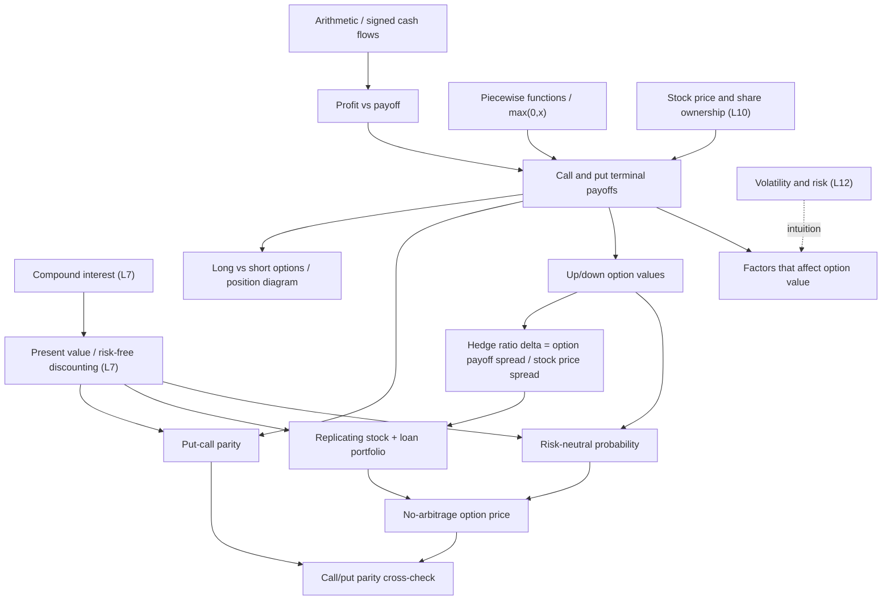

# ECON 131 — Lecture 13: Options and Binomial Pricing

> Source: Chenyue Hu, *Econ 131 — Lecture 13: Option*, one-page handout supplied 2026-11-19. This is a companion study module, NOT the professor's original PDF. The sections marked **Extension** unpack details not printed on the handout.
>
> Status: **prepared; not yet studied or mastered**. Do not add artificial reps to the generated progress tracker.

## Essential question

How do you price a contingent claim today when you know only two possible future stock prices?

## Objectives in the professor's order

1. Explain option, call, put, strike/exercise price, maturity; contrast European and American exercise.
2. Draw call/put payoff functions and a combined short-call/long-put position.
3. State and apply put-call parity.
4. Identify five determinants of option values.
5. Price a one-period option by (a) stock-and-loan replication and (b) risk-neutral probability; reconcile them.

## Dependency map

Arrows mean **must understand before**. Old nodes intentionally reference ECON 131 Lecture 7 and Lectures 10–12; the latter are source-adjacent, not mandatory for one-step binomial arithmetic.



Minimal study path: signed cash flows -> max payoff -> present value -> two-state payoff -> hedge ratio -> replication -> risk-neutral pricing. Do **not** require covariance/portfolio variance mastery first.

## Concept register (mark only with actual demonstrated work)

| ID | Concept | Prerequisite | Evidence of mastery | Recall | Use |
|---|---|---|---|---|---|
| O01 | Option/call/put/strike/maturity | stock ownership | define without notes | ⬜ | ⬜ |
| O02 | European vs American | O01 | distinguish exercise rules | ⬜ | ⬜ |
| O03 | Terminal option payoff | O01, max function | calculate 3 cases | ⬜ | ⬜ |
| O04 | Long/short positions | O03, signed cash flows | produce position diagram | ⬜ | ⬜ |
| O05 | Put-call parity | O03, present value | compute missing price | ⬜ | ⬜ |
| O06 | Five pricing factors | O01 | name, infer direction with conditions | ⬜ | ⬜ |
| O07 | Binomial two-state outcomes | O03 | list terminal payoff by state | ⬜ | ⬜ |
| O08 | Replicating hedge delta | O07 | calculate delta | ⬜ | ⬜ |
| O09 | Stock + loan replication | O08, PV | solve cash/borrow amount | ⬜ | ⬜ |
| O10 | Risk-neutral probability | O07, risk-free rate | compute and interpret q | ⬜ | ⬜ |
| O11 | Discounted option valuation | O10 | price call and put | ⬜ | ⬜ |
| O12 | No-arbitrage equivalence | O09, O11 | show two prices agree | ⬜ | ⬜ |

## Lesson 1 — Rights, not obligations

One share trades for S now. A **call** allows its owner to **buy** the share for K at expiration; a **put** allows its owner to **sell** the share for K. These are choices, not obligations. A European option is exercisable only at maturity; an American option may be exercised up to and including maturity.

At maturity T, a call pays **max(S_T - K, 0)**, and a put pays **max(K - S_T, 0)**. A sold (short) option has the negative of the owner's payoff. **Payoff != profit**: profit also accounts for the initial premium (and its financing when relevant).

Mini-check: at expiration S_T = $80 and K = $100, the call pays $0 and the put pays $20. Explain who exercises.

## Lesson 2 — Position diagrams (professor's exact problem)

Sell one 6-month call on Y, strike $200; buy one 6-month put on Y, strike $50.

Combined **terminal payoff**, excluding initial premiums:

```text
Payoff(S) = -max(S-200,0) + max(50-S,0)
          = 50-S      if S < 50
          = 0         if 50 <= S <= 200
          = 200-S     if S > 200
```

Plot three connected parts: descending line ending at (50,0); flat from (50,0) to (200,0); descending line beginning at (200,0). Sample table: S=0 => +50; S=30 => +20; S=100 => 0; S=220 => -20; S=250 => -50. Include premiums only if asked for a **profit** diagram.

## Lesson 3 — Put-call parity (European, same K and T)

> **Core interpretation to review:** “Put-call parity establishes that these two ways of obtaining the same financial outcome must have equal costs today, under the model's assumptions.”

**The two ways:** (1) buy a call and invest enough today to have the strike price at expiration; (2) buy one share today and a protective put with the same strike and expiration. Both end with the greater of the stock price and the strike price. The investment on the call side is a separate **pot of money**; it is not the price of the call or a reduction of the contractual strike.

**Active recall:** Without looking at the equation, explain what is owned on each side, what happens when the stock finishes above versus below the strike, and why identical payoffs imply equal initial costs under no-arbitrage assumptions.

**C_0 + PV(K) = P_0 + S_0**.

Reason: at maturity, call + risk-free amount K yields max(S_T,K). Put + stock yields the same max(S_T,K) in every state. If equivalent future payoffs have unequal initial prices, there is arbitrage (under simplifying assumptions such as no dividends/transaction costs).

**Extension:** In the no-dividend case with a single period and effective rate r, PV(K)=K/(1+r). If dividends matter, or the options are American, this simple equality may need adjustment.

Example: S=50, K=50, r=5%, one year, put P=5: C = 5 + 50 - 50/1.05 = $7.3810.

## Lesson 4 — Five factors

The handout lists stock price, exercise price, time to expiration, volatility, risk-free rate.

**Extension; usual comparative statics for otherwise identical vanilla options:** higher share price helps calls / hurts puts; higher strike hurts calls / helps puts; greater volatility generally increases both calls and puts; higher risk-free rate generally raises calls / lowers puts; time effects usually favor options but American/European exercise and dividends can create qualifications, especially for puts.

## Lesson 5 — Professor's binomial example, completely worked

Given S0=$50, Su=$60, Sd=$40, strike K=$50, one year, effective annual risk-free rate r=0.0525 (growth factor R=1.0525).

| State | Stock at T | Call payoff | Put payoff |
|---|---:|---:|---:|
| Up | $60 | $10 | $0 |
| Down | $40 | $0 | $10 |

**Method 1 — Replication (call):**
- Hedge ratio delta = (10 - 0)/(60 - 40) = 0.5 share.
- Set delta*Su + B*R = 10 => 30 + 1.0525 B=10 => B=-20/1.0525 = -$19.0023753. B negative means borrow today.
- Price C0 = delta*S0 + B = 25 - 19.0023753 = **$5.9976247**.

**Method 1 — Replication (put):**
- delta=(0-10)/(60-40)=-0.5 share.
- -0.5*60 + B*1.0525=0 => B=30/1.0525=$28.5035629.
- P0=-25+28.5035629 = **$3.5035629**.

**Method 2 — Risk-neutral probability:**
The handout writes p = (interest rate − downside change)/(upside change − downside change). Here upside change = +20%, downside change = -20%, interest rate = +5.25%. Therefore
q = (0.0525 - (-0.20))/(0.20 - (-0.20)) = **0.63125**.
The same result follows from q = (R*S0-Sd)/(Su-Sd) = (52.625-40)/20. This is a **pricing weight, not a prediction** of a real-world 63.125% chance.

- C0 = [0.63125*10 + (1-0.63125)*0]/1.0525 = **$5.9976247**.
- P0 = [0.63125*0 + 0.36875*10]/1.0525 = **$3.5035629**.
- Parity check: C0 + 50/1.0525 = P0 + 50, both sides ~$53.50356.

**Why both methods agree:** both assign today's unique no-arbitrage price to the same future cash flows. Risk-neutral pricing is just the convenient expectation form of the replication argument, not a claim that investors really ignore risk.

**Important notation warning:** the handout's "upside/downside change" are **returns** in its p formula; mixing 5.25% with dollar moves (+$10/-$10) is a units error.

## Likely confusion / error log

- **Right versus obligation:** owner may decline exercise; the writer is obligated if exercised.
- **Call versus put:** call = buy; put = sell.
- **Short option sign:** writer payoff is negative max(...).
- **Profit versus payoff:** initial premium matters for profit.
- **At the strike:** option payoff is zero.
- **Discounting:** divide future cash by 1+r; don't multiply.
- **Percent versus dollars in q:** use consistent units.
- **q is artificial:** don't describe q as a subjective forecast.
- **delta sign:** a put's replication delta is negative.
- **K and T in parity:** call and put must have matching terms.
- **No false mastery:** reading this module is not an earned recall/use rep.

## Practice sequence

Do P1–P4 without formulas visible, P5–P8 with the reference formulas available initially, and P9–P10 unassisted. Problems and solutions: [lecture-13-problem-bank.md](lecture-13-problem-bank.md).

Recommended dialogue: present one question, wait for an answer, check calculations and underlying concept, log recurring errors, then increase difficulty. Ask for delayed free recall later; do not mark concepts mastered from passive reading alone.

## Class-day questions to ask

1. Why is a put's hedge ratio negative?
2. What goes wrong with no-arbitrage pricing if risk-free growth lies outside the stock's up/down growth factors?
3. Is q a real probability or a mathematical pricing device?
4. Under what assumptions does the put-call parity equality hold?
5. Are we drawing option payoff or net profit when premiums are unspecified?

## Next review protocol

- End-of-session: 3 cold definitions + 1 terminal payoff + 1 numerical pricing calculation.
- Next day: redo the 50/40/60 example without seeing the solution.
- Later: transfer to a changed stock/strike/rate and explain why replication equals risk-neutral valuation.
- Write actual answers/reps through the laptop's **brain source-of-truth** workflow; do not edit generated School repo progress snapshots manually.
