# STAT 132 Discussion 6 (STAT132)

Generated by `sync.py` / `assignments.py`; do not edit. Track status in [../status.csv](../status.csv).

- **Due:** not set
- **Source:** stat132-disc06-w25
- **Readiness now:** 6% (13 of 40 concepts in the chain studied)

## Questions

| Q | asks | concepts (recall now) |
|---|---|---|
| 1 | c so that c(X1+X2)/sqrt(X3^2+X4^2+X5^2) is t | ⬜ t Distribution, ⬜ Sum of Squares of iid Standard Normal Is Chi-Square, ⬜ Linear Transformation Property of the Normal Distribution |
| 2 | show (Xbar -/+ Phi^-1((1+gamma)/2) sigma/sqrt n) is a gamma CI | ⬜ Confidence Interval for the Mean of a Normal Distribution, ⬜ Standard Normal CDF (Φ), ⬜ Quantile Function |
| 3 | n so a 95% CI for mu has length < 0.01 sigma | ⬜ Confidence Interval for the Mean of a Normal Distribution |
| 4 | CI for an exponential mean via the pivot (1/mu) sum X_i | ⬜ Pivotal Quantity, ⬜ Confidence Interval from a Pivotal, 🟥 Gamma Distribution, 🟥 Exponential distribution |

## Study order

Prerequisites first; only what is below 70% recall or never studied. Do these top to bottom, then work the set closed-book.

| # | concept | recall now | layer | taught in |
|---|---|---|---|---|
| 1 | Set | ⬜  | 1 | no source |
| 2 | Estimators | ⬜  | 1 | no source |
| 3 | Sample vs Population | ⬜  | 1 | no source |
| 4 | Experiment | ⬜  | 2 | stat132-stat131-notes01 p.1 |
| 5 | Confidence Interval | ⬜  | 2 | stat132-textbook-degroot-schervish-4e p.501 |
| 6 | Statistic (inference) | ⬜  | 2 | stat132-lec01; stat132-reading01 |
| 7 | Sample Space | ⬜  | 3 | stat132-stat131-notes01 p.1 |
| 8 | Multiplication Rule (Counting) | ⬜  | 3 | stat132-stat131-notes02 p.1 |
| 9 | Sampling Distribution | ⬜  | 3 | stat132-textbook-degroot-schervish-4e p.464 |
| 10 | Event | ⬜  | 4 | stat132-stat131-notes01 p.1 |
| 11 | Factorial | 🟥 0% | 4 | stat132-stat131-notes02 p.2 |
| 12 | Pivotal Quantity | ⬜  | 4 | stat132-textbook-degroot-schervish-4e p.505 |
| 13 | Gamma and Beta Functions | ⬜  | 5 | stat132-lec01; stat132-reading01 |
| 14 | Confidence Interval from a Pivotal | ⬜  | 5 | stat132-textbook-degroot-schervish-4e p.505 |
| 15 | Sample Space and Events | 🟥 30% | 5 | stat132-lec01 p.2 |
| 16 | Random variable | 🟥 0% | 6 | no source |
| 17 | PMF, PDF and CDF | 🟥 0% | 7 | stat132-lec01; stat132-reading01 |
| 18 | Probability distribution | ⬜  | 7 | no source |
| 19 | Normal distribution | ⬜  | 8 | no source |
| 20 | Joint probability distribution | ⬜  | 8 | no source |
| 21 | Expectation and Variance | ⬜  | 8 | stat132-lec01; stat132-reading01 |
| 22 | Probability density function | 🟥 30% | 8 | no source |
| 23 | Standard Normal Distribution | ⬜  | 9 | stat132-stat131-notes09 p.1 |
| 24 | Exponential distribution | 🟥 0% | 9 | no source |
| 25 | Joint PDF | ⬜  | 9 | stat132-stat131-notes05 p.2 |
| 26 | Joint PMF | ⬜  | 9 | stat132-stat131-notes05 p.1 |
| 27 | Linear Transformation Property of the Normal Distribution | ⬜  | 9 | stat132-stat131-notes09 p.4 |
| 28 | Sample Mean | ⬜  | 9 | stat132-stat131-notes09 p.6 |
| 29 | Cumulative Distribution Function (CDF) | ⬜  | 9 | stat132-stat131-notes04 p.6 |
| 30 | t Distribution | ⬜  | 10 | stat132-textbook-degroot-schervish-4e p.482 |
| 31 | Marginal Distribution | ⬜  | 10 | stat132-stat131-notes05 p.5 |
| 32 | Standard Normal CDF (Φ) | ⬜  | 10 | stat132-stat131-notes09 p.2 |
| 33 | Quantile Function | ⬜  | 10 | stat132-stat131-notes04 p.8 |
| 34 | Gamma Distribution | 🟥 30% | 10 | stat132-reading01 p.13 |
| 35 | Chi-Square Distribution | ⬜  | 11 | stat132-textbook-degroot-schervish-4e p.469 |
| 36 | Independence of Random Variables | ⬜  | 11 | stat132-stat131-notes05 p.6 |
| 37 | Confidence Interval for the Mean of a Normal Distribution | ⬜  | 11 | stat132-textbook-degroot-schervish-4e p.501 |
| 38 | Chi-Square Additivity | ⬜  | 12 | stat132-textbook-degroot-schervish-4e p.470 |
| 39 | Square of a Standard Normal Is Chi-Square | ⬜  | 12 | stat132-textbook-degroot-schervish-4e p.470 |
| 40 | Sum of Squares of iid Standard Normal Is Chi-Square | ⬜  | 13 | stat132-textbook-degroot-schervish-4e p.471 |

## Dependency map

Question -> concept -> prerequisite (arrows point from what you need to what needs it). Colour = recall now; dashed box = concept missing from the graph.

```mermaid
flowchart LR
  nff33f1b122(["Q 1"]):::q
  n74d502a713(["Q 2"]):::q
  n69855eda6d(["Q 3"]):::q
  n681568000c(["Q 4"]):::q
  ncdaeeeba9b["Set"]:::none
  nee455de4bd["Experiment"]:::none
  n22f6d7ecb0["Sample Space"]:::none
  n4119639092["Event"]:::none
  nc9093f29e2["Sample Space and Events"]:::red
  n0a7918b67a["Random variable"]:::red
  n4860a7b371["PMF, PDF and CDF"]:::red
  n36b018ff5b["Normal distribution"]:::none
  n83f786d6d4["Standard Normal Distribution"]:::none
  naf8927e2fa["t Distribution"]:::none
  n804a6a7127["Probability distribution"]:::none
  n1114e170a6["Probability density function"]:::red
  n882ab4ab2c["Exponential distribution"]:::red
  n8b0289c727["Multiplication Rule (Counting)"]:::none
  ncb89593d1f["Factorial"]:::red
  n5a7105af4d["Gamma and Beta Functions"]:::none
  nb08971141b["Gamma Distribution"]:::red
  n7d06ba5f9c["Chi-Square Distribution"]:::none
  na31af9d970["Joint probability distribution"]:::none
  n7d7c8dc1da["Joint PDF"]:::none
  nbf9bedbc8b["Joint PMF"]:::none
  n229a6e56df["Marginal Distribution"]:::none
  n37aee6ef58["Independence of Random Variables"]:::none
  ndd9a39a30b["Chi-Square Additivity"]:::none
  n85f87c973e["Square of a Standard Normal Is Chi-Square"]:::none
  n8ddab6e5cb["Sum of Squares of iid Standard Normal Is Chi-Square"]:::none
  n378b7a20a6["Linear Transformation Property of the Normal Distribution"]:::none
  n256af7cb9c["Estimators"]:::none
  nf2babe56f5["Confidence Interval"]:::none
  n7d9a20c9bc["Expectation and Variance"]:::none
  n8d18666697["Sample Mean"]:::none
  ne1bb0a2dbf["Confidence Interval for the Mean of a Normal Distribution"]:::none
  nd389ce3c53["Standard Normal CDF (Φ)"]:::none
  nab5b6eda0c["Cumulative Distribution Function (CDF)"]:::none
  n4bc50ab48d["Quantile Function"]:::none
  nef7713dc92["Sample vs Population"]:::none
  n37c4bae25d["Statistic (inference)"]:::none
  n4d572a7a82["Sampling Distribution"]:::none
  nd623375cfa["Pivotal Quantity"]:::none
  n4a731ebfbe["Confidence Interval from a Pivotal"]:::none
  ncdaeeeba9b --> nee455de4bd
  nee455de4bd --> n22f6d7ecb0
  n22f6d7ecb0 --> n4119639092
  n22f6d7ecb0 --> nc9093f29e2
  n4119639092 --> nc9093f29e2
  nc9093f29e2 --> n0a7918b67a
  n0a7918b67a --> n4860a7b371
  n4860a7b371 --> n36b018ff5b
  n36b018ff5b --> n83f786d6d4
  n83f786d6d4 --> naf8927e2fa
  n0a7918b67a --> naf8927e2fa
  n0a7918b67a --> n804a6a7127
  n804a6a7127 --> n1114e170a6
  n1114e170a6 --> n882ab4ab2c
  nee455de4bd --> n8b0289c727
  n8b0289c727 --> ncb89593d1f
  ncb89593d1f --> n5a7105af4d
  n882ab4ab2c --> nb08971141b
  n5a7105af4d --> nb08971141b
  nb08971141b --> n7d06ba5f9c
  n0a7918b67a --> na31af9d970
  n804a6a7127 --> na31af9d970
  na31af9d970 --> n7d7c8dc1da
  na31af9d970 --> nbf9bedbc8b
  nbf9bedbc8b --> n229a6e56df
  n7d7c8dc1da --> n229a6e56df
  nbf9bedbc8b --> n37aee6ef58
  n7d7c8dc1da --> n37aee6ef58
  n229a6e56df --> n37aee6ef58
  n7d06ba5f9c --> ndd9a39a30b
  n37aee6ef58 --> ndd9a39a30b
  n83f786d6d4 --> n85f87c973e
  n7d06ba5f9c --> n85f87c973e
  n85f87c973e --> n8ddab6e5cb
  ndd9a39a30b --> n8ddab6e5cb
  n36b018ff5b --> n378b7a20a6
  n256af7cb9c --> nf2babe56f5
  n4860a7b371 --> n7d9a20c9bc
  n7d9a20c9bc --> n8d18666697
  nf2babe56f5 --> ne1bb0a2dbf
  naf8927e2fa --> ne1bb0a2dbf
  n8d18666697 --> ne1bb0a2dbf
  n83f786d6d4 --> nd389ce3c53
  n1114e170a6 --> nab5b6eda0c
  n804a6a7127 --> nab5b6eda0c
  nab5b6eda0c --> n4bc50ab48d
  nef7713dc92 --> n37c4bae25d
  n37c4bae25d --> n4d572a7a82
  n4d572a7a82 --> nd623375cfa
  nd623375cfa --> n4a731ebfbe
  nf2babe56f5 --> n4a731ebfbe
  naf8927e2fa --> nff33f1b122
  n8ddab6e5cb --> nff33f1b122
  n378b7a20a6 --> nff33f1b122
  ne1bb0a2dbf --> n74d502a713
  nd389ce3c53 --> n74d502a713
  n4bc50ab48d --> n74d502a713
  ne1bb0a2dbf --> n69855eda6d
  nd623375cfa --> n681568000c
  n4a731ebfbe --> n681568000c
  nb08971141b --> n681568000c
  n882ab4ab2c --> n681568000c
  classDef q fill:#dbe7ff,stroke:#36c,color:#000
  classDef none fill:#eeeeee,stroke:#999,color:#333
  classDef red fill:#f4a6a6,stroke:#b33,color:#000
  classDef orange fill:#f8c58c,stroke:#c70,color:#000
  classDef yellow fill:#f6e58d,stroke:#aa0,color:#000
  classDef green fill:#9be29b,stroke:#3a3,color:#000
  classDef missing fill:#fff,stroke:#c00,stroke-dasharray:4 3,color:#c00
```

