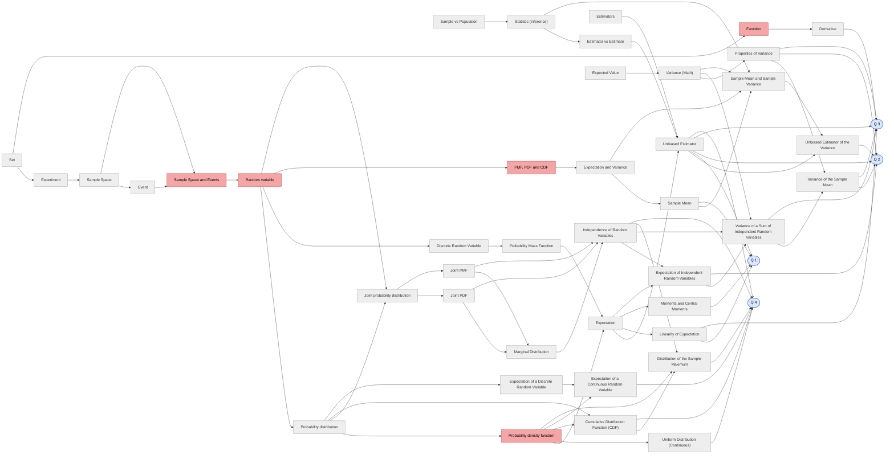

# STAT 132 Discussion 7 (STAT132)

Generated by `sync.py` / `assignments.py`; do not edit. Track status in [../status.csv](../status.csv).

- **Due:** not set
- **Source:** stat132-disc07-w25
- **Readiness now:** 7% (13 of 41 concepts in the chain studied)

## Questions

| Q | asks | concepts (recall now) |
|---|---|---|
| 1 | the k-th sample moment (1/n) sum X_i^k is unbiased for E(X^k) | ⬜ Unbiased Estimator, ⬜ Linearity of Expectation, ⬜ Moments and Central Moments, ⬜ Sample Mean |
| 2 | an unbiased estimator of [E(X)]^2 (hint: E(Xbar^2) = Var(Xbar) + [E(X)]^2) | ⬜ Unbiased Estimator, ⬜ Properties of Variance, ⬜ Variance of the Sample Mean, ⬜ Unbiased Estimator of the Variance, ⬜ Expectation of Independent Random Variables |
| 3 | theta-hat = a Xbar_m + (1 - a) Ybar_n: (a) when unbiased, (b) the a with minimum variance when Var(A) = 4 Var(B) | ⬜ Unbiased Estimator, ⬜ Linearity of Expectation, ⬜ Variance of a Sum of Independent Random Variables, ⬜ Properties of Variance, ⬜ Variance of the Sample Mean, ⬜ Derivative |
| 4 | Y = max(X_1..X_n) from Uniform[0, theta]: show (n+1)/n Y is unbiased | ⬜ Unbiased Estimator, ⬜ Uniform Distribution (Continuous), ⬜ Cumulative Distribution Function (CDF), ⬜ Independence of Random Variables, ⬜ Expectation of a Continuous Random Variable, ⬜ Distribution of the Sample Maximum |

## Study order

Prerequisites first; only what is below 70% recall or never studied. Do these top to bottom, then work the set closed-book.

| # | concept | recall now | layer | taught in |
|---|---|---|---|---|
| 1 | Sample vs Population | ⬜  | 1 | no source |
| 2 | Estimators | ⬜  | 1 | no source |
| 3 | Set | ⬜  | 1 | no source |
| 4 | Expected Value | ⬜  | 1 | no source |
| 5 | Statistic (inference) | ⬜  | 2 | stat132-lec01; stat132-reading01 |
| 6 | Experiment | ⬜  | 2 | stat132-stat131-notes01 p.1 |
| 7 | Variance (Math) | ⬜  | 2 | no source |
| 8 | Function | 🟥 30% | 2 | no source |
| 9 | Estimator vs Estimate | ⬜  | 3 | stat132-textbook-degroot-schervish-4e p.408 |
| 10 | Sample Space | ⬜  | 3 | stat132-stat131-notes01 p.1 |
| 11 | Properties of Variance | ⬜  | 3 | stat132-stat131-notes08 p.3 |
| 12 | Derivative | ⬜  | 3 | no source |
| 13 | Event | ⬜  | 4 | stat132-stat131-notes01 p.1 |
| 14 | Sample Space and Events | 🟥 30% | 5 | stat132-lec01 p.2 |
| 15 | Random variable | 🟥 0% | 6 | no source |
| 16 | Probability distribution | ⬜  | 7 | no source |
| 17 | Discrete Random Variable | ⬜  | 7 | stat132-lec01 p.2 |
| 18 | PMF, PDF and CDF | 🟥 0% | 7 | stat132-lec01; stat132-reading01 |
| 19 | Probability Mass Function | ⬜  | 8 | stat132-lec01 p.2 |
| 20 | Expectation and Variance | ⬜  | 8 | stat132-lec01; stat132-reading01 |
| 21 | Joint probability distribution | ⬜  | 8 | no source |
| 22 | Expectation of a Discrete Random Variable | ⬜  | 8 | stat132-stat131-notes07 p.1 |
| 23 | Probability density function | 🟥 30% | 8 | no source |
| 24 | Expectation | ⬜  | 9 | no source |
| 25 | Sample Mean | ⬜  | 9 | stat132-stat131-notes09 p.6 |
| 26 | Joint PDF | ⬜  | 9 | stat132-stat131-notes05 p.2 |
| 27 | Joint PMF | ⬜  | 9 | stat132-stat131-notes05 p.1 |
| 28 | Uniform Distribution (Continuous) | ⬜  | 9 | stat132-stat131-notes04 p.4 |
| 29 | Cumulative Distribution Function (CDF) | ⬜  | 9 | stat132-stat131-notes04 p.6 |
| 30 | Expectation of a Continuous Random Variable | ⬜  | 9 | stat132-stat131-notes07 p.2 |
| 31 | Unbiased Estimator | ⬜  | 10 | stat132-textbook-degroot-schervish-4e p.521 |
| 32 | Linearity of Expectation | ⬜  | 10 | stat132-stat131-notes07 p.6 |
| 33 | Moments and Central Moments | ⬜  | 10 | stat132-stat131-notes08 p.10 |
| 34 | Marginal Distribution | ⬜  | 10 | stat132-stat131-notes05 p.5 |
| 35 | Sample Mean and Sample Variance | ⬜  | 10 | stat132-lec01 p.6 |
| 36 | Independence of Random Variables | ⬜  | 11 | stat132-stat131-notes05 p.6 |
| 37 | Unbiased Estimator of the Variance | ⬜  | 11 | stat132-textbook-degroot-schervish-4e p.523 |
| 38 | Expectation of Independent Random Variables | ⬜  | 12 | stat132-stat131-notes07 p.6 |
| 39 | Distribution of the Sample Maximum | ⬜  | 12 | ?stat132-disc07-w25 |
| 40 | Variance of a Sum of Independent Random Variables | ⬜  | 13 | stat132-stat131-notes08 p.3 |
| 41 | Variance of the Sample Mean | ⬜  | 14 | stat132-stat131-notes08 p.4 |

## Dependency map

Question -> concept -> prerequisite (arrows point from what you need to what needs it). Colour = recall now; dashed box = concept missing from the graph.

