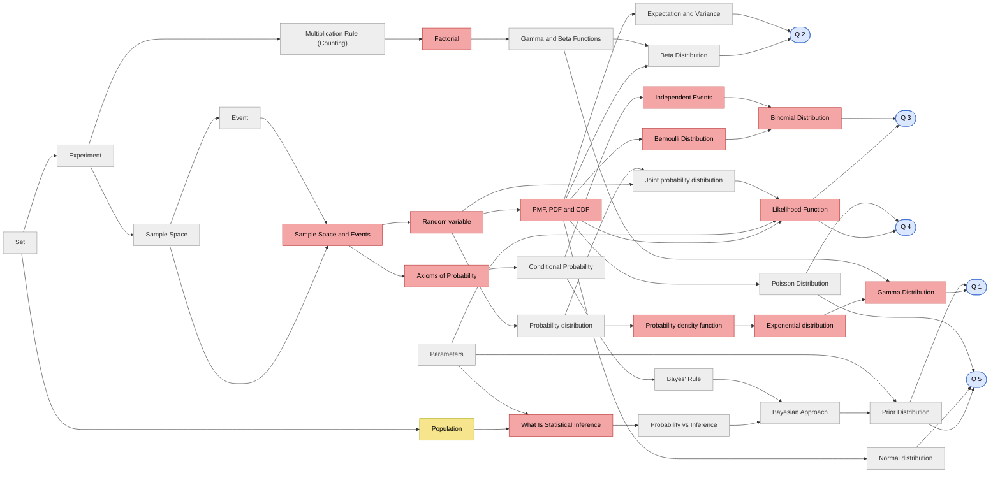

# STAT 132 HW1 (STAT132)

Generated by `sync.py` / `assignments.py`; do not edit. Track status in [../status.csv](../status.csv).

- **Due:** 2026-10-08
- **Source:** [STAT132 HW 01 - priors and likelihoods (due Oct 8).pdf](../../files/homework/STAT132%20HW%2001%20-%20priors%20and%20likelihoods%20(due%20Oct%208).pdf)
- **Readiness now:** 13% (25 of 32 concepts in the chain studied)

## Questions

| Q | asks | concepts (recall now) |
|---|---|---|
| 1 | Gamma prior from a given mean and variance: write the pdf | 🟥 Gamma Distribution, ⬜ Prior Distribution |
| 2 | Beta prior from a given mean and variance: write the pdf | ⬜ Beta Distribution, ⬜ Expectation and Variance |
| 3 | Coin flipped 100 times, 60 heads: likelihood for p, and a sketch | 🟥 Likelihood Function, 🟥 Binomial Distribution |
| 4 | Poisson household sizes, sample of 10: likelihood for lambda | 🟥 Likelihood Function, ⬜ Poisson Distribution |
| 5 | Is a normal prior with mean 1, variance 10 reasonable for lambda? | ⬜ Prior Distribution, ⬜ Normal distribution, ⬜ Poisson Distribution |

## Study order

Prerequisites first; only what is below 70% recall or never studied. Do these top to bottom, then work the set closed-book.

| # | concept | recall now | layer | taught in |
|---|---|---|---|---|
| 1 | Set | ⬜  | 1 | no source |
| 2 | Parameters | ⬜  | 1 | no source |
| 3 | Experiment | ⬜  | 2 | stat132-stat131-notes01 p.1 |
| 4 | Sample Space | ⬜  | 3 | stat132-stat131-notes01 p.1 |
| 5 | Multiplication Rule (Counting) | ⬜  | 3 | stat132-stat131-notes02 p.1 |
| 6 | What Is Statistical Inference | 🟥 30% | 3 | stat132-lec01 p.4 |
| 7 | Event | ⬜  | 4 | stat132-stat131-notes01 p.1 |
| 8 | Factorial | 🟥 0% | 4 | stat132-stat131-notes02 p.2 |
| 9 | Probability vs Inference | ⬜  | 4 | stat132-lec01; stat132-reading01 |
| 10 | Gamma and Beta Functions | ⬜  | 5 | stat132-lec01; stat132-reading01 |
| 11 | Sample Space and Events | 🟥 30% | 5 | stat132-lec01 p.2 |
| 12 | Random variable | 🟥 0% | 6 | no source |
| 13 | Axioms of Probability | 🟥 0% | 6 | stat132-lec01 p.2 |
| 14 | Probability distribution | ⬜  | 7 | no source |
| 15 | Conditional Probability | ⬜  | 7 | no source |
| 16 | PMF, PDF and CDF | 🟥 0% | 7 | stat132-lec01; stat132-reading01 |
| 17 | Bayes' Rule | ⬜  | 8 | stat132-lec01; stat132-reading01; stat132-textbook-degroot-schervish-4e |
| 18 | Beta Distribution | ⬜  | 8 | stat132-reading01 p.13 |
| 19 | Expectation and Variance | ⬜  | 8 | stat132-lec01; stat132-reading01 |
| 20 | Joint probability distribution | ⬜  | 8 | no source |
| 21 | Bernoulli Distribution | 🟥 0% | 8 | stat132-stat131-notes03 p.6 |
| 22 | Poisson Distribution | ⬜  | 8 | stat132-stat131-notes03 p.7 |
| 23 | Normal distribution | ⬜  | 8 | no source |
| 24 | Probability density function | 🟥 30% | 8 | no source |
| 25 | Independent Events | 🟥 30% | 8 | stat132-stat131-notes03 p.1 |
| 26 | Exponential distribution | 🟥 0% | 9 | no source |
| 27 | Bayesian Approach | ⬜  | 9 | stat132-reading02; stat132-textbook-degroot-schervish-4e |
| 28 | Likelihood Function | 🟥 0% | 9 | stat132-reading02; stat132-textbook-degroot-schervish-4e |
| 29 | Binomial Distribution | 🟥 0% | 9 | stat132-stat131-notes03 p.6 |
| 30 | Prior Distribution | ⬜  | 10 | stat132-reading02; stat132-textbook-degroot-schervish-4e |
| 31 | Gamma Distribution | 🟥 30% | 10 | stat132-reading01 p.13 |

## Dependency map

Question -> concept -> prerequisite (arrows point from what you need to what needs it). Colour = recall now; dashed box = concept missing from the graph.

