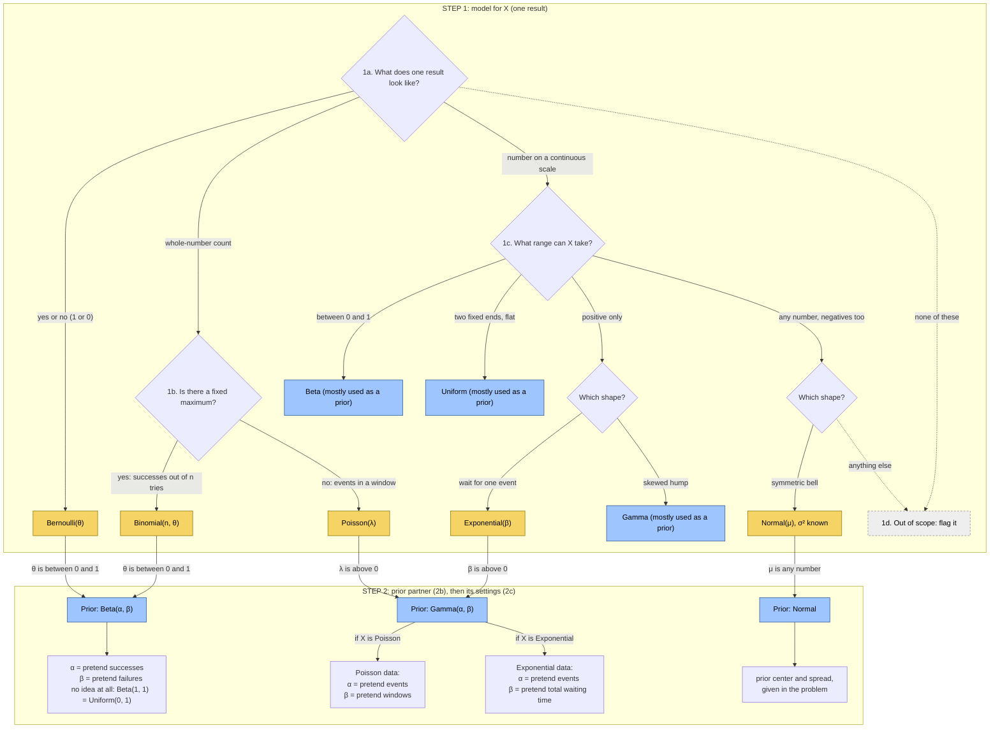

# Flowchart: steps 1 and 2 (model for X, then the prior partner)

Step 1 asks questions of one result X and ends at a data model. Step 2 follows the arrow out of that model to its prior partner, then sets the partner's settings from the pretend data. Gold boxes are data models, blue boxes are priors.

**Override (2a):** if the problem gives the prior (a list of candidates with weights, or a named curve), use it and ignore the partner arrows. A list means step 6 adds.

Sources: decision tree and allowed parameter values in [[STAT 132 Distribution Sheets]]; prior pairs in [[STAT 132 Kernels]] Table 3.
