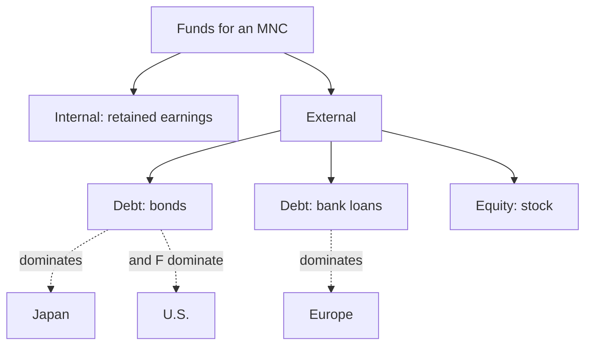
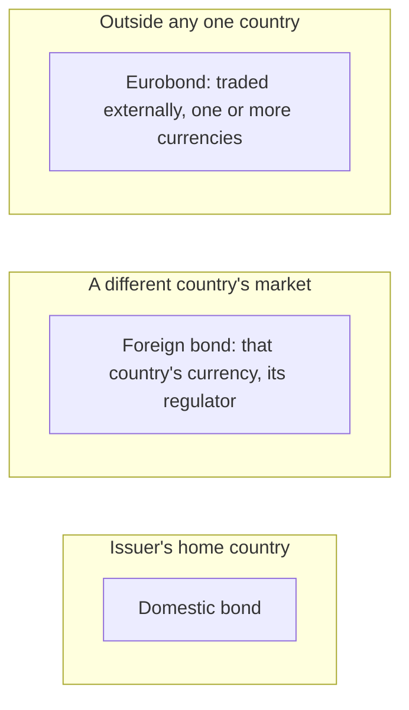
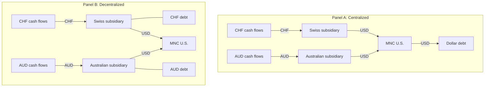

Source: `~/Documents/ECON131/Lectures/ECON131 Lecture 08 - Debt financing.pdf` (vault copy `econ131-lec08`) (Chenyue Hu, "Debt Financing"), 2 pages. Each topic below has: handout text, definition, formula, use case, what generalizes, and the fill-out of the handout example. Builds directly on [[ECON 131 Lecture 7 - Bonds and the term structure]] (PV, ytm, spot rates).

## Map

A multinational (MNC) needs money. Four decisions, in order:
1. **Where from?** Inside the firm or outside it (topic 1).
2. **What does it really cost?** Yield after fees (topic 2, AIC).
3. **Which market?** Home market or abroad (topic 3).
4. **Which currency, and where does the debt sit?** (topic 4).

Decisions 1 and 3 are classification. Decisions 2 and 4 are calculations, and both are the L7 idea again: find the rate that makes two streams of money equal.

## 1. Sources of funds for MNCs

> Internal funds — retained earnings
> External funds — debt/equity/loans
>
> Financing mix around the world:
> Equity and bond markets dominate in the U.S.
> Bond market dominates in Japan
> Loans dominate in Europe

**Definitions**
- **Internal funds:** profit the firm kept instead of paying out (retained earnings). No issuance, no lender.
- **External funds:** money raised from outside, three kinds: **debt** (borrowed, must repay with interest), **equity** (sold ownership), **loans** (borrowed from a bank, as opposed to a tradable bond).

**Formula:** none. It is a classification.

**Use case:** the first question when a firm needs cash is whether retained earnings cover it. If not, the choice among bonds, loans and stock depends partly on which market is deep in the country you are in.

**Depiction**

**Generalizes to:** "which market is deep" is a statement about financial-system structure. Market-based systems (U.S.: equity and bonds) versus bank-based systems (Europe: loans), with Japan leaning on bonds. The same firm can face a different menu of financing in each country.

My correction:

## 2. AIC (all-in-cost)

> AIC (all-in-cost): The discount rate that equates the present value of all the future interest rate and principal payments to the net proceeds received by the issuer.

**Definition.** The true annual cost of the borrowing to the issuer, after fees. It is the yield to maturity (L7), but seen from the borrower's side and using what the issuer actually receives, **net proceeds** = price minus fees.

**Formula.** With face value $F$, coupon $c$ per year, $n$ years, net proceeds $P_{net}$:

$$P_{net} = \sum_{t=1}^{n}\frac{c}{(1+AIC)^t}+\frac{F}{(1+AIC)^n}, \qquad P_{net} = \text{price} - \text{fees}$$

Compare L7: ytm uses the market price on the left. AIC uses the price minus fees. Fees shrink what the issuer receives while the payments stay the same, so **AIC > ytm**.

**Use case.** Compare two financing offers on one number. A bond with a low coupon but heavy fees can cost more than a bond with a higher coupon and light fees. AIC puts them on the same scale.

**Handout example.** Intel raises \$2 billion with a five-year bond. Price \$995.18 per \$1,000 face. Coupon 5.125%. Fees 0.275%. Find the AIC.

- Coupon: $c = 0.05125\times 1000 = 51.25$ per year.
- Fees: $0.00275\times 1000 = 2.75$ per bond.
- Net proceeds: $995.18 - 2.75 = 992.43$.
- Solve

$$992.43=\sum_{t=1}^{5}\frac{51.25}{(1+AIC)^t}+\frac{1000}{(1+AIC)^5}$$

- Result: $\mathbf{AIC \approx 5.30\%}$ (annual compounding).

Check with the pieces. Ignoring fees, the same equation with \$995.18 gives $5.24\%$. The fee adds about $0.06$ percentage points. The \$2 billion raised means about $2{,}000{,}000{,}000/1000\approx 2$ million bonds; fees total about \$5.5 million on the face value (assumption: fee is charged on face value).

If the bond paid coupons semi-annually (U.S. convention), the six-month rate would be $2.65\%$, an annualized $5.30\%$ stated, or $5.37\%$ effective. The handout does not say, so the annual-coupon answer is the one to use unless the instructor says otherwise.

**Generalizes to.** Any financing with upfront costs: loans with origination fees, leases, credit lines. The method is always "solve for the rate that makes cash received equal PV of cash paid", which is an IRR. It also extends to the cost of foreign-currency debt once exchange-rate changes are included (topic 4).

My correction:

## 3. The international character of debt

> Domestic bonds are issued and traded within an internal debt market.
> International bonds are traded outside the country of the issuer. There are two types of international bonds: 1) Foreign bonds are issued in a domestic market by a foreign borrower, denominated in the domestic currency, marketed to domestic residents, and regulated by the domestic authorities. 2) Eurobond is denominated in one or more currencies but is traded in external markets outside the borders of the countries issuing the currencies.

**Definitions**

| Type | Who issues | Where it trades | Currency | Regulator |
|---|---|---|---|---|
| Domestic bond | Local borrower | Local market | Local | Local |
| Foreign bond | Foreign borrower | The domestic market it is sold in | That market's currency | That market's authorities |
| Eurobond | Anyone | Outside the borders of the countries whose currencies it uses | One or more currencies | Largely outside any one country's rules |

The "Euro" in Eurobond does not mean the euro currency. It means traded outside the home market of the currency.

**Formula:** none.

**Use case.** A firm picks where to borrow based on market depth, cost, and rules. Foreign bonds let a foreign firm tap a deep local market, such as a Japanese company selling dollar bonds in the U.S. A Eurobond avoids one country's regulator and can be sold to investors in many places.

**Depiction**

**Generalizes to:** the three-way split is by (issuer nationality, market location, currency). Changing any one of the three gives a different instrument. Examples that do not appear in the handout, so check them with the lecture: a dollar bond sold in London by a Brazilian firm would be a Eurobond.

My correction:

## 4. Currency of denomination

> Ex. A company wishes to raise \$5,000,000 with debt financing. The funds will be repaid with interest in 1 year. The company is considering either borrowing USD at 1.50% or borrowing EUR at 3.00%. The current spot rate is USD .95/EUR. What is the projected USD/EUR rate for which the expected interest costs would be the same for the two loans?

**Definition.** The **currency of denomination** is the currency the debt is written in. If you borrow in a currency different from the one you earn, your cost depends on the exchange rate on repayment day. A low foreign interest rate is only a good deal if the foreign currency does not rise enough to eat the savings.

**Formula.** Spot $S_0$ and future spot $S_1$ in USD per EUR. Borrow \$$A$.

- USD loan: repay $A(1+i_{USD})$ dollars.
- EUR loan: borrow $A/S_0$ euros, repay $\dfrac{A}{S_0}(1+i_{EUR})$ euros, which costs $\dfrac{A}{S_0}(1+i_{EUR})\,S_1$ dollars.

Indifferent when total repayments are equal:

$$1+i_{USD}=(1+i_{EUR})\frac{S_1}{S_0}\quad\Longrightarrow\quad S_1^{*}=S_0\,\frac{1+i_{USD}}{1+i_{EUR}}$$

This is the same shape as interest rate parity (L3): the expected depreciation of the higher-rate-differential currency offsets the interest gap. Here it is used as a break-even for a borrower.

**Handout example, worked.** $S_0=0.95$ USD/EUR, $i_{USD}=1.5\%$, $i_{EUR}=3\%$, borrowing \$5,000,000.

- USD loan: interest $=0.015\times 5{,}000{,}000=\$75{,}000$.
- EUR loan: borrow $5{,}000{,}000/0.95 = €5{,}263{,}158$. Interest $=0.03\times 5{,}263{,}158 = €157{,}895$.

Two readings of "expected interest costs would be the same":

1. **Total repayment (principal plus interest), the economically meaningful one:**

$$S_1^{*}=0.95\times\frac{1.015}{1.03}=\mathbf{0.936\ USD/EUR}$$

   If the euro is expected to be worth less than $0.936$ at repayment, the EUR loan is cheaper. The euro would only need to fall about $1.5\%$ ($0.95\to0.936$) to cancel the $1.5$ point interest gap. If it ends above $0.936$, borrow dollars.

2. **Interest payments only, taken literally:** the euro interest, $€157{,}895$, must equal \$75,000 when converted:

$$S_1=\frac{75{,}000}{157{,}895}=0.475\ \text{USD/EUR}$$

   That is a $50\%$ fall in the euro, which is why this reading looks odd. It leaves out the principal, which is also exposed to the exchange rate. I would give the first answer on an exam and mention the second, but ask which one Hu wants since the handout wording says "interest costs".

**Use case.** Choosing between a cheap-interest foreign loan and a dollar loan. Compare the break-even $S_1^*$ to your forecast of $S_1$.

**Generalizes to.** Any pair of currencies and any maturity: $S_n^{*}=S_0\left(\dfrac{1+i_{home}}{1+i_{foreign}}\right)^{n}$. If your forecast equals the forward rate or the UIP rate, the two loans cost the same in expectation, and the difference is only risk. If the borrower has income in the foreign currency, the foreign loan is also a **natural hedge**, which leads to the next topic.

My correction:

### 4b. Centralized versus decentralized debt (the MNC structure)

> Centralized debt denomination: debts for both the parent company and its foreign subsidiaries are denominated in home currencies.
> Decentralized debt denomination: the parent company borrows in the countries and currencies where the subsidiaries operate or to which it exports.

**Definitions**
- **Centralized:** all debt is in the parent's home currency (here USD). Subsidiaries earn CHF and AUD but the debt is in USD.
- **Decentralized:** each subsidiary's debt is in the currency it earns (CHF debt for the Swiss subsidiary, AUD debt for the Australian one).

**Formula:** none, but the logic is a match: **currency of debt payments vs currency of cash inflows**. A mismatch means exchange-rate risk on the debt service.

**Depiction (the handout's page-2 graph).**

In Panel A, the dollar debt is paid with money that started as CHF and AUD, so the firm bears the CHF/USD and AUD/USD risk when converting. In Panel B, each subsidiary pays its own debt out of its own currency, so only the leftover profit crosses into USD.

**Use case.** A U.S. firm with a Swiss factory selling in CHF. If the CHF falls, CHF revenue buys fewer dollars, and dollar debt gets harder to pay (Panel A). With CHF debt, the revenue and the debt fall together (Panel B). This is the same lesson as the 1997 Asian crisis in [[Econ 131 Lecture 7]]: dollar debt against local-currency income, a currency mismatch.

**Generalizes to.** Hedging by matching, without derivatives. The cost is that decentralized debt means several loans, in several markets, with possibly higher interest rates (see topic 4 break-even).

My correction:

## Cheat table

| Topic | One line | Key formula |
|---|---|---|
| Sources of funds | Internal retained earnings vs external debt, equity, loans; U.S. markets, Japan bonds, Europe loans | none |
| AIC | Cost of debt after fees, an IRR | $P-\text{fees}=\sum \frac{c}{(1+AIC)^t}+\frac{F}{(1+AIC)^n}$ |
| Domestic / foreign / Eurobond | Where, who, which currency | none |
| Currency of denomination | Foreign loan is cheaper only if the currency does not appreciate past the break-even | $S_1^*=S_0\frac{1+i_{USD}}{1+i_{EUR}}$ |
| Centralized vs decentralized | Match debt currency to cash-flow currency | none |

## Answers at a glance

- Intel AIC: about **5.30%** (5.24% without fees).
- Currency break-even: **0.936 USD/EUR** on total repayment, or **0.475** if only the interest is compared.

## Connections

- [[ECON 131 Lecture 7 - Bonds and the term structure]]: PV, ytm, the idea behind AIC.
- [[ECON 131 Lecture 3 - Interest Rate Parity (fill-in)]]: the break-even exchange rate in topic 4 is the same equation.
- [[Econ 131 Lecture 7]]: currency mismatch in the 1997 Asian crisis.
