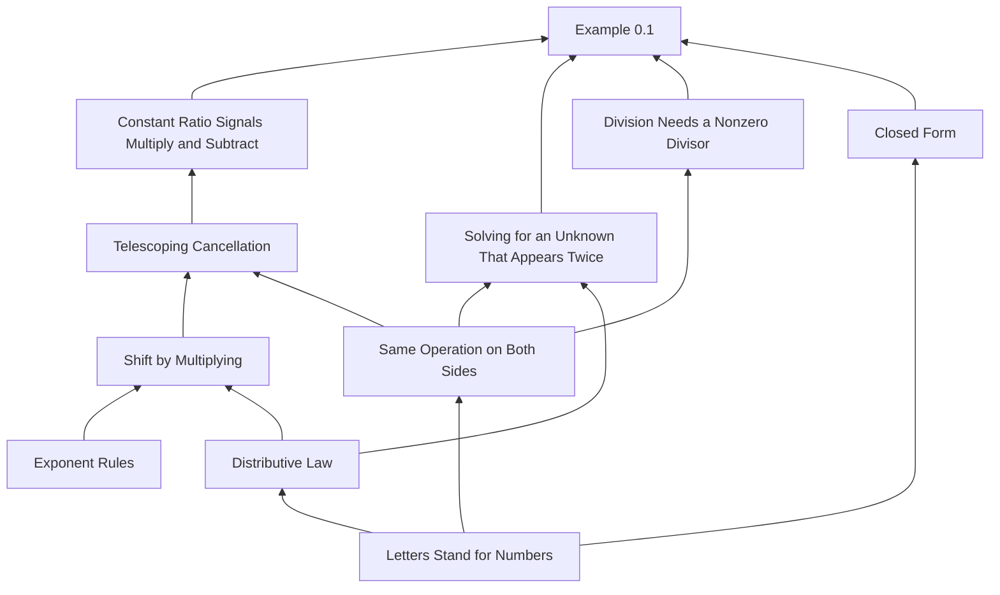

# Notes 00 Example 0.1 Finite Geometric Sum

Evaluate $S=1+x+\cdots+x^n$: result $\frac{1-x^{n+1}}{1-x}$ for $x \ne 1$ and $n+1$ for $x=1$.

Cards: [[STATS 131 Cards - Notes_00 Algebra Moves#Notes 00 Example 0.1 Finite Geometric Sum]]

## Dependency chart (read bottom to top: each box needs the ones pointing into it)

## What to notice, in order
1. **"Evaluate" + letters** means: find a [[closed form]]. The answer is a formula in x and n.
2. **Look at consecutive terms.** 1, x, x², x³: each is the previous one times x. That's a [[Constant Ratio Signals Multiply and Subtract|constant ratio]]. That observation is the whole trigger; nothing else suggests the trick.
3. **Multiply the sum by the ratio.** [[Shift by Multiplying]]: xS is the same list slid one step.
4. **Subtract.** [[Telescoping Cancellation]]: everything overlapping cancels, only the ends remain: S − xS = 1 − xⁿ⁺¹.
5. **Solve for S.** [[Solving for an Unknown That Appears Twice]]: factor S(1 − x), divide.
6. **Check the divisor.** [[Division Needs a Nonzero Divisor]]: x = 1 is its own case (S = n + 1).

Why it isn't magic: S is just a number ([[Letters Stand for Numbers]]). The only "idea" is step 2; steps 3 to 6 are ordinary algebra you already know, applied because step 2 told you to.
