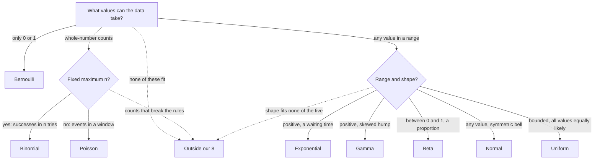

h nhg# STAT 132 Distribution Sheets

One sheet per distribution, in the order to learn them. Each sheet: **the story** (what it models), **the formula piece by piece**, **one plug-in example with real numbers**, **mean and variance and why**, and **how it shows up in a likelihood**. Flip here whenever a card stops making sense, then go back to the card. Also useful open-note for Quiz 1.

Conventions follow the course (DeGroot): Exponential and Gamma use the **rate** $\beta$. Lecture 1's table writes the Exponential rate as $\lambda$; it's the same thing.

> [!tip] Shaky on what $X$, $P$ and $f$ each take in and give back, or how counts become probabilities? Start with [[From Outcomes to Data to Probabilities]].

## 0. What a pmf and a pdf are (read this first)
A **pmf** (probability mass function) is a **list of the possible values and the probability of each**. "Mass" just means a chunk of probability sitting on each value.

Fair die: $f(1) = f(2) = \dots = f(6) = \frac{1}{6}$. $f(x)$ means "$P(X = x)$". The chunks add to 1.

A pmf **formula** is a shortcut for writing that list. Bernoulli's $p^x(1-p)^{1-x}$ is the two-value list $f(0) = 1-p$, $f(1) = p$. Poisson's $\frac{e^{-\lambda}\lambda^k}{k!}$ is a recipe: feed it a count $k$ and it returns $P(X = k)$.

A **pdf** (probability density function) is for continuous values (a waiting time, a height). There, $f(x)$ is **not** a probability; the **area** under the curve over a range is. Discrete (countable values): pmf. Continuous: pdf.

In the table in [[Path to Distributions]], the column "P(X=k) or density f(x)" is the pmf for Bernoulli, Binomial and Poisson, and the pdf for the rest.

> [!tip] Two ideas that make every sheet easier
> - **pmf vs pdf.** Discrete (you can count the values: 0, 1, 2, ...): the **pmf** $f(x)$ *is* the probability $P(X = x)$. Continuous (any value in a range): the **pdf** $f(x)$ is a *density*; probability is the **area** under it, $P(a < X < b) = \int_a^b f(x)\,dx$.
> - **The constant out front just makes the total equal 1.** Every formula = (shape part that has $x$ in it) × (a constant). When you recognize a distribution, you only need the shape part (the **kernel**).

| | Discrete | Continuous |
|---|---|---|
| Probability of a value | $f(x) = P(X=x)$ | $P(X = x) = 0$; use area |
| Mean | $\sum x f(x)$ | $\int x f(x)\,dx$ |
| Variance | $E[X^2] - (E[X])^2$ | same |

---

## Fingerprints: the fixed facts of each distribution
Each row is what never changes about that distribution. Check a problem against these columns: what values can $X$ take, and what does $X$ count or measure?

| Distribution            | Discrete or continuous | Values $X$ can take         | What $X$ is                                                                | Parameters: meaning (allowed values)                                     | Mean                          | Variance                                               |
| ----------------------- | ---------------------- | --------------------------- | -------------------------------------------------------------------------- | ------------------------------------------------------------------------ | ----------------------------- | ------------------------------------------------------ |
| Bernoulli$(p)$          | discrete               | 0 or 1                      | one yes/no trial (1 = yes)                                                 | $p$: chance of yes ($0 \le p \le 1$)                                     | $p$                           | $p(1-p)$                                               |
| Binomial$(n, p)$        | discrete               | $0, 1, \dots, n$            | number of yeses in $n$ independent trials, same $p$ each                   | $n$: number of trials (whole number); $p$: chance of yes                 | $np$                          | $np(1-p)$                                              |
| Poisson$(\lambda)$      | discrete               | $0, 1, 2, \dots$ (no top)   | number of events in a fixed window                                         | $\lambda$: average count per window ($\lambda > 0$)                      | $\lambda$                     | $\lambda$                                              |
| Exponential$(\beta)$    | continuous             | any $x > 0$                 | wait until the next event                                                  | $\beta$: rate, events per unit ($\beta > 0$)                             | $\frac{1}{\beta}$             | $\frac{1}{\beta^2}$                                    |
| Gamma$(\alpha, \beta)$  | continuous             | any $x > 0$                 | a positive amount: wait until the $\alpha$-th event, or a prior for a rate | $\alpha$: shape ($> 0$); $\beta$: rate ($> 0$)                           | $\frac{\alpha}{\beta}$        | $\frac{\alpha}{\beta^2}$                               |
| Beta$(\alpha, \beta)$   | continuous             | any $x$ between 0 and 1     | a proportion or probability, e.g. a prior for $p$                          | $\alpha$, $\beta$: shapes ($> 0$), roughly "prior yeses" and "prior nos" | $\frac{\alpha}{\alpha+\beta}$ | $\frac{\alpha\beta}{(\alpha+\beta)^2(\alpha+\beta+1)}$ |
| Normal$(\mu, \sigma^2)$ | continuous             | any real number             | a measurement that clusters around a center; sums and averages             | $\mu$: center (any number); $\sigma^2$: spread ($> 0$)                   | $\mu$                         | $\sigma^2$                                             |
| Uniform$(a, b)$         | continuous             | any $x$ between $a$ and $b$ | a value with no preference inside a range                                  | $a < b$: the ends                                                        | $\frac{a+b}{2}$               | $\frac{(b-a)^2}{12}$                                   |

**Letters are reused; names are not.** The same Greek letter means different things in different distributions. Read the letter by the distribution it sits in.
- $\beta$ in Exponential and Gamma is a **rate** (events per hour).
- $\beta$ in Beta$(\alpha, \beta)$ is a **shape** (roughly "prior nos"). It has nothing to do with time.
- The **Beta distribution** is named after the Beta *function* used in its formula, not after the letter $\beta$. It is continuous and lives between 0 and 1.

**"Time" is one example of a continuous axis, not the only one.** The Exponential fits any wait along a continuous axis where events happen independently at a steady rate: time until the next bus, miles until the next pothole, meters of cable until the next defect. It does not fit just any variable: it needs that "steady, independent events, wait for the first" story.

**Family links** (one distribution as a special case of another):
- Bernoulli is Binomial with $n = 1$.
- Exponential is Gamma with $\alpha = 1$.
- Uniform$(0, 1)$ is Beta$(1, 1)$.
- Poisson and Exponential describe the same stream of events: Poisson counts events in a window, Exponential measures the gap between them.

## 1. Bernoulli$(p)$: one yes/no trial
**Story:** one attempt that succeeds (1) with probability $p$ or fails (0). One coin flip, one defective-or-not item.
**Values:** $x \in \{0, 1\}$. **Parameter:** $0 \le p \le 1$.

**Formula:** $f(x) = p^x (1-p)^{1-x}$
- The exponents are a **switch**. Plug in $x = 1$: $p^1(1-p)^0 = p$. Plug in $x = 0$: $p^0(1-p)^1 = 1 - p$. That's all it says: P(success) = $p$, P(failure) = $1-p$, written as one line.

**Example:** $p = 0.3$. $P(X=1) = 0.3$, $P(X=0) = 0.7$.

**Mean** $= p$. Why: $0 \cdot (1-p) + 1 \cdot p = p$.
**Variance** $= p(1-p)$. Why: $X^2 = X$ (since $0^2 = 0$, $1^2 = 1$), so $E[X^2] = p$, and $p - p^2 = p(1-p)$. Example: $0.3 \times 0.7 = 0.21$.

**Likelihood** for data $x_1, \dots, x_n$: multiply one switch per observation. Each 1 contributes a $p$, each 0 a $(1-p)$:
$L(p) = p^{\sum x_i}(1-p)^{n - \sum x_i}$. Data 1, 0, 1, 1 gives $p^3(1-p)^1$. **8 heads in 10 gives $p^8(1-p)^2$.**

---

## 2. Binomial$(n, p)$: number of successes in $n$ tries
**Story:** repeat the Bernoulli trial $n$ times independently and **count** the successes. Heads in 10 flips.
**Values:** $x = 0, 1, \dots, n$. **Parameters:** $n$ (a whole number), $0 \le p \le 1$.

**Formula:** $f(x) = \binom{n}{x} p^x (1-p)^{n-x}$
- $p^x$: the $x$ successes. $(1-p)^{n-x}$: the $n - x$ failures. $\binom{n}{x}$: **how many orders** those successes could come in.

**Example:** $n = 3$, $p = 0.5$, $P(X = 2)$. Orders: HHT, HTH, THH, so $\binom{3}{2} = 3$. Each order has probability $0.5^2 \times 0.5^1 = 0.125$. Total $3 \times 0.125 = 0.375$.

**Mean** $= np$ (it's $n$ Bernoullis, each with mean $p$). **Variance** $= np(1-p)$ (independent, so variances add).
**Relations:** Bernoulli is Binomial with $n = 1$. As a likelihood, one Binomial observation of 8 in 10 is $\binom{10}{8}p^8(1-p)^2$, the same shape in $p$ as 10 Bernoullis.

---

## 3. Poisson$(\lambda)$: counts in a fixed window
**Story:** how many times something happens in a fixed stretch of time or space, when it happens at an average rate $\lambda$. Customers per hour, emails per day, people per household.
**Values:** $x = 0, 1, 2, \dots$ (no upper limit). **Parameter:** $\lambda > 0$, the average count.

**Formula:** $f(x) = \dfrac{e^{-\lambda}\lambda^x}{x!}$
- $e^{-\lambda}$ is $P(X = 0)$, and it's the constant that makes everything add to 1.
- $\dfrac{\lambda^x}{x!}$ rises and then falls: the counts near $\lambda$ are the likely ones.

**Example:** $\lambda = 2$. $e^{-2} \approx 0.135$.
$P(0) = 0.135$, $P(1) = 2 \times 0.135 = 0.271$, $P(2) = \frac{4}{2} \times 0.135 = 0.271$, $P(3) = \frac{8}{6} \times 0.135 = 0.180$.

**Mean** $= \lambda$. **Variance** $= \lambda$ (the same: a Poisson signature).
**Likelihood** for $x_1, \dots, x_n$: multiply $n$ copies.
- $e^{-\lambda}$ times itself $n$ times $= e^{-n\lambda}$ (exponents add).
- $\lambda^{x_1}\lambda^{x_2}\cdots = \lambda^{\sum x_i}$ (exponents add).
- The $x_i!$ just multiply: $\prod x_i!$.

$L(\lambda) = \dfrac{e^{-n\lambda}\lambda^{\sum x_i}}{\prod x_i!}$, for $\lambda > 0$.
**Relation:** a Binomial with huge $n$ and tiny $p$ (with $np = \lambda$) is about Poisson$(\lambda)$.

---

## 4. Exponential$(\beta)$: waiting time
**Story:** how long until the next event, when events arrive at rate $\beta$ per unit time. The wait for the next bus, the lifetime of a lamp.
**Values:** $x > 0$. **Parameter:** rate $\beta > 0$.

**Formula:** $f(x) = \beta e^{-\beta x}$
- Highest at $x = 0$ and decays: short waits are most common. The $\beta$ in front makes the area 1.

**Example:** buses come at $\beta = 4$ per hour. Average wait $= 1/4$ hour $= 15$ min. Probability of waiting more than 1 hour: $P(X > t) = e^{-\beta t} = e^{-4} \approx 0.018$.

**Mean** $= 1/\beta$ (higher rate, shorter wait). **Variance** $= 1/\beta^2$.
**Likelihood** for waits $x_1, \dots, x_n$: $L(\beta) = \beta^n e^{-\beta \sum x_i}$. Discussion 1's study times 2, 2.5 and 3 hours give $\beta^3 e^{-7.5\beta}$.
**Relations:** Exponential$(\beta)$ = Gamma$(1, \beta)$. Memoryless: having waited 10 minutes doesn't change the wait still to come.

---

## 5. Gamma$(\alpha, \beta)$: a positive quantity, often a rate
**Story (two uses):** (a) the total wait for $\alpha$ events at rate $\beta$; (b) **in this course, mostly a prior for a positive parameter**, such as a Poisson $\lambda$ or an exponential rate.
**Values:** $x > 0$. **Parameters:** shape $\alpha > 0$, rate $\beta > 0$.

**Formula:** $f(x) = \dfrac{\beta^\alpha}{\Gamma(\alpha)} x^{\alpha-1} e^{-\beta x}$
- **Kernel (the shape):** $x^{\alpha-1}e^{-\beta x}$. The power pushes up, the exponential pulls down.
- **Constant:** $\dfrac{\beta^\alpha}{\Gamma(\alpha)}$. $\Gamma$ is a factorial shifted by one: $\Gamma(n) = (n-1)!$, so $\Gamma(1) = 1$, $\Gamma(2) = 1$, $\Gamma(3) = 2$, $\Gamma(4) = 6$.

**Mean** $= \alpha/\beta$. **Variance** $= \alpha/\beta^2$.
**Solving for $\alpha$ and $\beta$ from a mean $m$ and variance $v$** (the homework move): divide the mean by the variance to get $\beta = m/v$, then $\alpha = m\beta$.
**Worked (the lamp example from class):** mean 0.0002, SD 0.0001, so variance $= 0.0001^2 = 10^{-8}$. Then $\beta = 0.0002 / 10^{-8} = 20{,}000$ and $\alpha = 0.0002 \times 20{,}000 = 4$. The prior is $\pi(\theta) = \frac{20000^4}{3!}\theta^3 e^{-20000\theta}$.
**Relations:** Gamma$(1, \beta)$ = Exponential$(\beta)$. Chi-square with $m$ degrees of freedom = Gamma$(m/2, 1/2)$ (Midterm 2).

---

## 6. Beta$(\alpha, \beta)$: an unknown proportion
**Story:** a random number between 0 and 1. **In this course, the prior for a probability $p$** (coin bias, defect rate).
**Values:** $0 < x < 1$. **Parameters:** $\alpha > 0$, $\beta > 0$.

**Formula:** $f(x) = \dfrac{x^{\alpha-1}(1-x)^{\beta-1}}{B(\alpha, \beta)}$, where $B(\alpha, \beta) = \dfrac{\Gamma(\alpha)\Gamma(\beta)}{\Gamma(\alpha+\beta)}$.
- **Kernel:** $x^{\alpha-1}(1-x)^{\beta-1}$. Read it like pretend data: about $\alpha - 1$ successes and $\beta - 1$ failures.
- **Constant:** $1/B(\alpha, \beta)$. It makes the area 1.
- $\alpha > \beta$ leans toward 1; $\alpha < \beta$ leans toward 0; $\alpha = \beta$ is symmetric around 0.5.

**Mean** $= \dfrac{\alpha}{\alpha+\beta}$. **Variance** $= \dfrac{\alpha\beta}{(\alpha+\beta)^2(\alpha+\beta+1)}$, which is easier as $\dfrac{m(1-m)}{s+1}$ with $m$ the mean and $s = \alpha + \beta$.
**Solving from a mean $m$ and variance $v$:** find $s$ from $v = \frac{m(1-m)}{s+1}$, then $\alpha = ms$ and $\beta = (1-m)s$.
**Worked:** Beta(3, 6): mean $= 3/9 = 1/3$, $s = 9$, variance $= \frac{(1/3)(2/3)}{10} = \frac{1}{45}$.
**Recognizing a kernel:** $p^8(1-p)^2$ is Beta(9, 3): add 1 to each exponent.
**Relation:** Beta(1, 1) = Uniform(0, 1), the "I know nothing" prior for $p$.

---

## 7. Normal$(\mu, \sigma^2)$: the bell curve
**Story:** measurements that cluster around a center; also **averages and sums of many things** (the Central Limit Theorem). IQ, test scores, measurement error.
**Values:** all real numbers. **Parameters:** mean $\mu$ (any real), variance $\sigma^2 > 0$.

**Formula:** $f(x) = \dfrac{1}{\sqrt{2\pi\sigma^2}}\, e^{-\frac{(x-\mu)^2}{2\sigma^2}}$
- $(x - \mu)^2$: squared distance from the center.
- Divided by $2\sigma^2$: a bigger spread makes distance matter less.
- $e^{-(\cdot)}$: the farther from the center, the smaller the density.
- $\frac{1}{\sqrt{2\pi\sigma^2}}$: the constant that makes the area 1.

**Mean** $= \mu$. **Variance** $= \sigma^2$ (the SD is $\sigma$). Watch for a given SD: square it.
**Standardize:** $Z = (X - \mu)/\sigma$ is Normal(0, 1). About 68% / 95% / 99.7% of values fall within 1 / 2 / 3 SDs.
**Likelihood** (class example: $\sigma = 10$, scores 45, 55, 50): the constants multiply and the exponents add, giving
$L(\mu) = (2\pi \cdot 100)^{-3/2}\exp\left(-\frac{(45-\mu)^2 + (55-\mu)^2 + (50-\mu)^2}{200}\right)$.

---

## 8. Uniform$(a, b)$: every value equally likely
**Story:** any value in $[a, b]$ is as likely as any other.
**Formula:** $f(x) = \dfrac{1}{b-a}$ on $[a, b]$ (flat; the height makes the area 1).
**Example:** Uniform(0, 10): height 0.1, mean 5, variance $100/12 \approx 8.33$.
**Mean** $= \frac{a+b}{2}$. **Variance** $= \frac{(b-a)^2}{12}$.
**Use as a prior:** Uniform(0, 1) = Beta(1, 1) when you know nothing about $p$. It puts zero prior on anything outside $[a, b]$, which is why Uniform[0, 10] is risky for a rate that could exceed 10.

---

## Decision tree (the 8 we use, plus one branch for everything else)
A teaching heuristic, not an official procedure: in practice the model comes from how the data was produced, checked against the data. The dashed branch collects distributions this course doesn't cover.

**What sends data to "Outside our 8":** it fails one of the assumptions the 8 are built on. Examples, not to memorize:
- **A different counting process:** tries until the first success (Geometric); counts more spread out than Poisson allows, variance far above the mean (Negative Binomial).
- **More than two categories per trial:** a die face, a survey choice (Categorical / Multinomial).
- **Heavier tails than the Normal:** extreme values far too often (Cauchy; the t distribution, which arrives in Midterm 2).
- **Positive and very skewed, like income or lifetimes:** Lognormal, Weibull.
- **Several humps:** the data mixes groups (mixture models).
- **Bounded but not flat and not a proportion:** e.g. Triangular.

## Which one? (quick picker)
- One yes/no: **Bernoulli**. Count of yeses in $n$ tries: **Binomial**.
- Count in a time window, no upper limit: **Poisson**.
- Waiting time for one event: **Exponential**. A positive rate you're unsure about (a prior): **Gamma**.
- An unknown proportion between 0 and 1 (a prior for $p$): **Beta**.
- Averages, measurements, a bell shape: **Normal**. No idea at all, bounded: **Uniform**.
- Pairs that go together as prior and data (Lecture 3): Beta prior with Bernoulli/Binomial data; Gamma prior with Poisson data; Normal prior with Normal data.
