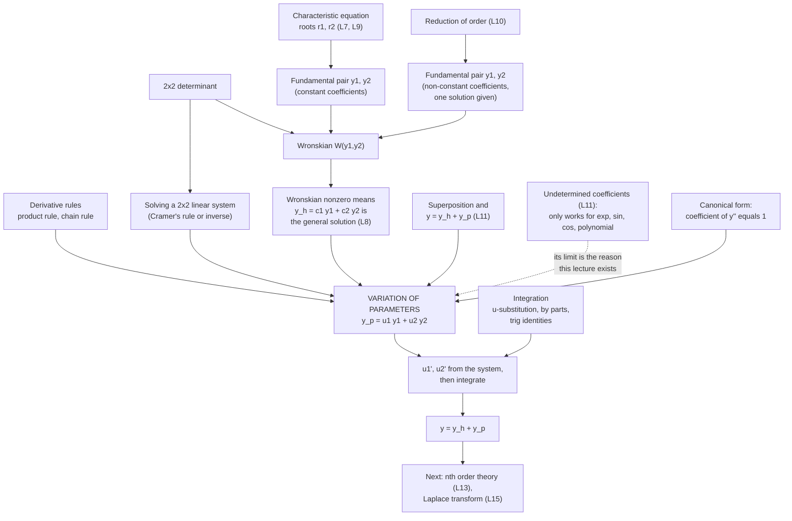

# Lecture 12: Variation of Parameters

Source: `~/Documents/AM20/Lectures/AM20 Lecture 12 - Variation of parameters.pdf` (5 pages). Practice set: `AM20 Lecture 12 - practice problems.pdf`.
Print this or copy it by hand. Every box marked **Your turn** is meant to be filled in on paper while the lecture runs.

> [!abstract] The whole lecture in three lines
> **Given:** a second-order linear equation $y'' + p\,y' + q\,y = g(t)$ whose forcing $g$ is too ugly for guessing ($\tan t$, $\ln t$, $1/t$, $\sec t$).
> **What changes:** the two constants in $y_h = c_1 y_1 + c_2 y_2$ become two unknown functions $u_1(t), u_2(t)$, and a 2 by 2 linear system hands you $u_1', u_2'$.
> **Next:** integrate $u_1', u_2'$, assemble $y_p = u_1 y_1 + u_2 y_2$, add $y_h$.

---

## 1. Dependency graph

Read it top to bottom: an arrow means "you need the thing at the tail before the thing at the head makes sense." Anything you cannot do cold is a gap to fix before it blocks you mid-lecture.

### What each arrow costs you, in plain words

| You need | Why this lecture uses it | Cold check (do it on paper, 30 seconds) |
|---|---|---|
| [[Product Rule (Calculus)]] | Step 3 differentiates $u_1 y_1 + u_2 y_2$, a product of two unknown things, twice | Differentiate $u(t)\,y(t)$. |
| [[Characteristic Equation]] | Produces $y_1, y_2$ for constant coefficients | Roots of $r^2 - 3r - 4 = 0$. |
| [[Fundamental Pair of Solutions]] | The method starts from two homogeneous solutions that are not multiples of each other | Is $\{e^{2t}, e^{3t}\}$ a fundamental pair? Is $\{e^{2t}, 5e^{2t}\}$? |
| [[Wronskian]] | It is the determinant of the matrix in Step 5 and the thing you divide by | $W(\cos t, \sin t) = ?$ |
| [[Determinant]] and [[Cramers Rule]] / [[Inverse of a 2x2 Matrix]] | Step 5 solves a 2 by 2 system for $u_1', u_2'$ | $\begin{pmatrix} a & b \\ c & d\end{pmatrix}^{-1} = ?$ |
| [[General Solution]] and [[Particular Solution]] | Final answer is $y = y_h + y_p$ | Which part has $c_1, c_2$ in it? |
| [[Method of Undetermined Coefficients]] | Lecture 12 is its replacement when $g$ is not in the allowed list; Example 1 checks the two methods agree | Which of $e^{2t}$, $t^2\cos t$, $\tan t$, $\ln t$, $1/t$ can it handle? |
| [[U Substitution]], [[Integration By Parts]], [[Trigonometric identities]] | The integrals in Eqs. (10) and (11) are where the real work happens (Example 2 needs $\sin^2 t = 1 - \cos^2 t$ and $\int \sec t\,dt$) | $\int \tan t\,dt = ?$ |

> [!question] Your turn: gap list
> Cross out the rows above you did cold. Whatever is left is what you fix first. Write them here:
>
> 1. &nbsp;
> 2. &nbsp;
> 3. &nbsp;

---

## 2. Definitions to write out

Write each in your own words on paper, then compare with the box. The box is the handout's meaning; the slot is yours.

> [!definition] Canonical form of a second-order linear ODE
> $$y'' + p(t)\,y' + q(t)\,y = g(t) \tag{1}$$
> The coefficient of $y''$ is exactly $1$. This is the form every formula in this lecture assumes. $p$, $q$, $g$ are continuous on an interval $I$.

**Your turn:** Put $2t^2 y'' + 3y' - y = 5t$ into canonical form. What is $g$? &nbsp;

> [!definition] Homogeneous equation and $y_h$
> $$y'' + p(t)\,y' + q(t)\,y = 0 \tag{2}$$
> If $y_1, y_2$ solve Eq. (2) and $W(y_1, y_2) \neq 0$, then
> $$y_h = c_1 y_1 + c_2 y_2 \tag{3}$$
> is the general solution of Eq. (2).

**Your turn:** What does "$W \neq 0$" guarantee, in one sentence? &nbsp;

> [!definition] Wronskian of two functions
> $$W(y_1, y_2)(t) = \det\begin{pmatrix} y_1 & y_2 \\ y_1' & y_2' \end{pmatrix} = y_1 y_2' - y_2 y_1'$$

**Your turn:** Compute it for $y_1 = e^{4t}$, $y_2 = e^{-t}$. (Check against Example 1 below.) &nbsp;

> [!definition] Forcing $g(t)$
> The right side of Eq. (1) *after* dividing so the $y''$ coefficient is $1$. It is the thing that makes the equation nonhomogeneous.

> [!definition] Particular solution $y_p$
> Any one function that solves Eq. (1) with the forcing in place. It carries no free constants. The general solution is $y = y_h + y_p$.

> [!definition] Variation of parameters
> Take $y_h = c_1 y_1 + c_2 y_2$, **replace the constants (the parameters) $c_1, c_2$ by unknown functions** $u_1(t), u_2(t)$, and solve for those functions so that
> $$y_p = u_1(t)\,y_1 + u_2(t)\,y_2$$
> solves Eq. (1). Credited to Lagrange ([[Joseph-Louis Lagrange]]). Needs no restriction on $g$ beyond continuity.

**Your turn:** In one sentence, what is different about this method compared with guessing? &nbsp;

---

## 3. The derivation, one step at a time

Do each step on paper with the page covered. The text under each step shows what the handout does.

**Step 1. Two homogeneous solutions.** Take $y_1, y_2$ solving Eq. (2) with $W \neq 0$. Constant coefficients: from the characteristic equation. Non-constant: one is given, the other from reduction of order (Lecture 10).

**Step 2. Let the parameters vary.**
$$y = u_1(t)\,y_1 + u_2(t)\,y_2. \tag{4}$$

**Step 3. First derivative, and the one free choice.** Differentiate:
$$y' = u_1' y_1 + u_1 y_1' + u_2' y_2 + u_2 y_2'.$$
You are solving for two unknown functions with only one equation (the ODE), so you are allowed to impose one more requirement. Choose
$$u_1' y_1 + u_2' y_2 = 0. \tag{5}$$
Then
$$y' = u_1 y_1' + u_2 y_2', \tag{6}$$
$$y'' = u_1' y_1' + u_1 y_1'' + u_2' y_2' + u_2 y_2''. \tag{7}$$

> [!note] Why choose Eq. (5)?
> Without it, $y'$ would still contain $u_1'$ and $u_2'$, and $y''$ would contain $u_1''$ and $u_2''$. You would be solving a second-order problem for $u_1, u_2$, which is worse than where you started. Eq. (5) is a choice you make because it kills exactly those terms. The ODE does not force it.

**Your turn:** Cover Eq. (6) and (7). Starting from the $y'$ line above and using Eq. (5), write $y'$ and then $y''$. &nbsp;

**Step 4. Substitute into Eq. (1) and group.**
$$u_1\bigl(y_1'' + p\,y_1' + q\,y_1\bigr) + u_2\bigl(y_2'' + p\,y_2' + q\,y_2\bigr) + u_1' y_1' + u_2' y_2' = g(t).$$
Both brackets are $0$ because $y_1, y_2$ solve Eq. (2). What is left:
$$u_1' y_1' + u_2' y_2' = g(t). \tag{8}$$

**Step 5. The system for $u_1', u_2'$.**
$$\begin{cases} u_1' y_1 + u_2' y_2 = 0 \\ u_1' y_1' + u_2' y_2' = g(t) \end{cases}
\quad\Longleftrightarrow\quad
\begin{pmatrix} y_1 & y_2 \\ y_1' & y_2' \end{pmatrix}\begin{pmatrix} u_1' \\ u_2' \end{pmatrix} = \begin{pmatrix} 0 \\ g(t) \end{pmatrix}.$$
The determinant of the matrix is $W(y_1, y_2)(t) \neq 0$, so there is exactly one solution:
$$\begin{pmatrix} u_1' \\ u_2' \end{pmatrix} = \frac{1}{W}\begin{pmatrix} y_2' & -y_2 \\ -y_1' & y_1 \end{pmatrix}\begin{pmatrix} 0 \\ g \end{pmatrix}.$$

> [!note] The inverse matrix
> The middle matrix is the inverse of $\begin{pmatrix} y_1 & y_2 \\ y_1' & y_2' \end{pmatrix}$: swap the diagonal, negate the off-diagonal, divide by $W$. Its top-left entry is $y_2'$. That entry multiplies the $0$ in the right-hand vector, so only the second column matters for the answer.

**Your turn:** Multiply the vector out and read off $u_1'$ and $u_2'$ before looking at Step 6. Which one gets the minus sign? &nbsp;

**Step 6. Read off and integrate.**
$$u_1' = -\frac{y_2\,g}{W}, \qquad u_2' = \frac{y_1\,g}{W}. \tag{9}$$
$$u_1 = -\int \frac{y_2\,g}{W}\,dt, \qquad u_2 = \int \frac{y_1\,g}{W}\,dt. \tag{10, 11}$$

**Step 7. Assemble.** $y = y_h + y_p$, with
$$y_p(t) = -y_1(t)\int_{t_0}^{t} \frac{y_2(s)\,g(s)}{W(y_1,y_2)(s)}\,ds \;+\; y_2(t)\int_{t_0}^{t} \frac{y_1(s)\,g(s)}{W(y_1,y_2)(s)}\,ds. \tag{12}$$

> [!tip] Remarks from the handout
> 1. **Definite integrals, dummy variable $s$.** The integral runs from $t_0$ to $t$ and the variable inside is renamed $s$ so the result is a function of $t$. The constants $c_1, c_2$ are dropped, because carrying them would just add $c_1 y_1 + c_2 y_2$ to $y_p$, which is already in $y_h$.
> 2. **Two limits of the method.** (a) Finding $y_1, y_2$ for non-constant coefficients is hard, so one is given. (b) The integrals in (10) and (11) may have no elementary antiderivative.
> 3. **No initial condition, no natural $t_0$.** Use indefinite integrals with the constants set to zero. The examples do this.

---

## 4. The recipe (put this on one index card)

1. **Canonical form.** Divide so the $y''$ coefficient is $1$. Read $g$ off *after* dividing.
2. **Homogeneous solutions.** $y_1, y_2$ from the characteristic equation (or given).
3. **Wronskian.** $W = y_1 y_2' - y_2 y_1'$. Should be nonzero.
4. **$u_1' = -y_2 g / W$** and **$u_2' = y_1 g / W$.** Simplify before integrating.
5. **Integrate** to get $u_1, u_2$. No constants.
6. **$y_p = u_1 y_1 + u_2 y_2$.** Drop any piece that is a multiple of $y_1$ or $y_2$ (it belongs to $y_h$).
7. **$y = c_1 y_1 + c_2 y_2 + y_p$.**
8. **Check** by plugging $y_p$ back in, if the integrals were messy.

> [!bug] The three errors that cost points
> - **$g$ read before dividing.** The formulas need canonical form. (Example 3 shows it.)
> - **Sign of $u_1'$.** It has the minus sign; $u_2'$ does not. $y_2$ goes with $u_1'$, $y_1$ goes with $u_2'$ (they swap).
> - **Constants of integration in $u_1, u_2$.** Leave them out; they just rebuild $y_h$.

---

## 5. Worked examples (attempt first, solution folded)

Fold the callout closed, work on paper, then open it to compare.

### Example 1: $y'' - 3y' - 4y = 3e^{2t}$

Undetermined coefficients also works here (that is the point: the two methods must agree).

**Your turn:** Do the steps below on paper.

> [!example]- Solution
> **Step 1.** $r^2 - 3r - 4 = (r-4)(r+1) = 0$, so $y_1 = e^{4t}$, $y_2 = e^{-t}$, $y_h = c_1 e^{4t} + c_2 e^{-t}$.
>
> **Step 2. Wronskian.**
> $$W = \det\begin{pmatrix} e^{4t} & e^{-t} \\ 4e^{4t} & -e^{-t}\end{pmatrix} = -e^{4t}e^{-t} - 4e^{4t}e^{-t} = -5e^{3t} \neq 0.$$
>
> **Step 3. $u_1$.**
> $$u_1' = -\frac{e^{-t}\cdot 3e^{2t}}{-5e^{3t}} = \frac{3}{5}e^{-2t} \;\Rightarrow\; u_1 = -\frac{3}{10}e^{-2t}.$$
>
> **Step 4. $u_2$.**
> $$u_2' = \frac{e^{4t}\cdot 3e^{2t}}{-5e^{3t}} = -\frac{3}{5}e^{3t} \;\Rightarrow\; u_2 = -\frac{1}{5}e^{3t}.$$
>
> **Step 5. $y_p$.**
> $$y_p = u_1 y_1 + u_2 y_2 = -\frac{3}{10}e^{2t} - \frac{1}{5}e^{2t} = -\frac{1}{2}e^{2t}.$$
>
> **Step 6.** $y = c_1 e^{4t} + c_2 e^{-t} - \tfrac12 e^{2t}$.
>
> Cross-check by undetermined coefficients: $y_p = Ae^{2t}$ gives $(4 - 6 - 4)A = 3$, so $A = -\tfrac12$. ✓

### Example 2: $y'' + y = \tan t$ on $-\pi/2 < t < \pi/2$

$\tan t$ is not in the undetermined-coefficients list, so this one *needs* variation of parameters.

**Your turn:** Notice the numerator of $u_1'$ becomes $\sin^2 t / \cos t$. What identity do you reach for? &nbsp;

> [!example]- Solution
> **Step 1.** $r^2 + 1 = 0$, $r = \pm i$, so $y_1 = \cos t$, $y_2 = \sin t$.
>
> **Step 2.** $W = \cos t\cos t - (-\sin t)\sin t = \cos^2 t + \sin^2 t = 1$.
>
> **Step 3. $u_1$.**
> $$u_1' = -\frac{\sin t\,\tan t}{1} = -\frac{\sin^2 t}{\cos t} = -\frac{1 - \cos^2 t}{\cos t} = -\sec t + \cos t.$$
> Using $\int \sec t\,dt = \ln|\sec t + \tan t|$:
> $$u_1 = -\ln|\sec t + \tan t| + \sin t.$$
>
> **Step 4. $u_2$.** $u_2' = \cos t\tan t = \sin t$, so $u_2 = -\cos t$.
>
> **Step 5. $y_p$.**
> $$y_p = \bigl(-\ln|\sec t + \tan t| + \sin t\bigr)\cos t + (-\cos t)\sin t = -\cos t\,\ln|\sec t + \tan t|.$$
> (The $\sin t\cos t$ terms cancel.)
>
> **Step 6.** $y = c_1\cos t + c_2\sin t - \cos t\,\ln|\sec t + \tan t|$.
>
> The interval $-\pi/2 < t < \pi/2$ is the largest one containing $t = 0$ on which $\tan t$ is continuous.

### Example 3: $t^2 y'' - 2y = 3t^2 - 1$, $t > 0$, given $y_1 = t^2$, $y_2 = t^{-1}$

Non-constant coefficients. Both homogeneous solutions are handed to you.

**Your turn, before anything else:** what is $g$? (This is the trap.) &nbsp;

> [!example]- Solution
> **Step 1. Canonical form.** Divide by $t^2$:
> $$y'' - \frac{2}{t^2}y = 3 - \frac{1}{t^2}, \qquad g(t) = 3 - t^{-2}.$$
> Reading $g = 3t^2 - 1$ straight off the original is the most common error.
>
> **Step 2. Wronskian.**
> $$W = t^2\bigl(-t^{-2}\bigr) - (2t)\bigl(t^{-1}\bigr) = -1 - 2 = -3.$$
>
> **Step 3. $u_1$.**
> $$u_1' = -\frac{t^{-1}(3 - t^{-2})}{-3} = \frac{1}{3}\Bigl(\frac{3}{t} - \frac{1}{t^3}\Bigr) = \frac{1}{t} - \frac{1}{3t^3}, \qquad u_1 = \ln t + \frac{1}{6t^2}.$$
>
> **Step 4. $u_2$.**
> $$u_2' = \frac{t^2(3 - t^{-2})}{-3} = -\frac{3t^2 - 1}{3} = -t^2 + \frac13, \qquad u_2 = -\frac{t^3}{3} + \frac{t}{3}.$$
>
> **Step 5. $y_p$.**
> $$y_p = \Bigl(\ln t + \frac{1}{6t^2}\Bigr)t^2 + \Bigl(-\frac{t^3}{3} + \frac{t}{3}\Bigr)t^{-1} = t^2\ln t + \frac16 - \frac{t^2}{3} + \frac13 = t^2\ln t - \frac{t^2}{3} + \frac12.$$
> The $-t^2/3$ is a constant multiple of $y_1 = t^2$, so it belongs to $y_h$. Drop it: $y_p = t^2\ln t + \tfrac12$.
>
> **Step 6. Check.** $y_p' = 2t\ln t + t$, $y_p'' = 2\ln t + 3$.
> $$t^2 y_p'' - 2y_p = 2t^2\ln t + 3t^2 - 2t^2\ln t - 1 = 3t^2 - 1. \checkmark$$
>
> **Step 7.** $y = c_1 t^2 + \dfrac{c_2}{t} + t^2\ln t + \dfrac12$.

> [!note] I re-derived all three examples independently
> Every $W$, $u_i'$, $u_i$ and $y_p$ above matches the handout when recomputed by hand.

---

## 6. Claim check (fill in during lecture)

Use this when the instructor says something that sounds off, or when you disagree with a step.

| Claim (what was said or written) | Verdict | My correction |
|---|---|---|
| &nbsp; | &nbsp; | &nbsp; |
| &nbsp; | &nbsp; | &nbsp; |
| &nbsp; | &nbsp; | &nbsp; |

**The real question as if/then.** If $g(t)$ is a sum of exponentials, sines, cosines, polynomials, then try ______. If it is $\tan t$, $\ln t$, $1/t$, $\sec t$, anything else, then use ______.

---

## 7. After lecture

- Do the two worked problems in `AM20 Lecture 12 - practice problems.pdf`: Problem 1 ($y'' - 5y' + 6y = 2e^t$, check by undetermined coefficients) and Problem 2 ($y'' + y = \sec t$).
- Gaps you wrote in section 1: add each to Todoist as one task, or tell me the topics and I will file them.
- The existing concept note [[Variation Of Parameters]] only lists "Integrating-Factor" as a prerequisite and links to a Lecture 15 from an older semester. This lecture note carries the better dependency list; I did not touch the concept note.
