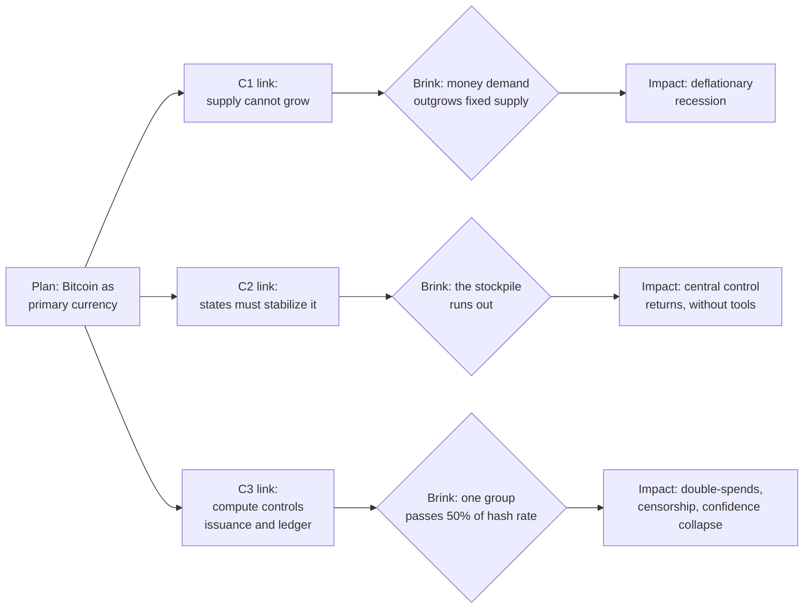

# Argument: Bitcoin fails as a currency (link, brink, impact)

My argument from [[ECON 131 Lecture 2 - Exchange Rates]], framed as a debate **disadvantage (DA)** in three numbered contentions. Each contention runs A Uniqueness, B Link, C Internal link, D Brink, E Impact. It uses the corrected claims from the claim-by-claim check in that note, so every link survives cross-examination.

> [!info] How a disadvantage is built
> | Part | Question it answers |
> | --- | --- |
> | **Uniqueness** | Is the harm absent right now? (If it is already happening, the plan does not cause it.) |
> | **Link** | How does the plan trigger it? |
> | **Internal link** | What chain carries the link to the harm? |
> | **Brink** | Where is the tipping point, and why does the plan push us past it? |
> | **Impact** | How bad is it: magnitude, probability, timeframe? |

**The plan being attacked:** Bitcoin (or any fixed-supply cryptocurrency) becomes a primary currency, the money people are paid in, price things in and owe debts in.

**Thesis:** money needs a manager. A fixed-supply coin is deflationary, stabilizing it brings the manager back, and the coins and the ledger drift toward whoever owns the most compute.

---

## Contention 1: Deflation

**1A. Uniqueness.** Today, major currencies have elastic supply. Central banks expand money when demand for it jumps (as in 2020) and target low, positive inflation. No large economy uses a fixed-supply money, so deflationary spirals from money scarcity are not happening now.

**1B. Link.** Bitcoin's issuance is fixed by code: about 450 BTC a day since the 2024 halving, capped at 21 million, about 95% already mined. Adopt it as primary currency and the money supply can no longer respond to the economy.

**1C. Internal link.**
1. Real economies grow, so the demand for money grows.
2. Quantity equation $MV = PY$: with $M$ fixed and output $Y$ rising (and velocity steady), the price level $P$ must fall.
3. Falling prices raise the real value of every debt (Fisher's debt-deflation, 1933), reward delaying purchases, and collide with wages that do not fall, which produces layoffs.

**1D. Brink.** The tipping point is when money demand outruns the fixed supply faster than prices can smoothly adjust. Under a fixed supply, every year of real growth pushes toward it, and **any** demand shock (a panic, a dash for cash) hits it at once, because supply cannot respond at all (see the vertical supply graphic in the Lecture 2 note).

**1E. Impact.** A deflationary recession: defaults, unemployment, and a banking system that cannot get emergency liquidity.
- *Magnitude:* economy-wide.
- *Probability:* high under a fixed supply; it is the predictable result of growth.
- *Timeframe:* ongoing pressure, acute at the first crisis.
- *Evidence:* the gold standard. Countries that left gold earlier recovered faster from the Great Depression (Eichengreen and Sachs, 1985; Bernanke, 1995).

---

## Contention 2: The manager comes back

**2A. Uniqueness.** Today central banks hold the tools to manage their currencies (rates, reserves, open market operations). Under the plan, by design, nobody holds them.

**2B. Link.** Governments will not accept a primary currency they cannot stabilize. To stabilize a Bitcoin economy, they must become buyers and sellers of last resort of Bitcoin itself.

**2C. Internal link.**
1. To ease deflation a government can only **sell** Bitcoin it already holds; it can never add supply.
2. To build that stockpile it must buy, which pushes the price up further during the build.
3. So every stabilizer holds a finite, appreciating stockpile and competes with other states for it.

**2D. Brink.** The point where the stockpile runs out during a crisis. That happened to gold: the London Gold Pool (1961 to 1968) sold central bank gold to hold the price at \$35 an ounce, and collapsed when demand outran the pool. Bretton Woods hit the deeper version, the Triffin dilemma (1960): reserves could not grow with the world economy.

**2E. Impact.** Either central control returns (the decentralization the plan promised is gone), or it returns *without the tools to work*, which is worse: a managed currency whose managers cannot add money in a crisis.
- *Magnitude:* defeats the plan's own purpose.
- *Probability:* high; every gold-standard era produced state management.
- *Timeframe:* the first serious crisis after adoption.

---

## Contention 3: Compute concentration

**3A. Uniqueness.** In fiat systems, the right to create money is held by accountable public institutions, not by whoever owns the most hardware.

**3B. Link.** Compute does **not** create more Bitcoin: the difficulty adjustment (every 2,016 blocks, about two weeks) keeps blocks at about one per 10 minutes. What compute decides is **who** receives the new coins and **who** orders the ledger. Make Bitcoin primary money and control of compute becomes control of the money's plumbing.

**3C. Internal link.**
1. Mining has large economies of scale (chips, cheap power, capital).
2. Mining profits fund more hardware, so leaders compound their lead over small miners.
3. Pools already concentrate hash power; a few pools have often held most of it.
4. Quantum computing adds a second channel: breaking exposed signatures (Shor's algorithm) could let whoever gets there first take coins from old addresses, including an estimated ~1M early coins, a sudden supply shock controlled by one party.

**3D. Brink.** One group passing 50% of the hash rate. Past that line it can double-spend and censor transactions. Smaller proof-of-work coins have already crossed it: Bitcoin Gold (2018), Ethereum Classic (2019 and 2020).

**3E. Impact.** Double-spends and censorship in the economy's primary money, a collapse in confidence, and a payments system controlled by an unaccountable private party.
- *Magnitude:* systemic, if it is the primary currency.
- *Probability:* low per year for Bitcoin today, rising with concentration and quantum progress.
- *Timeframe:* long-run, but irreversible once crossed.

---

## Impact calculus
| | Contention 1: Deflation | Contention 2: Manager returns | Contention 3: Compute |
| --- | --- | --- | --- |
| **Magnitude** | Economy-wide recession | Plan defeats itself | Systemic payments failure |
| **Probability** | High | High | Low now, rising |
| **Timeframe** | Ongoing, acute in first crisis | First crisis | Long-run, irreversible |
| **Strongest evidence** | Gold standard recoveries | London Gold Pool, Triffin | ETC and BTG 51% attacks |

**Lead with Contentions 1 and 2:** highest probability, best historical evidence. Contention 3 is the long-run kicker.

**The alternative I defend:** a manager accountable to a political community, which is why the U.S. Free Banking Era (1837 to 1863, private banknotes and repeated panics) ended, after the Panic of 1907, in the Federal Reserve (1913). If you want a decentralized currency, start a country whose value does not depend on anyone else.

---

## Answers to likely responses
> [!question]- "Bitcoin divides into satoshis, so it never runs out."
> Divisibility does not stop deflation. It lets prices fall smoothly; it does not stop them falling. Debts are still fixed in coins, so their real burden still rises (Contention 1C, step 3).

> [!question]- "Deflation from productivity is good deflation."
> Sometimes (U.S. 1870s to 1890s). But a fixed money supply forces deflation in *every* shock, not only productivity booms, and a dash for cash cannot be met with more money. The gold standard shows the bad kind dominates in crises.

> [!question]- "Compute doesn't create coins; the difficulty adjustment fixes that."
> Agreed, and that is why Contention 3 is about **who** gets the coins and controls the ledger, not how many exist.

> [!question]- "Bitcoin is digital gold, not a currency."
> Then we agree. These contentions are against Bitcoin as a **primary currency**. As a speculative or reserve asset, these harms are much smaller.

> [!question]- "Fiat has its own failures: inflation, bailouts, capital controls."
> True (see the incentives section in the Lecture 2 note). The comparison is which failures are fixable: a bad central bank can be reformed by its political community; a fixed supply and a compute race cannot be voted on.

> [!question]- "Scottish free banking (1716 to 1845) was stable without a central bank."
> It is the strongest counterexample. Its banks still issued **elastic** notes backed by convertible reserves, so it was not a fixed-supply system, and that is the point of Contention 1.

## Citations to look up before using these
- Irving Fisher, "The Debt-Deflation Theory of Great Depressions" (Econometrica, 1933)
- Barry Eichengreen and Jeffrey Sachs, "Exchange Rates and Economic Recovery in the 1930s" (Journal of Economic History, 1985)
- Ben Bernanke, "The Macroeconomics of the Great Depression: A Comparative Approach" (Journal of Money, Credit and Banking, 1995)
- Robert Triffin, *Gold and the Dollar Crisis* (1960)
- Satoshi Nakamoto, "Bitcoin: A Peer-to-Peer Electronic Cash System" (2008): issuance schedule and difficulty retargeting
- U.S. Executive Order 6102 (1933); London Gold Pool (1961 to 1968)

> [!note] My notes
> 
