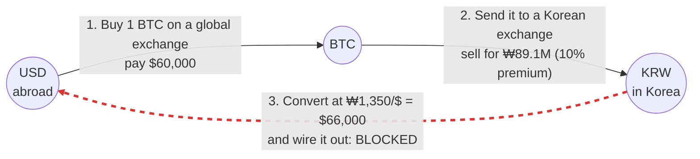
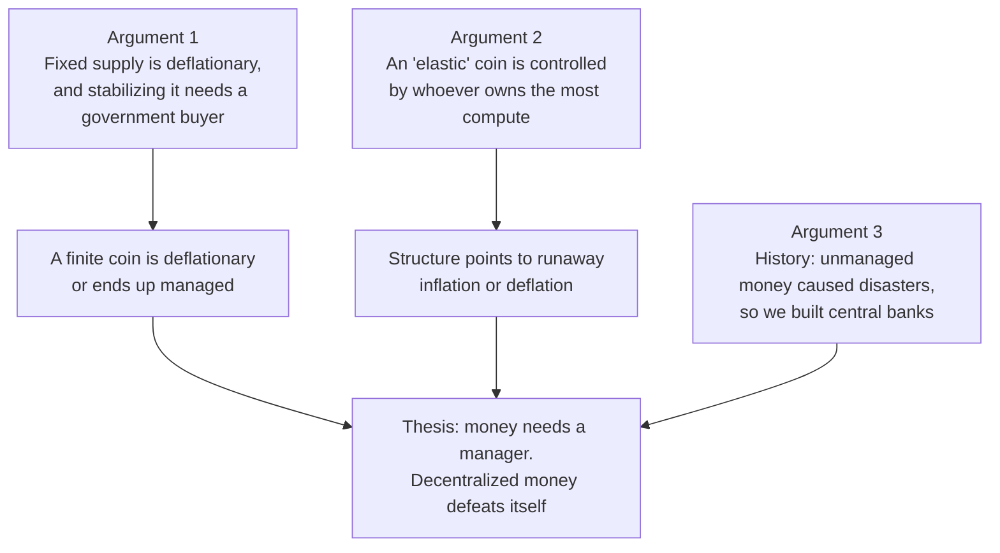

# ECON 131 Lecture 2: Exchange Rates

> [!info] Lecture card
> | | |
> | --- | --- |
> | **Course** | [[ECON 131]] International Financial Markets |
> | **When** | Week 2, Lecture 2, Tue 2026-09-29; finished Thu 2026-10-01 with the Bitcoin aside |
> | **Lecturer** | Chenyue Hu (office hours Thu 15:00-16:30, E2 469) |
> | **Handout** | [[econ131-lec02.pdf]] |
> | **Recording** | `~/Documents/ECON131/Recordings/ECON131 Lecture 02 - recording 2026-09-29.m4a` (transcript next to it) |
> | **Flashcards** | [[ECON 131 Cards - ECON131 Lecture 2]] (11 concepts, plus practice problems at the bottom) |
> | **On the exam** | Midterm 1, Tue 2026-10-20 17:20 (weeks 1-3) |
> | **Next** | [[ECON 131 Lecture 3 - Interest Rate Parity]] |

> [!abstract] What is in this note
> 1. **My class notes** (Tue 2026-09-29): forex market, instruments, quotes, appreciation vs devaluation, Brexit and Trade War 2, cross rates, triangular arbitrage.
> 2. **End of lecture** (Thu 2026-10-01): the Kimchi premium, traditional vs crypto arbitrage, Bitcoin vs fiat incentives, demand and supply.
> 3. **My argument** against Bitcoin as a currency, with a claim-by-claim check.

## My class notes (Tue 2026-09-29)
Typed in class (from `L2 Econ.txt`). Words unchanged; only formatting fixed so it renders (tab outlines became bullets, \$ signs escaped).

FOREX market done w/o any authorities involved btw two parties as opposed to on a centralized exchange = 'over the counter'
Centralized Exchange - Do need a centralized authority to allow for the exchange of assets
- e.g.
- The NY Stock Exchange would be a centralized exchange
the difference between a centralized and an over the counter

Currency exchange is an over-the-counter exchange market

---

Very huge trading volume is measured in trillions of dollars

---
Currency market is dispersed due to necessity of continuous operation and due to market realities

---
You can always trade soemwhere in the world

---
Lastly the currency market features low margins of profit

Homogeneous is a euro by whomever trades it. There's hardly no ability to find competitive advantage as there are homogenous goods. There is no advantage in a euro from one compared to another.

Q: How do institutions find a competitive advantage?

Business realationsships make the reality of the interbank advantage and not a uniquness in goods

---

Major participants: large international banks
- BLA, DB, the large players, the interbank is a sort of wholesale distributor for the currency market

There are many other players
- Central banks, very frequent traders to regualte their own currency
    - We will talk about this later

- Multinational Firms
    - To do business across national lines

- Smaller Institutional Investors
    - Hedge Funds
        - Speculate on currency movements to make profits
        - Soros would be an example of a currency trader who made billions

---
Instruments of Financial Currency Trading
- Spot Trading
    - Spot
        - A place w/ immediate exchange btw currencies
            - Most common tool used

    - Forward
        - A contract btw buy and sel to agree to exchange rate in the future
            - Allows a lock-in future exchange rate for future delivery
                - Ex.
                    - We sign a contract to sell in 10 days at 1to1 euro to dollar regardless of the future exchange rate.
                    - Even tho the delviery may happen in the future

---

Derivatives

(See sheet)

---
Swap
        - Two parties exchange currencies for a certain length of time and agree to reverse the transaction at a later date
            - Ex.
Option
- The owner has the right but not the obligation to exchange money at a pre-agreed whose payoff over time is derived from the performance of underlying assets.

---

Exchange rate: always in relative terms

---
Let's learn about some popular currencies
USD\$
EUR (euro symbol)
... (You get the idea)
currencies listed
GBP
JPY, symbol for this one also used for the CNY

Let's now try to express these exchange rates using these currencies

---

If it takes 100 yuan to purchase 1 dollar
\# 100 / \$

Here the Hash is the placeholder for the Yuen symbol

Some textbooks put numbers in front of the symbol but our convention for this course is the symbol first

Read as 100 Yen a dollar

---

Quoting

- Two methods
    - Direct and Indirect
        - Direct
            - With the domestic currency first, i.e. numerator of fraction \$.01 / Yen
        - Indirect
            - Quoting foreign currency first Yen100/\$

Example: Need 1k euros, have GBP.
.1 exchange is pound.9/euro (this is the DIRECT QUOTE)
.2 exchange is euro 2/GBP (this is the INDIRECT QUOTE)

---

Appreciate/depcreciate - the value of a currency increases/decreases in terms of another
TRANSITIVE OBVIOUSLY - Relative to #
- e.g. The Yen has strengthened relative to the Dollar
    - This is typically for free-float currencies, which leads to currency dynamics influencing the value of it : it devalues and revalues

Devalue/Revalue - the value of a currency is changed by the domestic government

        - "fixed" "pegged"
    - China is known to change the currency value a lot by let the central bank be a player in the currency market
    - In this context devalue would be a better value as it is changed deliberately

    - If China is lowering the supply so the Yen is revalued in this particular example

    - So fixed or pegged receive the language of devalue or revalued as they have influence

    - The main reason is that China wants to keep the exrate to boost their exports

Important claim*star**star*

With devlauations, exports cheaper and imports become more expensive

With revaluations, exports costlier and imports cheaper

- Suppose China exports a shirt to the US, the original price is 100 yen in China

- IF the exchange rate is 4 yen per dollar then the price of the shirt will be 100 yen  divided by 4 yen per dollar = 25 dollars

- Under 5 yen/dollar 100 // 5 yen/dollar = \$20

This strategy is closely linked to its exports oriented industrial strategy

Exchange rate has played an important role in the success of the export strategy

Now the exchange rate is under 'managed floating'

It is no-longer compleletly fixed

Respond to Luis when you get out of class

---

Quanitifying rate of change  (new-old/old)
e.g.
2\$/GBP -> \$2.5/GBP

( (2.5/GBP - \$2/GBP)/ \$2/GBP ) - 25%

GBP appreciates to \$ by 25%

So \$2/GBP = GBP .5/\$

\$2.5/GBP = GBP .4 / \$

...

.4GBP/\$ - .5GBP/\$) / .5GBP/\$ = -20%

Interpret this as the dollar depreciates to GBP by 20%

STAR THIS IT WOULD NOT BE EASY FOR YOU TO TO DO THIS AT 5 LEVELS OF SEPERATION FROM THE BASIC CALCULATION EG -20% or messing with very awkward permutations

---

BREXIT June 23 '16

Brexit - A single market buys them access to that single market

Since the UK is so heavily reliant on its exports, if that recession happened of course is going to plummet, on that single day started to sell the GBP and their assets, so the price plummeted. It lost 16% of its value.

And after 2016 manythings were going on w/in the UK.

Theresa May was pro-deal
- She wanted to negotiate with other EU members to stay as much as possible in the UK single market

In April 2024, the trade war 2 started in Trump's presidency

Preview of Trade War 2
- Dollar and Yuan lost around 10% of their values and the direction and magnitude were fundmeentally different dispite similarity in outcome.
    - US depreciated as a result of lack of demand for \$ized assets
    - US investors were shocked. They started to seek alternatives as some investors pulled out. So economic risk was sudddenly 'priced in'

    - IF the demand is low for the dollar, the value plummeted (relative in currency terms)

    - So put techinically **market dynamics** led the US dollar to drop
    - // I feel like this is the sort of techincal lang. she'll expect idk how to make a card out of that but like fs let's try and decompose the ability to differentiate between causes or levers by which these things can happen and the broadscale language to asses what happens thereby
- Yuan case:
    - The Chinese exchange rate devalued due to the Chinese Central Bank deciding to sell its currency in FEX market. It was an intentional supply shock. This was done deliberely to absorb the economic blow and protect its core industries

    - To stay competitive in the face of the tarrif they had to devaltute it despite the tarrif.

- The Dollar's plunge, -10.8% sufferest its worst first-half-year performance in over five decades
    - Heightened Recession Risk: Global investors bet that aggressive tarrifs would force the Federal Reserve into significant rate cuts ot protect US growth
    - Soaring Fiscal Deficits concerns over the us fiscal position erodeedd onfidence

    - Eroding instituational credibility
    - Public pressure on FEd REs independence further devalued

- Yuans decent
    - Even from the staggered chart, the main goal was to weaken the Yuan just enough to act as a tarrif offset for chinese exporter protecting manufacturing employment

---
COnsequence of currency
- Protection for targeted industries
- Tarrif Tax on American Households
    - This tarrif may offer some protection did benefit from the competition
    - Domestic steel and aluminum producers benefited directly from the insulation provided by 25% tarrifs on foreign compeitits
- US the tariff Tax on American Households
    - US consumers faced a signiicant finaicial burden with the estiamted cost of tariffs on imported goods ranging from 1.1k to 1.8k annually per household.

When goods increase in price, the ability for market entry for retailers entry and lives in the market becomes more difficult as increased prices for wholesaling toys leads to increased prices passed onto customers leading to lower customership leading to exits from the market

---

China's internal pivot: Industrial upgrades and sacrificies

Prioritizing a high tech future
- High-margin, "innovative sectors" were prioritized for state support and industrial upgrades, aligned with long-term strategic goals.

"Lethal" pressure on labor intensive exports
- Traditional, labor-intensive manufactureres faced immense pressure and the risk of mass unemployment as they sutruggled ot complete with the

The country wants to transoform, on high margin innovation

If look forward 1 dollar is about 6.8-6.7 to USD. This makes it fairly weak. Whether this is due to market dynamics and uncertainty can be shorted due to the undertanding that national uncertainty to trump is likely to resolve at the elapsement of his term for example.

LOOKING FORWARD: Currency report

She encourages us to do a lot of research

Let's get back to the original lecture materials.

Next we have some definitions.

---

VEHICLE CURRENCY:

A currency that is used in many FEX transactions, USD is 90% of all transactions.

CROSS RATE:

Trading currency in NY market where both currencies ar enot expressed in USD e.g. GBP/EUR

---

TRIANGULAR ARBITRAGE:

Trading 3 currencies in such a way that differences in prices can be arbitrated resulting in a market correcting profit.

E.g. 1.2EUR/GBP, GBP.8/\$, \$2/EUR

Can we make a profit w/ 10 EUR

1. Sell Euros to GBP, here we divide and get 8.33 GBP alt,
2. Now we sell pounds, buy dollars our 8.33 GBP gets converted at a rate of \$2/GBP into 16.67
3. FInally we sell dollars to buy euros at an exchange rate to get from 16.67 USD  by .8 EUR/\$ giving us 13.34 EUR

That RoR is (13.34 -10)/10 = 33.4%

Q: Due to computerization are such vast TRI ARBIT harder to do? When there are large market forces i.e. Trumpian decision making is there anyway to bandwagon onto firms that make such trades and profit from their moneymaking or someone that will manage your money and use their algos? Does this difference suffer from the same issue as Quant Fi where finding Phi or whatever it is closes that gap due to slippage

The way we find it is in a triangular fashion

EUR/\$ < EUR/\$ * \$/GBP

Since the RoR is always a scalar proportion it is agnostic to quantity CETERIS PARIBUS

SLIPPAGE

EUR/USD > EUR/USD > USD / GBP

The inverse can also be profit making it just depends on relative ratio magnitude

---

Is triangular arbitratage sustainable?

The answer is: no.

That arbitrage opp. the supply and demand conditions will be updated as the trade is made.

We will now discuss the mechanism by which that correction is made.

---

If people funnel into the EUR to GBP conversion, the demand increases the value of the GBP, the second step increases the denominator likewise so if EUR to USD the USD will appreciate, and then the RHS will go down from the origin, until the LHS = RHS

**star** STAR I could not explain this, I do not have this in the mouth.

k

---

# End of Lecture 2 (Thu 2026-10-01): Bitcoin aside
> [!info] Where this came from
> Class finished Lecture 2 on Thursday with an aside on Bitcoin and the Kimchi premium before starting [[ECON 131 Lecture 3 - Interest Rate Parity]]. My class notes from the aside are in the first "My notes" box below.

## Kimchi premium (an arbitrage that will not close)
Class aside on Thu 2026-10-01 that finished Lecture 2. It takes [[Triangular Arbitrage]] into crypto and sets up Lecture 3's big idea: **arbitrage forces prices into line only when money can move freely.**

The **Kimchi premium** is the gap between the price of bitcoin (and other crypto) on South Korean exchanges, in won, and the price abroad. For years Korean prices have often sat above global prices.

### The triangle
Three currencies, three exchange rates, same as the triangular arbitrage problem above: USD, BTC, KRW. Illustrative numbers: BTC is \$60,000 abroad, the won is ₩1,350/\$, and BTC trades at a 10% premium in Korea.

| Step | Trade | You hold |
| --- | --- | --- |
| 1 | Buy 1 BTC abroad | 1 BTC, cost \$60,000 |
| 2 | Sell it on a Korean exchange at the premium | ₩89,100,000 |
| 3 | Convert won to dollars and send them home | \$66,000, so **\$6,000 profit (10%)** before fees |

Cross-rate check, as in triangular arbitrage: the **implied** won price of BTC is $1{,}350 \times 60{,}000 = 81{,}000{,}000$ won. The **actual** Korean price is ₩89,100,000. Implied ≠ actual, so there is a triangle to run. In a free market, everyone running it would push the Korean price down and the global price up until the gap closed.

### The barrier: why the triangle does not close
Steps 1 and 2 are easy. **Step 3 is the wall.**
- **Capital controls on the won.** South Korea's Foreign Exchange Transactions Act caps how much an individual can remit abroad per year without documentation (through small remittance agencies: \$10,000 per transfer, \$100,000 per year), so profits stuck in won cannot be sent out at scale.
- **Real-name bank accounts (2018).** Korean exchanges must link each user to a real-name account at a Korean bank, which shuts out most foreigners. Foreign arbitrageurs cannot easily run step 2 themselves.
- **Friction and time.** Blockchain confirmations and bank transfer windows mean the premium can move before the loop finishes.

> [!warning] Correcting the common framing
> - The barrier was **not built to allow the arbitrage.** The controls exist to manage FX flows and capital flight. A side effect is that they **block** the closing leg of the arbitrage, and that is why the gap survives.
> - It is **not perpetual.** The premium swings with demand in Korea: it was reported as high as 20.8% in May 2021, and it has shrunk and even flipped at other times.
> - People did push money through anyway. In 2022 Korean regulators investigated about \$6.5B in overseas remittances (Jan 2021 to June 2022) that mostly started in crypto exchange accounts and were suspected of being Kimchi premium arbitrage. Sam Bankman-Fried's early trading profits are also widely reported to have come from this trade around 2017-2018.

### Bridge to Lecture 3
Covered interest parity ([[Covered Interest Rate Parity (CIP)]], Lecture 3) is enforced by the same mechanism: **arbitrage**. Borrow in one currency, convert, invest, convert back. If step "convert back and send home" is blocked by capital controls, CIP can fail just as the Kimchi triangle fails. Keep asking, for every parity condition: *which trade enforces it, and can that trade actually be done?*

> [!note] My notes
> Bitcoin aside:
>
> USD -> BTC -> KRW ->
>
> In FX world it's well known that there's the kimchi 

Sources: [CNBC 2024](https://www.cnbc.com/2024/04/03/south-koreas-kimchi-premium-in-the-spotlight-after-btcs-record-highs.html), [Cointelegraph on the \$6.5B probe](https://cointelegraph.com/news/regulators-tie-kimchi-premium-to-6-5b-in-overseas-remittances), [Nonlinear dynamics of Kimchi premium (Economic Modelling, 2024)](https://www.sciencedirect.com/science/article/pii/S0264999324000828), [Bloomberg via Yahoo on Bankman-Fried](https://finance.yahoo.com/news/bitcoin-trade-gave-bankman-fried-071815312.html)

## Compare and contrast: traditional FX arbitrage vs crypto arbitrage
The Kimchi premium is a crypto version of the arbitrage this course studies in currency markets. Same logic, very different plumbing.

### Same logic
- **Law of one price.** The same asset should cost the same everywhere once you convert at the exchange rate. Any gap is a free trade.
- **Same test.** Compare the **implied** price (built from the other legs' rates) with the **actual** price, as in the triangular arbitrage cross-rate check.
- **Same enforcer.** Arbitrageurs running the loop are what close the gap. A gap that lasts means some leg of the loop is blocked or too costly.
- **Same walls.** Capital controls block both. Crypto does not escape them, because every crypto loop starts and ends in fiat money, and the fiat legs go through banks.

### Different plumbing

| | Traditional FX (triangular, covered interest) | Crypto (Kimchi premium) |
| --- | --- | --- |
| **What is traded** | Currencies, through banks and dealers | Coins on exchanges, plus the fiat legs on and off them |
| **Market structure** | Over the counter, a few big dealer banks, open 24 hours on weekdays | Many separate exchanges, open 24/7, each with its own price |
| **Who arbitrages** | Large banks with credit lines and tiny costs | Anyone with exchange accounts, but KYC, real-name and remittance rules limit who and how much |
| **Typical gap** | Basis points, and usually smaller than transaction costs | Whole percents, sometimes double digits (20.8% reported in May 2021) |
| **How fast gaps close** | Seconds, by algorithms | Minutes to months: blockchain confirmations, bank withdrawal windows, legal caps |
| **Settlement** | Spot usually two business days; forwards lock a future date | The coin moves on-chain quickly; the fiat legs settle through banks |
| **Removing the risk** | Forwards, swaps, futures, deep money markets (that is CIP) | Futures and perpetual swaps exist, but hedging is thinner, especially against the won |
| **Counterparty risk** | Regulated banks and settlement systems | Exchanges can freeze withdrawals, be hacked, or fail |
| **Main barrier** | Transaction costs, capital controls in some countries | Capital controls on the fiat leg, exchange account rules, transfer delays |

### The takeaway
CIP holds tightly in major currencies because the covered loop (borrow, convert, invest, sell forward) is cheap, fast and legal for big banks. The Kimchi premium survives because one leg (won back to dollars, sent abroad) is capped by law. **The size and life of a price gap measure how hard the closing trade is.** When you meet any parity condition, ask: who can do the trade, how fast, and what stops them?

> [!question]- Self-check: why doesn't crypto get around Korea's capital controls?
> The loop has to end in dollars outside Korea. The coin can move freely, but turning won into dollars and sending them abroad is the leg the Foreign Exchange Transactions Act caps.

> [!note] My notes
> 

## Incentives: Bitcoin vs traditional currency
Every money has someone who issues it and someone who keeps it running. What they are paid to do shapes how the money behaves.

| | Traditional currency (dollar, won, euro) | Bitcoin |
| --- | --- | --- |
| **Who issues it** | Central bank (base money) and commercial banks (deposits, by lending) | The protocol: new coins go to miners on a fixed schedule |
| **What the issuer is paid to do** | Meet a mandate: stable prices, employment, financial stability | Miners earn the block subsidy plus fees for securing the ledger |
| **Who can change the rules** | Legislature and central bank | Nobody alone: changes need broad agreement among users, miners and developers |
| **Crisis response** | Lender of last resort, rate cuts, money printing | None. No one can expand supply or bail anyone out |

### Problems with traditional currency incentives
- **Inflation tax and seigniorage.** The issuer gains from printing; savers lose purchasing power.
- **Time inconsistency.** Governments are tempted to promise low inflation, then inflate once people have committed (why central bank independence matters).
- **Moral hazard.** Bailouts and a lender of last resort encourage risk-taking.
- **Capital controls and financial repression.** Governments can trap money at home, as Korea's controls on the won do (see the Kimchi premium).

### Problems with Bitcoin incentives
- **Security budget.** The block subsidy halves about every four years and goes to zero around 2140. After that, fees alone must pay miners enough to make attacks too costly. Whether fees will be enough is an open question.
- **Hoarding vs spending.** A fixed supply rewards holding over spending, which works against its use as a medium of exchange.
- **No shock absorber.** With no lender of last resort and no elastic supply, every demand shock hits the price (see below).
- **Concentration.** Mining pools and early holders control large shares of hash power and coins.
- **Slow governance.** Rule changes need rough consensus, so fixes are slow and fights can split the chain (the 2017 block size dispute produced Bitcoin Cash).

> [!note] My notes
> 

## Demand and supply: why Bitcoin's price behaves differently
In this course, an exchange rate is the price that clears **demand and supply for a currency**. Run Bitcoin through the same lens.

### Demand
| Driver | Traditional currency | Bitcoin |
| --- | --- | --- |
| **Use (adoption)** | Needed to pay taxes, wages and invoices; used to price trade; held as central bank reserves | Users, exchanges, spot ETFs (approved in the U.S. in January 2024), company treasuries, a few countries (El Salvador made it legal tender in 2021, then made accepting it voluntary in 2025) |
| **Narrative** | Mostly background: trust in the institutions behind it | Central: "digital gold", inflation hedge, payments, freedom from governments. The story moves demand, and price moves feed the story (reflexivity) |
| **Macro sentiment** | Interest rate differentials (UIP), growth, safe-haven flows to the dollar in a crisis | Trades like a risk-on asset: rises with easy money, falls when the Fed tightens (it lost about two-thirds of its value in 2022). In a dash for cash it has fallen with stocks (it roughly halved in two days in March 2020) rather than acting as a safe haven |
| **Speculation** | Carry trades and positioning, mostly by institutions | Large share of demand: leverage, perpetual futures, liquidation cascades, retail momentum. The Kimchi premium is itself a gauge of Korean speculative demand |
| **Anchor** | An interest rate and an economy's output stand behind it | No cash flows and no policy rate. Its value rests on expected future demand alone |

### Supply
- **Traditional currency: elastic.** The central bank adjusts the money supply to hit its targets. When demand for money jumps (for example, the 2020 dash for cash), it can create more. When a currency is under attack, it can sell reserves to defend it (see [[Exchange Rate Regimes (Peg and Managed Float)]]).
- **Bitcoin: perfectly inelastic issuance.** New supply follows a code schedule, not the price: 3.125 BTC per block since the April 2024 halving, about 450 BTC a day, capped at 21 million in total. About 95% is already mined. Price elasticity of new supply $= \frac{\%\Delta Q_s}{\%\Delta P} = 0$.
- **Nuance:** the coins *available to trade* do respond a little to price, because long-term holders sell into rallies, and millions of coins are believed lost forever.

### The graphic: same demand shock, two supply curves

<svg viewBox="0 0 620 260" xmlns="http://www.w3.org/2000/svg" style="max-width:620px;width:100%;font-family:sans-serif;font-size:12px">
  <g stroke="currentColor" fill="none" stroke-width="1.5">
    <path d="M40 20 V220 H290"/>
    <path d="M340 20 V220 H590"/>
  </g>
  <g fill="currentColor">
    <text x="20" y="30">P</text><text x="280" y="238">Q</text>
    <text x="320" y="30">P</text><text x="580" y="238">Q</text>
    <text x="80" y="252">Traditional currency: elastic supply</text>
    <text x="400" y="252">Bitcoin: vertical supply</text>
  </g>
  <line x1="60" y1="180" x2="270" y2="80" stroke="#2a9d8f" stroke-width="2.5"/>
  <text x="235" y="74" fill="#2a9d8f">S</text>
  <line x1="465" y1="30" x2="465" y2="215" stroke="#2a9d8f" stroke-width="2.5"/>
  <text x="470" y="210" fill="#2a9d8f">S (fixed)</text>
  <line x1="70" y1="60" x2="250" y2="200" stroke="#888" stroke-width="2"/>
  <line x1="110" y1="40" x2="290" y2="180" stroke="#e76f51" stroke-width="2" stroke-dasharray="6 4"/>
  <text x="58" y="56" fill="#888">D</text><text x="100" y="36" fill="#e76f51">D'</text>
  <line x1="370" y1="60" x2="550" y2="200" stroke="#888" stroke-width="2"/>
  <line x1="410" y1="20" x2="590" y2="160" stroke="#e76f51" stroke-width="2" stroke-dasharray="6 4"/>
  <text x="358" y="56" fill="#888">D</text><text x="400" y="18" fill="#e76f51">D'</text>
  <circle cx="162" cy="132" r="4" fill="currentColor"/>
  <circle cx="203" cy="112" r="4" fill="#e76f51"/>
  <line x1="40" y1="132" x2="162" y2="132" stroke="currentColor" stroke-dasharray="2 3"/>
  <line x1="40" y1="112" x2="203" y2="112" stroke="#e76f51" stroke-dasharray="2 3"/>
  <circle cx="465" cy="134" r="4" fill="currentColor"/>
  <circle cx="465" cy="63" r="4" fill="#e76f51"/>
  <line x1="340" y1="134" x2="465" y2="134" stroke="currentColor" stroke-dasharray="2 3"/>
  <line x1="340" y1="63" x2="465" y2="63" stroke="#e76f51" stroke-dasharray="2 3"/>
</svg>

Demand shifts from D to D' (dashed) in both panels; the dotted lines mark the old and new prices. With elastic supply, quantity rises and the price moves a little. With a vertical supply curve, quantity cannot move, so the **entire shock shows up in the price**. That is the core reason Bitcoin is so volatile, and why narrative, sentiment and speculation (all demand-side) dominate its price.

### Link to Lecture 3 (interest parity)
Interest parity ties a currency's expected change to an **interest rate differential**: $1 + i = E_t\left[\frac{S(t+1)}{S(t)}\right](1 + i^*)$. Bitcoin has no central bank rate to put in for $i^*$, and nothing to adjust supply, so there is no parity anchor pinning its expected path. Its expected return is expected appreciation, which comes back to demand.

> [!question]- Self-check 1: why does a fixed supply make the price more volatile?
> Quantity cannot adjust to a demand shift, so the whole shift lands on the price.

> [!question]- Self-check 2: name the four demand drivers and one example of each for Bitcoin.
> Adoption (spot ETFs, 2024), narrative ("digital gold"), macro sentiment (fell about two-thirds in 2022 as the Fed tightened), speculation (leverage and liquidation cascades).

> [!question]- Self-check 3: what is Bitcoin's "security budget" problem?
> Miner pay comes from the block subsidy plus fees. The subsidy halves every four years toward zero, so security will eventually depend on fees alone, which may not be enough.

> [!note] My notes
>

---

## My argument: Bitcoin cannot work as a currency
My own position, written in class on 2026-10-01 and framed here as premises and conclusions. A claim-by-claim check and a stronger version follow.

Debate version (numbered contentions: uniqueness, link, internal link, brink, impact): [[Argument - Bitcoin Fails as a Currency (Link Brink Impact)]]

> [!quote]- My original words (verbatim)
> Bitcoin: the coin itself, and many like it are perfectly inelastic. Perfectly inelastic currencies or finite currencies were dropped en masse out of no forced leverage nor any coercion. This was due to the maladaptive deflationary pressures that arrive out of non-managed/non-fiat currencies. Bitcoin in its finite form is inalienably finite and thus a deflationary and recession inducing currency. Further, even supposing it was made a global currency despite this, it's decentralized currency would likely not exist perpetuity as to have stabilizing monetry policies it is in the governments incentive to do large currency purchases to manipulate the price. This A. reintroduces monetary controllers as governments will still want currency control over primary tender and B. Spikes demand and forces goverments to buy ever increasingly partial shares of every part of a bit coin which has may sound absurd which is what the gold standard found as well. THere is no alternative to this.
>
> Second suppose we go with an elastic currency that is moderately inelastic due to compute difficulties. Then elasticity is a function of compute. Compute is increasing. Complexity of encoding is static. Moreover, compute for blockchain decoding is not scaling linear as in moores law but due to quantum computing will scale asymptotically. That is to say, as time increases our ability to decode will increase. This makes the currency steadily more elastic. Which could be a good thing but there is the issue of value, where too much currency will deflate the value. This then creates an incentive to sustain value while printing large sums. Due to it being a non-guarenteed tender by any national government,' printing' is decentralized. Access to this compute ability is not uniform, it is quite stratified where a datacenter owner will be able to out compute by orders of magnitude a home lab. Furthermore, his gains in wealth due to that lead suggest him consolidating that lead and only growing faster beyond homelabbers. Eventually an individual will reach a maximum point where the bitcoin that is elastic reveals itself to be secretly parabolic in its value where as soon as an individual has the ability to print coins at a monopolistic rate which seems inevitable due to the capital intensivity of the industry, their incentive will be to sell that now abundant currency before others realize that lead and sell deflating or defeating his ability to profit. This means that in addition to the specualative volatitiy there is every strutucral symptom that suggests this is an increasingly inflationary currency or increasingly deflationary currency....
>
> If only we had someone to manage that rate... oh wait we do... bc currency used to be decentralized in the bronze age with shells and other odd tender and then we formed central banks to stop the awful things that happened to the market when we didnt manage the flow of currency. Unfortunately there are no hard laws of unbeatable problems for humans. If you want a decentralized currency go start a country whose value does not depend on others.

> [!abstract] Thesis
> A currency needs someone to manage its supply. Bitcoin either has a fixed supply, which makes it deflationary, or a supply that ends up in the hands of whoever owns the most computing power. Either way a manager comes back, so a decentralized currency defeats itself.

### Argument 1: a fixed supply is deflationary, and the fix brings back a central bank
1. Bitcoin's supply is perfectly inelastic: issuance follows a fixed schedule toward a hard cap of 21 million.
2. When an economy grows, demand for money grows with it. If the money supply cannot grow, the price level must fall: **deflation**.
3. Sustained deflation induces recessions: debts grow in real terms, people delay spending, and wages that will not fall turn into unemployment.
4. History agrees: societies dropped finite, commodity-backed money (the gold standard) because of these deflationary pressures.
5. Suppose Bitcoin became the global currency anyway. To stabilize its value, governments would have to buy and sell it in huge amounts, which makes them **monetary controllers again**, because governments will always want control over their primary tender.
6. With demand rising and supply fixed, those purchases drive the price up, so governments chase an ever more valuable asset. The gold standard ran into the same squeeze.

**Conclusion 1:** A finite Bitcoin is either deflationary or ends up managed by governments. Either way it is not a stable decentralized currency.

### Argument 2: an "elastic" crypto ends up controlled by whoever owns the most compute
1. Suppose instead a coin's supply is moderately elastic, with new coins limited only by how hard they are to compute.
2. Then supply is a function of compute. Compute keeps growing (Moore's law now, quantum computing later) while the difficulty of the encoding stays fixed, so the coin gets steadily more elastic.
3. More coins dilute value, so producers want to keep the value up while still producing large amounts.
4. No government guarantees the coin, so "printing" is decentralized to whoever has compute.
5. Compute is stratified: a datacenter owner out-computes a home lab by orders of magnitude, and the profits let the leader widen the gap.
6. Mining is capital-intensive, so a near-monopoly producer is eventually likely. Its best move is to sell its flood of coins before others notice its lead, which crashes the value.

**Conclusion 2:** On top of speculative volatility, the structure pushes the coin toward runaway inflation (the monopolist dumps) or deflation (fixed supply).

### Argument 3: we already invented the fix, and it is a central bank
1. Money used to be decentralized (shells and other odd tender), and unmanaged money flows caused repeated market disasters.
2. Societies built central banks to manage the flow of money and stop those disasters.
3. No technology is a permanent law that removes the need for human management of money. *(My reading of "there are no hard laws of unbeatable problems for humans"; reword if you meant something else.)*
4. A currency's value rests on the political community that accepts and backs it.

**Conclusion 3:** If you want a decentralized currency, start a country whose value does not depend on anyone else. Short of that, money needs a manager.

### Claim-by-claim check
| # | Claim | Verdict | Why, and how to fix it |
| --- | --- | --- | --- |
| 1 | Bitcoin's supply is perfectly inelastic | **Holds** | Fixed issuance schedule, 21M cap. Say "issuance": the coins available to trade respond a little to price. |
| 2 | Fixed supply plus growing money demand means deflation | **Holds** | Quantity equation $MV = PY$: with $M$ fixed and output $Y$ growing (and $V$ steady), $P$ must fall. Bitcoin splits into 100 million satoshis, so it never "runs out" for payments; the price level just keeps falling. |
| 3 | Deflation induces recessions | **Mostly holds** | Fisher's debt-deflation (1933) and sticky wages are the channels; name them. Caveat: deflation from productivity gains (U.S. 1870s to 1890s) came with growth, so say "tends to". |
| 4 | Finite currencies were dropped with no coercion | **Does not hold** | Leaving gold involved coercion: U.S. Executive Order 6102 (1933) forced citizens to hand in their gold, and Nixon ended dollar-gold convertibility unilaterally in 1971. The *deflation* reason is well supported: countries that left gold earlier recovered faster from the Great Depression (Eichengreen and Sachs, 1985). Drop "no coercion", keep "because of deflation". |
| 5 | Bitcoin is inalienably finite | **Mostly holds** | The cap is a consensus rule, not a law of nature. A fork could change it, but users treat the cap as the whole point, so in practice it is fixed. |
| 6 | Governments would buy Bitcoin to stabilize it and become controllers again | **Holds, strong** | Historical match: the London Gold Pool (1961 to 1968), where central banks sold gold to hold it at \$35 an ounce and failed. Sharper version: with fixed supply, a government can ease only by selling what it already holds and can never add supply, so its toolkit is a finite stockpile. |
| 7 | Governments would be forced to buy ever smaller fractions of a coin, which is absurd | **Partly** | Divisibility is not the problem (satoshis). The real problem is holding reserves of an asset whose value keeps rising while the economy needs more money than exists. The gold standard's version: gold reserves could not grow with the world economy (the Triffin dilemma under Bretton Woods). Reword to that. |
| 8 | There is no alternative | **Overclaim** | Bitcoin can still be a reserve or speculative asset ("digital gold") without being anyone's main currency. Your argument hits Bitcoin *as primary currency*; narrow the claim to that and it holds. |
| 9 | Supply is a function of compute | **Does not hold for Bitcoin** | The difficulty adjustment resets every 2,016 blocks (about two weeks) so a block arrives about every 10 minutes however much compute joins. More compute means higher difficulty, not more coins. What compute *does* buy is your **share** of new coins and, above 50%, control over which transactions get in. Rebuild premise 2 on that. |
| 10 | Mining is "decoding" a static encoding, and quantum will decode faster | **Does not hold as stated** | Mining is a brute-force search for a hash below a target; nothing is encoded. Quantum gives at most a quadratic speedup on that search (Grover), and the difficulty adjustment absorbs it. The real quantum threat is to **signatures**: Shor's algorithm could recover private keys from exposed public keys and take those coins, including an estimated ~1M early coins. That would put "lost" coins back into circulation, a genuine supply shock. Use that instead. |
| 11 | Compute scales linearly (Moore) and asymptotically (quantum) | **Wording** | Moore's law is exponential (doubling about every two years). "Asymptotic" means levelling off toward a limit; you mean faster growth, which is not established for quantum. |
| 12 | Compute is stratified and leaders compound their lead | **Holds** | Economies of scale in chips and cheap power. A few mining pools have often controlled most of the hash rate. |
| 13 | A monopolist could print and dump in secret | **Partly** | It cannot print beyond the schedule (other nodes reject blocks with oversized rewards), and pool shares are public, so the lead is not secret. With over 50% it can double-spend and censor, which has happened to smaller coins (Bitcoin Gold 2018, Ethereum Classic 2019 and 2020). The usual defense for Bitcoin: an attack would crash the value of the attacker's own coins and hardware. |
| 14 | Money was decentralized, then central banks were formed to stop the chaos | **Holds, timeline compressed** | Central banks came millennia after shell money: Sweden's Riksbank (1668), the Bank of England (1694). Better evidence: the U.S. Free Banking Era (1837 to 1863), with thousands of private banknotes and repeated panics, and the Federal Reserve (1913), founded after the Panic of 1907. Have an answer for the usual counterexample: Scottish free banking (1716 to 1845) is often cited as stable. |
| 15 | A currency's value rests on its political community | **Holds (a known school of thought)** | Chartalism: money has value because a state demands it for taxes. Ties to the "Anchor" row in the demand table above. |

### Stronger version (same argument, fixes applied)
Bitcoin's issuance is fixed, so if it became the main currency of a growing economy, the price level would have to keep falling, and through debt-deflation and sticky wages that tends to cause recessions. That is the lesson of the gold standard, which countries abandoned (sometimes by force) largely because of deflation, and those that left first recovered fastest. Any government that tried to stabilize a Bitcoin economy would have to become a buyer and seller of last resort, but with a fixed supply it could only ever ease by selling a finite stockpile, the same trap that broke the London Gold Pool. Meanwhile, compute does not create more Bitcoin, but it does decide **who** gets the new coins and who controls the ledger, and mining's economies of scale concentrate that power; smaller coins have already been taken over by majority attacks. Quantum computing threatens the coins themselves by breaking exposed signatures, which would dump "lost" coins back into supply. So the coin is either deflationary, managed by someone, or exposed to whoever controls the most compute. Money that works needs a manager accountable to a political community, which is why the free-banking eras ended in central banks.

> [!note] My notes
>

---

## Related
- Flashcards: [[ECON 131 Cards - ECON131 Lecture 2]]
- Concepts: [[Foreign Exchange Market]], [[Spot vs Forward Contract]], [[Direct vs Indirect Quote]], [[Appreciation and Depreciation]], [[Devaluation and Trade]], [[Vehicle Currency and Cross Rates]], [[Triangular Arbitrage]], [[Bid-Ask Spread]], [[Exchange Rate Regimes (Peg and Managed Float)]]
- Next lecture: [[ECON 131 Lecture 3 - Interest Rate Parity]]
- Course hub: [[ECON 131]] · Topic hub: [[Exchange Rates]]
