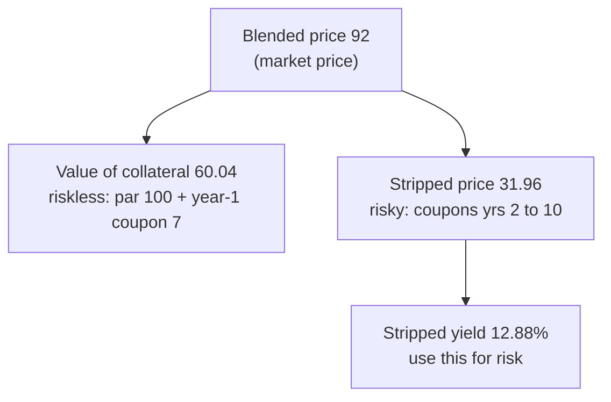
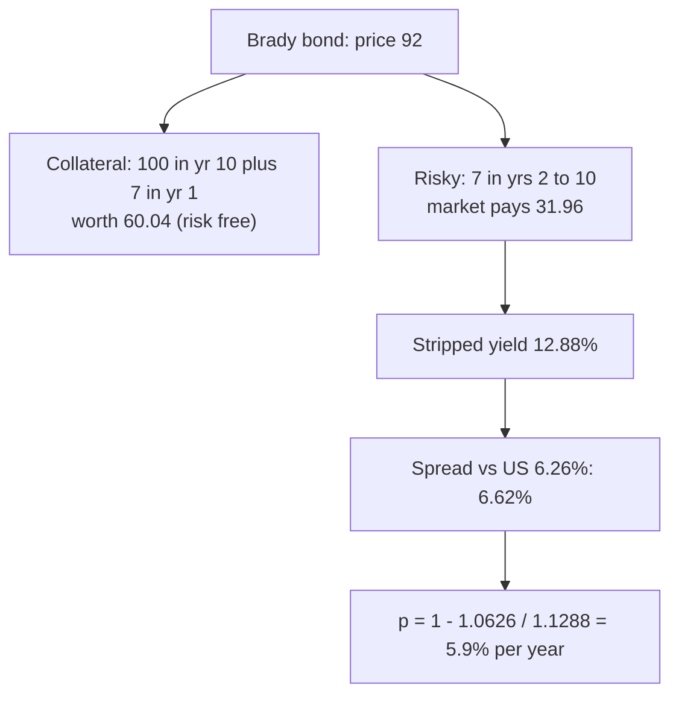

Source: `~/Documents/ECON131/Lectures/ECON131 Lecture 09 - Debt crises.pdf` (Chenyue Hu, "Debt Crises"), 1 page. Written live on 2026-11-03: topic 1 is the full handout example, worked out. Topics 2 and 3 are only headings on the handout, so they hold a short background sketch and a slot for what she says in class. Builds on [[ECON 131 Lecture 7 - Bonds and the term structure]] (spot rates, ytm) and [[ECON 131 Lecture 8 - Debt financing]] (foreign-currency debt).

## Map

Lecture 8 was a firm borrowing. Lecture 9 is a **country** borrowing in dollars, and what happens when it cannot pay.
1. **Brady bonds:** how to price the chance that a government defaults (country spread, then default probability).
2. **Latin American debt crisis, 1980s:** the episode that created the Brady bonds.
3. **European debt crisis, 2010s:** the same problem inside a currency union.

The calculation in topic 1 is the whole technical content of the page. It is the L7 idea again (spot rates, ytm) with one new move: strip out the part of the bond that is safe, and attribute the rest of the discount to default.

## 1. Brady bonds

> Brady bonds are dollar-denominated bonds, issued mostly by Latin American countries in the late 1980s. The bonds were named after U.S. Treasury Secretary Nicholas Brady, who proposed a novel debt-reduction agreement for developing countries.
>
> Consider a Brady bond with an annual coupon of 7% issued by Peru with 10 years remaining until maturity. If the Peruvian government does not default, the investor in this bond receives $7 (per $100 par) each year and receives $107 of interest and principal 10 years from now. The price of the bond is $92. Dollar spot rates are listed in the table.

| Year | Dollar cash flows | Dollar spot rates (%) |
|---|---|---|
| 1 | 7 | 3.50 |
| 2 | 7 | 4.10 |
| 3 | 7 | 4.65 |
| 4 | 7 | 5.05 |
| 5 | 7 | 5.55 |
| 6 | 7 | 5.85 |
| 7 | 7 | 6.05 |
| 8 | 7 | 6.25 |
| 9 | 7 | 6.35 |
| 10 | 107 | 6.50 |

> 1). If there is no collateral, what is the country spread of Peru compared to the US?
> 2). Assume that the par value of the bond and the following year's coupon payments are collateralized by U.S. Treasury bonds. What is the country spread?
> 3). The spread is relatively high since there is a probability that Peru will default. Based on your answer to previous questions, estimate Peruvian government's default probability $p$.

**Definitions**
- **Brady bond:** a dollar bond a developing country issued in a debt restructuring, usually with part of it backed by U.S. Treasuries (collateral). Dollar-denominated, so Peru bears no currency risk on the bond, only default risk.
- **Country spread:** the extra yield an investor demands from a country's bond over a default-free U.S. bond with the **same cash flows**. It is the price of default risk.
- **Collateralized part:** cash flows backed by U.S. Treasuries, so they are as safe as a Treasury even if Peru defaults.
- **Stripped bond / stripped yield:** the bond with the collateralized flows removed, leaving only the cash flows that depend on Peru paying. Its yield is the **stripped yield**.

**Classification: the three values of a Brady bond (class)**

The one market price splits into a safe piece and a risky piece. Only the risky piece tells you about Peru.

| Piece | What it is | Risk | Handout example |
|---|---|---|---|
| **Blended price** | The bond's market price, safe and risky parts mixed together | mixed | $\$92$ |
| **Value of collateral** | PV of the flows backed by U.S. Treasuries (here the $\$100$ par and next year's $\$7$ coupon), at US spot rates | riskless | $\$60.04$ |
| **Stripped price** | Blended price minus collateral: what the market pays for the expected cash flows that depend on Peru paying (the uncollateralized coupons, and the face value when it is not collateralized) | risky | $92-60.04=\$31.96$ |

$$\underbrace{P_{\text{blended}}}_{\text{market price}}=\underbrace{PV(\text{collateral})}_{\text{riskless}}+\underbrace{P_{\text{stripped}}}_{\text{risky}}$$

**Why it matters for risk evaluation.** The yield on the blended price (8.20%) mixes Treasury-safe money with Peru money, so it understates Peru's risk. The yield on the stripped price (the stripped yield, 12.88%) is the yield on the Peru money alone. That is the number to compare with the US yield to get the country spread (6.62%) and the default probability.

**Formulas**

Price a default-free dollar bond with the same flows by discounting each flow at its own spot rate (L7):

$$P_{US}=\sum_{t=1}^{n}\frac{CF_t}{(1+s_t)^t}$$

The yield $y$ on any bond solves price $=\sum \frac{CF_t}{(1+y)^t}$. Then

$$\text{country spread}=y_{\text{Peru}}-y_{US},\qquad y_{US}\text{ solved from }P_{US}\text{ with the same flows.}$$

With collateral, use the **stripped yield** $y_s$ (the yield on the risky flows only) and compare it to the same US benchmark $y_{US}$:

$$\text{stripped country spread}=y_s-y_{US}$$

Default probability per year, assuming Peru pays nothing on default and investors are risk neutral. A dollar lent to Peru for one year must earn the same expected return as a dollar lent to the U.S.:

$$(1-p)(1+y_s)=1+y_{US}\quad\Longrightarrow\quad p=1-\frac{1+y_{US}}{1+y_s}$$

**Fill-out of the handout example.**

*Question 1: no collateral.*
- Value the same flows as if default-free, at the spot rates: $P_{US}=\$105.37$.
- Yield of that default-free bond (same 7, 7, ..., 107): $y_{US}\approx 6.26\%$.
- Yield of the Peruvian bond at its market price of $92$: $y_{\text{Peru}}\approx 8.20\%$.
- **Country spread $\approx 8.20-6.26=1.94\%$** (about 194 basis points).

*Question 2: par value and next year's coupon collateralized.*
- Collateral is the $\$100$ par paid in year 10 and the $\$7$ coupon paid in year 1. Both are risk free, so value them at US spot rates:

$$\frac{100}{1.065^{10}}+\frac{7}{1.035}=53.27+6.76=\$60.04$$

- The market price of the Peruvian bond is $92$. So the market is paying only $92-60.04=\mathbf{\$31.96}$ for the **risky** flows: $\$7$ in each of years 2 through 10.
- Yield on those risky flows at $\$31.96$: **stripped yield $\approx 12.88\%$**.
- Compare to the same US benchmark as question 1, $y_{US}\approx 6.26\%$.
- **Country spread $\approx 12.88-6.26=6.62\%$** (the class answer).

The spread jumps from 1.94% to 6.62% because the collateral hides the risk. Most of the bond's value is safe, so the headline yield averages a very safe part with a very risky part. Removing the safe part shows what the market really charges for lending to Peru.

*Question 3: implied default probability.*

$$(1-p)(1.1288)=1.0626\quad\Rightarrow\quad p=1-\frac{1.0626}{1.1288}\approx\mathbf{5.9\%}\text{ per year}$$

Quick check: $p\approx\frac{\text{spread}}{1+y_s}=\frac{0.0662}{1.1288}\approx 5.9\%$, so the default probability is roughly the spread.

(Class answer for Q3 not confirmed yet. If she gets a different number, write it under My correction.)

**Use case.** Read a distressed country's bond price as a probability. A stripped spread of 6.62% says the market expects about a 6% chance per year that Peru stops paying.

**Assumptions to state if asked:** zero recovery on default (Peru pays nothing on the risky flows), the same $p$ every year, risk-neutral investors, and the US yield is the default-free benchmark. A real market would add a risk premium and some recovery, so the true $p$ differs.

**Depiction**

**Generalizes to.** Credit spreads in general. A corporate or sovereign yield above the Treasury yield is compensation for default. With a recovery rate $R$ (cents per dollar repaid after default), the same logic becomes $(1-p)(1+y_s)+pR(1+y_s)=1+y_{US}$.

My correction:

## 2. The Latin American debt crisis in the 1980s

> 2. the Latin American debt crisis in the 1980s

The handout gives only the heading. **Background sketch, not from the handout, check against what she says:**
- In the 1970s, Latin American governments borrowed heavily from international banks, in **dollars**, at floating interest rates.
- In the early 1980s U.S. interest rates rose sharply and the dollar strengthened, so debt service on dollar loans got more expensive in local-currency terms while commodity export income fell. This is the currency mismatch from [[ECON 131 Lecture 8 - Debt financing]] (dollar debt, local income) at the scale of a country.
- Mexico announced in 1982 that it could not service its debt, and others followed. A long period of renegotiation followed.
- The **Brady plan** (1989) swapped the defaulted bank loans for tradable dollar bonds, the Brady bonds of topic 1, with a reduction in face value or interest and U.S. Treasury collateral behind part of the payments.

Class notes:

My correction:

## 3. The European debt crisis in the 2010s

> 3. the European debt crisis in the 2010s

The handout gives only the heading. **Background sketch, not from the handout, check against what she says:**
- After the 2008 financial crisis, doubts about government finances in Greece, Ireland, Portugal, Spain and Italy pushed their bond yields far above Germany's, the same **country spread** as topic 1.
- The difference from Latin America is the currency. These governments borrowed in **euros**, a currency they do not control, so they could not inflate or devalue their way out (compare the exchange-rate lessons of [[ECON 131 Lecture 2 - Exchange Rates]]).
- Responses were bailouts with conditions (austerity) from the EU and IMF and, in Greece, a restructuring of private debt.

Class notes:

My correction:

## Cheat table

| Topic | One line | Key formula |
|---|---|---|
| Brady bond | Dollar bond from a debt restructuring, part backed by U.S. Treasuries | none |
| Country spread | Yield on the country bond minus yield on a default-free bond with the same flows | $y_{\text{Peru}}-y_{US}$ |
| Stripped yield | Remove collateralized flows, find the yield on what is left, compare to the US yield | price $-$ PV(collateral) $=\sum\frac{CF_t}{(1+y_s)^t}$, spread $=y_s-y_{US}$ |
| Default probability | Expected return on Peru equals the US return | $p=1-\frac{1+y_{US}}{1+y_s}$ |

## Answers at a glance

- Q1 no collateral: spread about **1.94%** ($8.20\%$ vs $6.26\%$).
- Q2 collateralized: stripped yield **12.88%**, country spread **6.62%** ($12.88\%$ vs $6.26\%$).
- Q3: $p\approx$ **5.9% per year** ($1-1.0626/1.1288$), not yet confirmed in class.

## Connections

- [[ECON 131 Lecture 7 - Bonds and the term structure]]: spot rates and ytm drive every number in topic 1.
- [[ECON 131 Lecture 8 - Debt financing]]: foreign-currency debt and the currency mismatch behind the 1980s crisis.
- [[ECON 131 Lecture 2 - Exchange Rates]]: why a euro borrower differs from a dollar borrower with its own currency.
